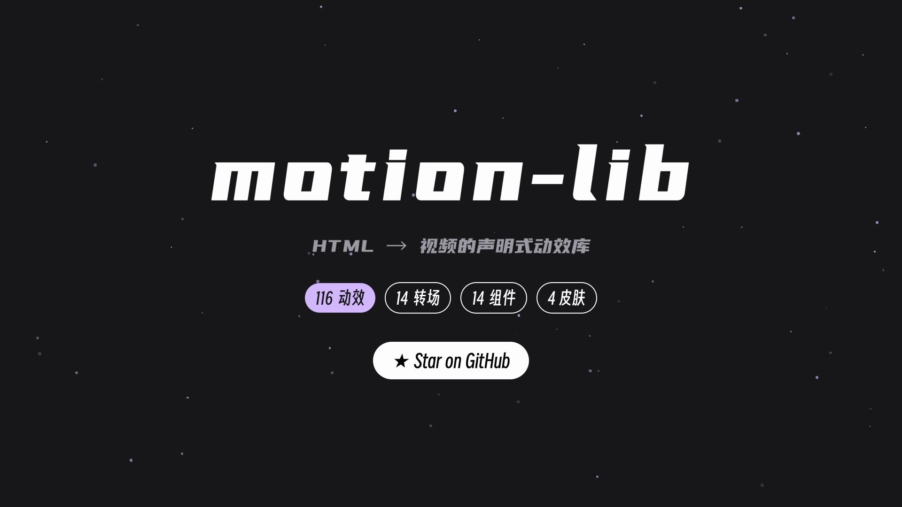
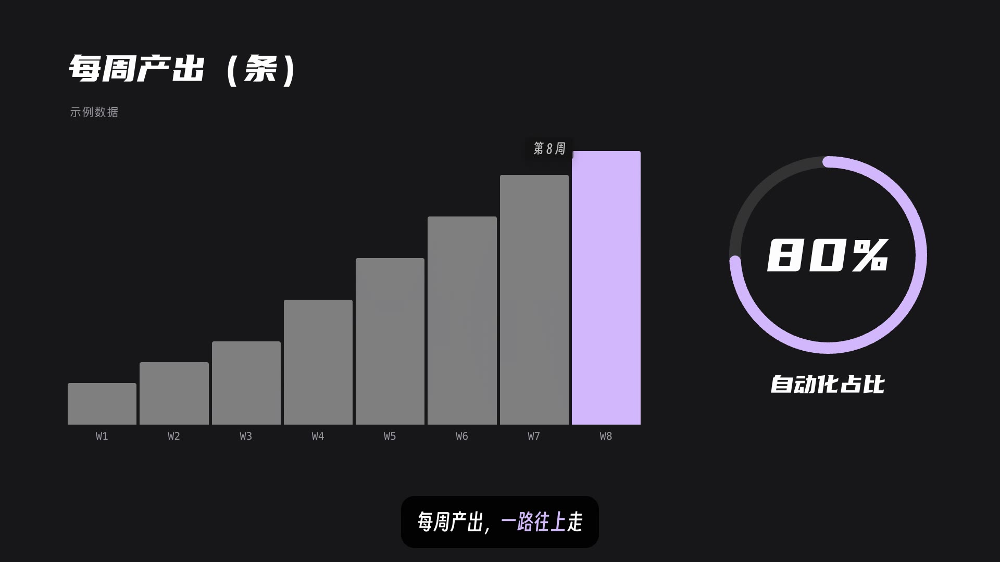
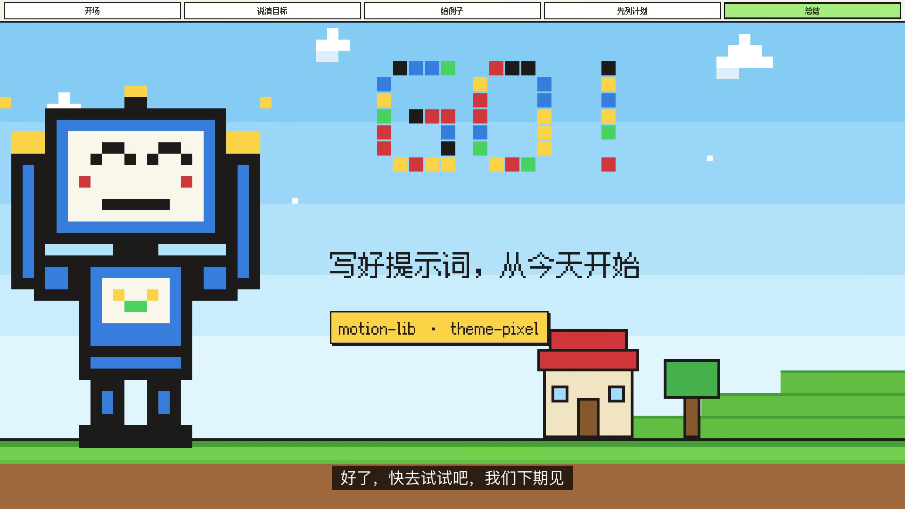
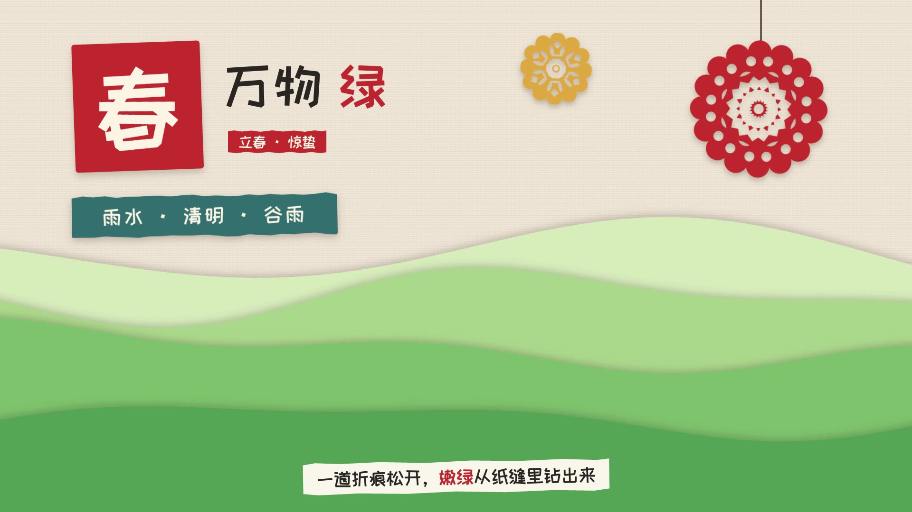

# motion-lib

[简体中文](README.md) · [繁體中文](README.zh-TW.md) · **English** · [日本語](README.ja.md)

**A declarative motion library for HTML → video.** Write one line, `data-fx="effect-name@seconds"`, on an element to get the motion you see in talking-head explainers and tech videos, then render it frame by frame to MP4 with [HyperFrames](https://hyperframes.heygen.com).

> **New in v1.1**: 40 effects + 4 transitions (`paper-slide` `tear` `glitch-cut` `open`) + 5 component generators (`circle-text` `retro-grid` `papercut` `hills` `torn`); 2 new categories, Text and Papercut; a 4th theme, `theme-paper` (papercut collage). Inspired by animate.css, Magic UI and React Bits; see Credits at the bottom.

[](promo/motion-lib-promo.mp4)

> The promo above was made with this library. Source: [`promo/index.html`](promo/index.html).

<!-- STATS:START -->
| | Count |
|---|---|
| Effects | **116** (Enter 26 · Exit 9 · Emphasis 37 · Text 9 · Data 6 · Camera 11 · Character 5 · Papercut 10 · Components 3) |
| Transitions | **14** |
| Component generators | **14** (`bars` `wave` `steps` `chapters` `ring` `wall` `dust` `line` `pixels` `circle-text` `retro-grid` `papercut` `hills` `torn`) |
| Skins | **4** themes (violet tech · black-gold cinema · retro pixel · papercut collage) |
<!-- STATS:END -->

## Why use it

Making video with HTML, layout is not the hard part. Motion is:

- **The renderer works by "seek to frame N, take a screenshot".** CSS animations, `setTimeout` and `Math.random` are outside its control, so the output either doesn't move or differs on every run.
- Hand-writing GSAP timelines means calculating hundreds of time points for a one-minute video.

motion-lib schedules every effect onto **one paused GSAP timeline**. You only declare "which element, which effect, at which second":

```html
<h1 data-fx="blur-rise-in@0.2">What is the hardest part of chasing trends?</h1>
<b  data-fx="count@0.6 marker@1.6">7,000</b>
<ul data-fx="each:pop-in@1(stagger=0.1)"> <li>Chips</li><li>Compute</li><li>LLMs</li> </ul>
```

- **Frame-accurate seeking**: jump to any frame and the picture is identical to sequential playback, so every render gives the same result.
- **Reproducible randomness**: anything random (particles, scrambled text, waveforms) uses the seeded `FX.rand(seed)`.
- **No network needed**: GSAP and the fonts are bundled in the repo.
- **Zero build**: one `fx.js`, one `fx.css`. No npm or bundler.

## Layout

```
motion-lib/
├── fx.js            the library: effects, transitions, component generators, subtitles, preview player
├── fx.css           base styles, component styles, four themes
├── fonts/           YouSheBiaoTiHei, Smiley Sans, Fusion Pixel, ZCOOL KuaiLe (licenses in fonts/README.md)
├── vendor/          GSAP 3.15 (a local copy)
├── new-project.sh   install the library into a video project (also used to update)
├── chrome-tall.sh   Chrome wrapper for rendering (keeps the bottom subtitles from being cut off)
├── gen-readme.mjs   generates the count table and effect catalog in this file (node gen-readme.mjs)
├── demo/            demo page: 6 scenes using the first three themes
├── promo/           promo source + final video
└── examples/        one full example per theme (four in all) + a showreel
```

## Requirements

- Node.js 18+ (uses `npx hyperframes`)
- FFmpeg
- Google Chrome (default macOS location; set the `REAL_CHROME` environment variable for other locations)
- The first `npx hyperframes` run downloads the CLI automatically

## Quick start

**1. Create a project**

```bash
mkdir my-video
./new-project.sh my-video        # copies fx.js / fx.css / fonts / GSAP into my-video/lib/
```

> HyperFrames can only read files inside the project directory, so the library is **copied into** the project rather than referenced via `../`. After the library is updated, run the same command again on the same project.
> The same goes for `demo/` and `promo/` in this repo: run `./new-project.sh demo` and `./new-project.sh promo` before opening them for the first time.

**2. Write `my-video/index.html`**

```html
<!doctype html>
<html lang="en">
<head>
  <meta charset="UTF-8">
  <link rel="stylesheet" href="lib/fx.css">
  <script src="lib/vendor/gsap.min.js"></script>
  <script src="lib/fx.js"></script>
</head>
<body>
<div id="root" class="theme-violet" data-composition-id="main" data-width="1920" data-height="1080">

  <section class="scene dark center" data-d="3.5">
    <h1 class="t-title" data-fx="mask-rise@0.2">Fully automated editing <span class="accent">Skill</span></h1>
    <p class="t-body" data-fx="rise-in@0.6 marker@1.4">Watch this, and you can too</p>
  </section>

  <section class="scene light" data-d="4" data-in="blur-cross">
    <div class="abs" style="left:200px;top:300px;width:1200px;height:400px"
         data-make="bars" data-values="3,8,21,40,26,12" data-hi="4"
         data-fx="each:grow-y@0.3(stagger=0.05)"></div>
  </section>

</div>
<script>
  FX.subtitles([[0.2, 3.4, 'Watch this, and you can too'], [3.5, 7.4, 'Views peak in the {first few hours} after going live']], { style: 'pill' });
  FX.build();
</script>
</body>
</html>
```

**3. Preview, snapshot, render**

```bash
cd my-video
open "index.html?play"                       # browser preview: Space to play, ←/→ frame by frame, ↑/↓ jump between scenes
npx hyperframes snapshot --at 1,3,5          # grab a few frames to check
HYPERFRAMES_BROWSER_PATH="$PWD/lib/chrome-tall.sh" \
  npx hyperframes render -o out.mp4 --experimental-fast-capture=false
```

> Always render with `chrome-tall.sh`. With the full Chrome on this machine in headless mode, the visible height is about 90px shorter than the window, so the bottom of the video (subtitles) gets cut off. The script makes the window taller.

## Examples

Each of the four themes has a full example (motion only, no voice-over). The source is in the matching directory, ready to adapt:

| Theme | Example | Source |
|---|---|---|
| Violet tech `theme-violet` | [](examples/violet/violet.mp4) | [`examples/violet/index.html`](examples/violet/index.html) |
| Black-gold cinema `theme-gold` | [](examples/gold/gold.mp4) | [`examples/gold/index.html`](examples/gold/index.html) |
| Retro pixel `theme-pixel` | [](examples/pixel/pixel.mp4) | [`examples/pixel/index.html`](examples/pixel/index.html) |
| Papercut collage `theme-paper` | [](examples/paper/paper.mp4) | [`examples/paper/index.html`](examples/paper/index.html) |

All four combined: [`examples/showreel.mp4`](examples/showreel.mp4).

## Syntax

### Scenes `<section class="scene">`

A scene is a shot. Scenes are chained end to end in order.

| Syntax | Meaning |
|---|---|
| `data-d="4"` | Duration of 4 seconds |
| `data-t="12.5"` | Explicit start time (if omitted, it follows the previous scene) |
| `data-in="blur-cross(dur=0.5)"` | The transition into this scene; see "Transitions" |
| `class="scene dark"` / `"scene light"` | Switch a single scene to a dark / light background |
| `class="scene overlay"` | Overlay layer: takes no sequence time and shows alongside other scenes (corner badges, persistent progress bars) |

The root element must have `data-composition-id="main"`, `data-width` and `data-height`. The total duration is computed automatically.

### Effects `data-fx="[target:]name@time(params)"`

An element can have several effects, separated by spaces: `data-fx="rise-in@0.2 pulse@1.5 fade-out@-0.3"`.

| Part | Syntax | Meaning |
|---|---|---|
| Time | `@1.2` | 1.2 seconds after the scene starts |
| | `@+0.3` | 0.3 seconds after the previous effect on the same element |
| | `@-0.4` | 0.4 seconds before the scene ends (for exits) |
| Target | (omitted) | The element itself |
| | `each:` | Every child element, automatically staggered (card groups, lists, bars) |
| | `chars:` / `words:` / `lines:` | Split into characters / words / lines (by `<br>`) and animate each |
| Params | `dur=0.8` | Duration in seconds |
| | `ease=spring` | Easing; see the table below |
| | `stagger=0.1` | Stagger interval (with `each:` / `chars:`) |
| | `order=center` | Stagger order: `start` `end` `center` `edges` |
| | others | Each effect's own parameters; see the "Effect catalog" |

**Easing aliases**

| Alias | Equals | Feel |
|---|---|---|
| `out` (default) | `power3.out` | Fast start, soft stop; the most general-purpose |
| `soft` | `power2.out` | Gentle |
| `snap` | `expo.out` | Shoots into place, then settles slowly |
| `sharp` | `power4.out` | Crisper than out |
| `inout` | `power3.inOut` | Slow at both ends, fast in the middle; for camera moves |
| `in` | `power2.in` | Keeps accelerating; for exits |
| `spring` | `back.out(1.7)` | Slight overshoot and settle |
| `bounce` | `back.out(2.8)` | Pronounced overshoot |
| `elastic` | `elastic.out(1,0.55)` | Spring |
| `drop` | `bounce.out` | Bounces on landing |
| `linear` | `none` | Constant speed |
| `pixel` | `steps(5)` | Stepped (pixel style) |

You can also write GSAP's own names directly, e.g. `ease=power4.out`, `ease=steps(8)`, `ease=elastic.out(1,0.5)`.

### Component generators `data-make="name"`

Let the library generate repetitive DOM, then pair it with the matching effect:

| Name | Attributes | Pairs with | Use |
|---|---|---|---|
| `bars` | `data-values` `data-labels` `data-hi="2,3"` `data-max` | `each:grow-y` | Bar chart / histogram |
| `line` | `data-values` `data-w` `data-h` `data-smooth` | `draw` | Line / curve |
| `ring` | `data-size` `data-stroke` `data-dash` | `ring(to=0.7)` | Ring progress, countdown |
| `wave` | `data-n` `data-seed` | `each:grow-y`, `wave-live` | Audio waveform |
| `steps` | `data-labels="Topic,Script,Voice"` | `step(i=2)` | Step navigation pills |
| `chapters` | `data-labels` | `chapter(i=3)` | Top chapter progress bar |
| `pixels` | `data-text="SKILL?"` `data-size` `data-colors` | `each:pixel-in(order=random)` | 5×7 dot-matrix block lettering |
| `wall` | `data-cols` `data-rows` `data-seed` | `drift` | Background card wall |
| `dust` | `data-n` `data-seed` | `drift`, `float` | Floating particles |
| `circle-text` | `data-text` `data-r` (radius) | `spin` (rotate the ring of text) | Circular text, badges, stamps |
| `retro-grid` | `data-cell` (cell size) `data-color` `data-angle` (tilt) | `bg-scroll` (make the grid flow toward the viewer) | Retro perspective-grid background |
| `papercut` | `data-size` `data-fold` (number of folds: 6 / 8 / 12) `data-shape` (`flower` `circle` `square`) `data-color` `data-seed` | `pop-in`, `spin`, `jitter` | Symmetric paper-cut window flowers; every seed gives a different pattern |
| `hills` | `data-layers` (number of layers) `data-colors` (colors from back to front) `data-seed` | `layer-rise`, `parallax` | Layered paper hills; each layer is a child element |
| `torn` | `data-edges` (`top,right,bottom,left`, default `top,bottom`) `data-depth` `data-teeth` `data-seed` | `stick-on`, `rise-in` | Cuts an element's edges into a ragged torn-paper strip; `clip-path` clips shadows, so wrap it in `fx-torn-shadow` if you want one |

### Subtitles

```js
FX.subtitles([
  [startSeconds, endSeconds, 'Text; words in {braces} take the accent color'],
  …
], { style: 'pill', pop: false });
```

| `style` | Look | Pairs with theme |
|---|---|---|
| `pill` | Black rounded pill + white text | Violet tech |
| `bar` | Semi-transparent black bar | Retro pixel |
| `plain` | White text + shadow, no background | Black-gold cinema |
| `paper` | Beige torn-paper strip + dark text | Papercut collage |

With `pop: true` each subtitle floats up gently as it appears; the default is a hard cut, which is what talking-head videos usually use.

### Hand-written extras

For effects the library doesn't have, write GSAP directly. Use `at('sceneId', secondsInScene)` to convert to absolute time:

```js
FX.build({
  extra(tl, at) {
    tl.to('#logo', { rotation: 360, duration: 1 }, at('s3', 0.5));
  }
});
```

You can also register it as a new effect, usable from `data-fx` afterwards:

```js
FX.register('spin-in', '入场', 'Spin in', c => {
  c.tl.from(c.els, { rotation: -180, opacity: 0, duration: +(c.o.dur || 0.6) }, c.t);
});
```

> The second argument is the category key used by the catalog (`入场` Enter, `退场` Exit, `强调` Emphasis, `数据` Data, `文字` Text, `镜头` Camera, `角色` Character, `剪纸` Papercut, `组件` Components, `转场` Transitions). Keep these Chinese keys as-is.

**Three hard rules**: no CSS animation / transition; no `setTimeout` / `requestAnimationFrame`; for randomness use `FX.rand(seed)`, never `Math.random`.

## Four themes

Change one class on the root element to restyle the whole video:

| class | Style | Background | Title font | Accent | Good for |
|---|---|---|---|---|---|
| `theme-violet` | Violet tech | White `#fdfdfd` / dark `#171719` (switch per scene with `dark` / `light`) | YouSheBiaoTiHei | Violet `#8453e8` / light violet `#d5befe` | AI tools, productivity, workflow explainers |
| `theme-gold` | Black-gold cinema | Deep blue-black `#080a0f` + blurred footage + vignette | Gold gradient italic | Gold `#e4b256`; red `#ff5b56` only for declines | Finance, industry analysis, rankings |
| `theme-pixel` | Retro pixel | Beige halftone paper `#efe9dc` | Fusion Pixel font | Green `#9fe07a` · red · yellow | Anime hosts, light-hearted explainers |
| `theme-paper` | Papercut collage | Beige paper `#efe6d6` + pure-CSS paper grain | ZCOOL KuaiLe | Paper red `#c8322b` · teal `#2f6b6e` · mustard `#e3a83b` | Culture, solar terms, lifestyle, kids' science, handmade-feel brands |

All colors, fonts, corner radii and subtitle sizes are CSS variables at the top of `fx.css` (`--fx-bg` `--fx-accent` `--fx-font-title` …). Change the variables to build your own theme.

**Common style classes**

| Type | Class names |
|---|---|
| Text | `t-hero` `t-title` `t-h2` `t-h3` `t-body` `t-small` `t-en` (small English subtitle) `t-num` (big number) `t-mono` `t-pixel` `accent` `muted` `unit` |
| Layout | `layer` (full-screen layer) `abs` `center` `row` `col` |
| Cards | `card` `shot` (screenshot card) `glass` (glass card) `qcard` (question-mark placeholder card) `stat` (big-number card) |
| Labels | `pill` `note` (black annotation on a screenshot) `tag` `speed` (×3.5 fast-forward badge) `ptag` (pixel tag) |
| Components | `fx-window` (mac window; add `.pixel` for a pixel window) `fx-chat` (chat bubble) `fx-check` (checklist tick) `fx-cursor` (mouse cursor) `pbar` (pixel energy bar) `fx-hbar` (horizontal bar) |
| Background | `bg-footage` (blurred footage) `vignette` |
| Character | `host` (portrait container holding several `[data-pose]` images, used with `pose` / `lipsync`) |
| Papercut | `paper` (paper sheet; add `.red` `.teal` `.mustard` `.ink` `.tilt-l` `.tilt-r`) `paper-tag` (ragged-edge label) `tape` (masking tape) `fx-torn-shadow` (wrapper that adds a shadow to torn-edge elements) `scene.paper-bg` (paper-grain background for a scene under any theme); new variable `--fx-font-round` (rounded font) |

## FAQ

**Screenshots look fine, but the final video is missing the bottom strip and the subtitles?**
You rendered without `chrome-tall.sh`. See step 3 of "Quick start".

**An effect doesn't show up?**
First check the name for typos. A wrong name doesn't abort the render; it only prints `FX：没有这个动效` ("no such effect") to the console, visible with `npx hyperframes validate` or the browser console. Also check that the time doesn't exceed the scene duration.

**Chinese text turns into boxes, or the font is wrong?**
Body text uses the system PingFang SC. On non-macOS machines, install Noto Sans SC and add it to `--fx-font-body`.

**`npx hyperframes lint` reports `missing_timeline_registry` / `font_family_without_font_face`?**
These are false positives from the static check: the timeline is registered by `fx.js` at runtime, and the fonts are declared via `@import` in `fx.css`. Trust the frames produced by `snapshot`.

**Gradient text disappears after splitting?**
Gradient text made with `background-clip:text` (such as the gold text in the gold theme) vanishes when combined with splitting effects like `chars:`, `type` or `roll`. Give the text you animate per character a solid colour instead (e.g. `color:#e4b256`).

**Want to sync with a voice-over?**
Use the voice-over timestamps to fill each scene's `data-t` / `data-d` and the times in `FX.subtitles`. Effect times are all relative to the start of the scene, so they don't need to change.

## License

- Code: [MIT](LICENSE). Third-party notes: [NOTICE](NOTICE).
- GSAP: used under GreenSock's [Standard License](https://gsap.com/standard-license) (free, including commercial use).
- Fonts: see [fonts/README.md](fonts/README.md).

## Credits

The new effects and theme in v1.1 were inspired by these open-source projects:

- [animate.css](https://github.com/animate-css/animate.css) (MIT)
- [Magic UI](https://github.com/magicuidesign/magicui) (MIT)
- [React Bits](https://github.com/DavidHDev/react-bits) (MIT + Commons Clause)

Those projects are CSS animations or React components, which a frame-by-frame renderer cannot drive. motion-lib re-implements the corresponding effects for a seekable, reproducible timeline. We borrowed only the ideas and effect names (the original names in parentheses in the catalog) and **did not copy any of their code**.

<!-- CATALOG:START -->
## Effect catalog (116 effects + 14 transitions)

> This section is generated from `fx.js` by `node gen-readme.mjs`. Do not edit it by hand.
> All effects accept the common parameters `dur` (duration), `ease` (easing) and `stagger`; the tables below list only each effect's own parameters.

### Enter (26)

How elements appear. By default they animate from a "pre-entry" state back to the element's own look, so any CSS position or rotation you set on the element is preserved.

| Name | What it does / parameters |
|---|---|
| `fade-in` | Plain fade-in, the most restrained; for subtitles and secondary notes |
| `rise-in` | Slide up from below + fade in, the most versatile entrance. Param: dist=offset in px |
| `drop-in` | Drop in from above + fade in; for tags and badges |
| `slide-in` | Slide in from one side. Params: dir=left/right/up/down (direction of motion), dist |
| `blur-in` | Blur to sharp, appearing in place; for big titles and screenshot cards |
| `blur-rise-in` | Blur + slide up + fade in, the standard cinematic title entrance |
| `scale-in` | Scale up from slightly smaller into place, the standard entrance for cards and images. Param: from=starting scale |
| `pop-in` | Pop: scale up from small with an overshoot bounce; for callout pills, icons, checks and crosses |
| `zoom-settle` | Settle from an enlarged, blurred state (like a lens snapping into focus); for opening headlines |
| `wipe-in` | Reveal with a mask wipe. Param: dir=right/left/up/down (direction the wipe advances) |
| `mask-rise` | Text rises from beneath an invisible baseline (mask slide-up); the strongest title feel |
| `flip-in` | Flip upright around the horizontal axis (3D); for card flips and revealing question cards |
| `tilt-in` | Fly in tilted with perspective (a 3D card turning to face front from the side); for UI screenshots |
| `stamp-in` | Stamp: slams down from very large and shakes when it lands; for conclusions, seals, checks and crosses |
| `drop-bounce` | Falls from above the frame and bounces twice on landing; for stacking objects and pixel blocks |
| `swing-in` | Swings down from the top edge like a hanging sign and settles |
| `focus-in` | Letter-spacing tightens from very wide + blur to sharp; common for small English titles and subtitles |
| `grow-x` | Grow from 0 along the horizontal axis (bars, dividers, progress bars). Param: origin=left/center/right |
| `grow-y` | Grow from 0 along the vertical axis (bar charts). Param: origin=bottom/top |
| `fan-in` | A stack of cards fans out from the center to their own positions (use with each:); final positions and angles follow your CSS |
| `type` | Typewriter: types out character by character. Params: cps=characters per second, caret=1 to show the cursor |
| `draw` | Line drawing: an SVG stroke is drawn along its path (connectors, arrows, circled callouts, line charts) |
| `pixel-in` | Pixel-style entrance: appears in 4-5 discrete steps (not smooth); with each: it can assemble block lettering |
| `scramble` | Scramble decode: each character first flickers through random glyphs (gray), then locks into the correct character (white) from left to right. Params: dur, chars=pool of scramble characters |
| `light-speed-in` | Light-speed entrance: rushes in from one side with a skew, overshoots, then straightens (animate.css lightSpeedIn). Params: dir=left/right (direction of motion), dist |
| `jack-in` | Jack-in-the-box: pops up gradually from the bottom, wobbles left and right twice and settles (animate.css jackInTheBox) |

### Exit (9)

How elements leave. Usually written as `@-0.4` (0.4 s before the scene ends).

| Name | What it does / parameters |
|---|---|
| `fade-out` | Fade out |
| `rise-out` | Slide up and away + fade out |
| `drop-out` | Slide down and away + fade out |
| `blur-out` | Blur + fade out (recedes into the background) |
| `scale-out` | Shrink + fade out. Param: to=ending scale (>1 means it grows as it disappears) |
| `slide-out` | Slide out to one side. Param: dir |
| `wipe-out` | Disappear with a mask wipe |
| `hinge` | Hinge drop: pinned at the top-left corner, it swings twice, then falls out of frame (animate.css hinge). Param: dist |
| `fall-out` | Falling text: each character tumbles down out of frame with some rotation (FallingText); usually used with chars:. Params: dist, seed |

### Emphasis (37)

For elements already on screen: emphasize them when the narration reaches them. Also covers movement, color changes and content swaps.

| Name | What it does / parameters |
|---|---|
| `pulse` | Scale up briefly and back (a tap when the narration hits this word). Param: to=peak scale |
| `shake` | Shake left and right (negation, errors, warnings) |
| `nod` | A small up-and-down hop (character nod, icon bounce) |
| `blink` | Blink a few times (cursor, warnings). Param: n=count |
| `color` | Change text / background color. Params: to=color, bg=background color |
| `marker` | Highlighter: a color block sweeps left to right across the bottom of the text. Params: color, h=block height in % |
| `underline` | Underline grows from left to right. Params: color, w=thickness in px |
| `strike` | A strikethrough sweeps across (the old plan is void) |
| `box` | Highlight box: draws an outline around the element (circle the key point on a screenshot). Params: color, pad, w, r |
| `glow` | Glow breathing: the halo lights up then fades. Params: color, n=count |
| `sheen` | Shine sweep: a highlight sweeps diagonally across a card / button |
| `ping` | Ripple: a ring expands from the element's center (click feedback, marking a location) |
| `dim` | Dim (demote to secondary). Param: to=opacity |
| `undim` | Restore brightness |
| `spot` | Spotlight: use with each:; the i-th child stays bright and slightly enlarged while the rest are dimmed. Param: i (1-based) |
| `float` | Continuous up-and-down floating (idle feel). Params: amp=amplitude, period=seconds per cycle, dur=how long it lasts |
| `spin` | Rotate. Params: deg=total angle, dur |
| `move` | Move the element to another element's position (cursor moves to a button, a tag flies into a card). Params: to=#target or x, y |
| `click` | Click: press-down shrink + ripple (use with the .fx-cursor component) |
| `swap` | Swap content in place: fades itself out and fades the target element in. Param: to=#target |
| `squash` | Card squash-and-spring: narrows horizontally then springs back (about 3 frames squash + 4 frames spring), often used together with a content swap. Param: to=narrowest ratio |
| `cycle` | Hard-cut carousel over children: one visible at a time, switching to the next every `every` seconds (a thumbnail whose picture keeps changing). Params: every, loop=1 to loop, stop=which item to stop on |
| `text` | Hard-cut text to new content (clock ticks, label changes). Param: v=new text |
| `to` | Universal tween: write GSAP properties directly. Example: to@2(x=120,scale=1.2,opacity=0.5,dur=0.6,ease=inout) |
| `tada` | Tada: shrinks slightly, then scales up and sways left and right (animate.css tada) |
| `jello` | Jello: skews back and forth with decreasing amplitude (animate.css jello) |
| `rubber-band` | Rubber band: stretches horizontally, squashes vertically, and bounces a few times (animate.css rubberBand) |
| `heartbeat` | Heartbeat: two quick scale-ups in a row (animate.css heartBeat) |
| `head-shake` | Head shake: a left-right shake with a bit of 3D rotation (for "no" or "wrong") (animate.css headShake) |
| `wobble` | Wobble: translates while tilting back and forth (animate.css wobble) |
| `border-beam` | Border beam: a short streak of light runs around the element's border (BorderBeam / StarBorder). Params: color, w=thickness, len=beam length as a fraction of the perimeter, n=laps, dur=seconds per lap, keep=1 to stay visible after finishing |
| `spotlight` | Spotlight: dims the screen and leaves one circular bright area over the target; calling it again in the same scene moves the spot to the new target (Spotlight). Put it on the element to light, or use to=#id. Params: r=radius, dim=darkness 0~1, off=1 to turn it off |
| `confetti` | Confetti: bursts a handful of confetti from the element's center, tossed up and falling back down (Confetti / ClickSpark). Params: n, colors=c1/c2/c3, power, seed |
| `sparkle` | Sparkle: little stars pop up at random around the element and twinkle (SparklesText). Params: n, color, dur, seed |
| `orbit` | Orbit: spreads the container's children evenly on a circle and rotates them around the center while keeping each child upright (OrbitingCircles). Put it on the container. Params: r=radius, turns=number of turns, dur, reverse=1 to reverse |
| `beam` | Connecting beam: draws an arc between two elements and a glow flows along it (AnimatedBeam, good for "A sends data to B"). Put it on the start element, to=#end. Params: curve=curvature, color, n=number of flows, dur |
| `flip-swap` | Flip and swap: the element flips around its vertical axis, the back shows the second child, then flips back (flip cards, reveal an answer). Put two children inside: the first is the front, the second is the back. Param: axis=y/x |

### Text (9)

Made for text: shimmer, glitch, word swap, delete-and-retype, split-flap, stroke, echo.

| Name | What it does / parameters |
|---|---|
| `shimmer` | Shimmer text: a highlight sweeps across the text from left to right (ShinyText). Params: color=highlight color, n=number of sweeps, gap=pause between sweeps |
| `glitch` | Glitch text: red/blue split + jitter + skew for a short burst, then settles (GlitchText). Params: amp=split in px, dur, seed. Note: it zeroes the element's x, so wrap the element in a shell if it needs to move itself |
| `rotate-words` | Word rotate: the word flips up and away, the next one flips in at the same spot (WordRotate). Params: words=B/C/D (separated by /, the element's original text is the first), every=seconds each word stays |
| `morph` | Morphing words: the old word blurs and disperses, the new one condenses out of the blur (MorphingText). Params: words=B/C, every |
| `retype` | Delete and retype: erases the existing text character by character from the end, then types the new text (TextType). Params: v=new text, cps=characters typed per second, del=characters deleted per second |
| `true-focus` | Word-by-word focus: only one word is sharp at a time, the rest blur, and a focus frame jumps to the active word (TrueFocus). For Chinese separate words with / (e.g. AI/won't/replace/you); English splits on spaces. Params: every, blur, color |
| `split-flap` | Split-flap board: each character flips through random glyphs, then settles on the right one from left to right (SplitFlap, airport departure board). Use as an entrance. Params: dur, stagger, chars=glyph pool |
| `stroke-in` | Stroke text: draws a hollow outline in one direction first, then fills in the color (StrokeText). Params: w=stroke width, color=stroke color, hold=seconds to stay hollow |
| `echo` | Echo entrance: several translucent copies trail behind and slide in together, then fade away once in place (EchoText). Params: n=number of echo layers, dist, dir |

### Data (6)

Numbers, progress and charts. Number effects automatically keep decimal places and thousands separators.

| Name | What it does / parameters |
|---|---|
| `count` | Number counter. Put the final number in the element, or set it with to=; from=starting value. Automatically keeps decimal places and thousands separators |
| `roll` | Digit-by-digit vertical roll: each digit is a 0-9 vertical strip that scrolls with blur and then stops from left to right (the $7,000 in the black-gold theme). Params: dur, stagger, spins=extra full turns |
| `clock` | Clock dial-in: from=23:28 to to=01:23 (crosses midnight automatically) |
| `fill` | Progress bar fill: grows the element's width (or height with dir=y) from from% to to% |
| `ring` | Ring progress: use with data-make="ring". Params: from, to (0-1) |
| `wave-live` | Waveform jumping: use with data-make="wave"; each bar fluctuates randomly from a seed. Params: dur, seed |

### Camera (11)

Applied to a whole container: push in, pan, 3D tilt, shake.

| Name | What it does / parameters |
|---|---|
| `push` | Slow push-in (Ken Burns): the whole container scales up slightly at constant speed over time. Params: from, to, dur |
| `pan` | Slow pan. Params: x, y (total displacement in px), dur |
| `zoom-to` | Zoom to a region: scales and pans the container so the target area fills the frame. Params: to=#target or x,y,w,h (px inside the container), fill=fraction of the frame |
| `zoom-reset` | Pull back from a close-up to the full view |
| `tilt` | Place at a 3D tilt and slowly rotate (a floating UI card). Params: rx, ry start angles; rx2, ry2 end angles |
| `drift` | Slow background drift (blurred card wall, particle layer). Params: x, y, rot, dur |
| `cam-shake` | Camera shake (heavy hit, error) |
| `meteors` | Meteor shower: streaks of light slanting across the screen (Meteors); put it on a full-bleed background layer. Params: n, angle=direction in degrees (default 135 = toward bottom-left), color, dur, seed |
| `marquee` | Marquee: a row of content scrolls horizontally in an endless loop (Marquee / LogoLoop). Put it on a single-row container; children are duplicated automatically to fill the width. Params: speed=px per second, reverse=1 to reverse |
| `bg-scroll` | Background pattern scroll: keeps the background (grid, texture, stripes) translating at a set speed; use it with the retro-grid component. Params: x, y=px per second |
| `parallax` | Parallax: layers inside the container translate at different speeds by order (back layers move less, front layers more); use it with the hills layered paper hills. Put it on the container. Params: x, y=total displacement of the front layer, dur |

### Character (5)

For stand-up portraits and little characters: switch poses, lip sync, nod, hop, walk.

| Name | What it does / parameters |
|---|---|
| `pose` | Switch character pose: put several [data-pose] images in a .host and hard-cut to the one named by name (talking-head portraits are normally hard cuts); bounce=1 adds a squash-and-spring |
| `lipsync` | Lip sync: hard-cuts between several [data-mouth] images in the container every `frames` frames (usually 2-4), returning to the first when done. Params: dur, frames, seed |
| `talk` | Small up-and-down bobbing while talking. Params: dur=how long it talks, rate=bobs per second |
| `hop` | Hop in place (surprise, joy). Params: h=height, n=count |
| `walk` | Walk over: horizontal movement + a bounce per step. Params: x=displacement or to=#target, steps=number of steps; for pixel characters add ease=steps(8) |

### Papercut (10)

Papercut / paper-craft collage style: unfold, cut open, tear, stick on, layers rising one by one, plus a handmade stop-motion feel at 12 fps. Pairs best with the `theme-paper` skin, but works with any skin.

| Name | What it does / parameters |
|---|---|
| `paper-unfold` | Paper unfold: like folded paper opening flat from the crease, with a bit of rebound. Param: dir=down/up/left/right (direction of unfolding) |
| `cut-in` | Scissor cut: "cuts" the element out snip by snip along a zigzag edge, advancing frame by frame for a papercut feel. Params: dir=right/left/down/up, teeth=number of teeth, jag=tooth depth (%), snips=number of cuts |
| `peel-in` | Corner peel: a sticker lifted at one corner settles back and is pressed flat. Param: corner=tl/tr/bl/br (which corner) |
| `layer-rise` | Layer rise: paper layers in the container rise from below one after another, back to front; the nearer the layer, the later and farther it rises (layered paper hills, paper stage). Put it on the container. Params: dist, stagger |
| `stick-on` | Sticker slap: slaps onto the paper from in front of the camera with a big shadow that tightens on landing (labels, photos). Params: from=starting scale, rot=starting tilt angle |
| `stop-in` | Stop-motion entrance: jumps in at the pace of 12 fps stop-motion, each frame with a random bit of tilt (handmade animation feel). Params: dist, steps=number of jumps, fps, seed |
| `jitter` | Stop-motion jitter: keeps tilting and shifting slightly at 12 fps, as if shot frame by frame by hand (boiling). Best added to an outer container so it does not fight an entrance effect for position. Params: amp=angle, px=offset, fps, dur |
| `lift` | Paper lift: floats up slightly while the shadow grows larger and fainter, as if pinched up by a finger; down=1 puts it back. Param: dist |
| `flutter` | Flutter: like a paper caught by a gust, it swings side to side a few times and slowly settles. Params: deg, n=number of swings, origin |
| `sway` | Hanging sway: hanging things (lanterns, tags, window flowers) keep swaying slowly left and right. Params: deg, period=seconds per swing, dur |

### Components (3)

Used together with components generated by `data-make`.

| Name | What it does / parameters |
|---|---|
| `step` | Step navigation switch: use with data-make="steps"; lights up the i-th pill (1-based) and turns the rest off |
| `chapter` | Chapter progress bar: use with data-make="chapters"; the highlight block slides to chapter i (1-based) |
| `check` | Checklist tick: use with the .fx-check component; the check mark is drawn and the text turns solid |

### Transitions (14)

Written on the **later** scene: `<section class="scene" data-in="blur-cross(dur=0.5)">`.

| Name | What it does / parameters |
|---|---|
| `cut` | Hard cut (default). The most common and fastest-paced |
| `fade` | Cross-fade |
| `blur-cross` | Blur cross: the previous shot blurs and fades out while the next goes from blurred to sharp |
| `zoom-through` | Zoom through: the previous shot scales up and rushes out of frame while the next scales up from small into place |
| `push` | Push: the new scene pushes the old one out. Param: dir=left/right/up/down |
| `wipe` | Wipe: the new scene covers the old one along a direction. Param: dir |
| `iris` | Iris: the new scene expands from a point to full screen. Params: x, y (percent) |
| `flash` | Flash to white (or any color): for key sentences and chapter openings. Param: color |
| `dip` | Dip to black: fades to dark then back up (change of topic). Param: color |
| `pixelate` | Pixel dissolve: blocks cover the screen in random order and then disperse (scene change for the pixel style). Params: cols, color |
| `paper-slide` | Paper pull: a new sheet slides in from one side over the old one, with a shadow along the edge and the old sheet slightly darkened. Param: dir=left/right/up/down |
| `tear` | Paper tear: the new scene is revealed from one side along a jagged torn edge (papercut-style scene change). Params: dir=right/left/down/up, jag, teeth |
| `glitch-cut` | Glitch cut: the new scene flickers a few times with a red/blue split, then stabilizes (tech-style cut) |
| `open` | Doors open: the new scene opens outward from a slit in the middle. Param: dir=x (opens left/right)/y (opens up/down) |
<!-- CATALOG:END -->
