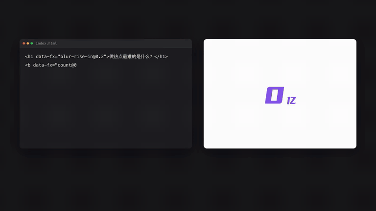
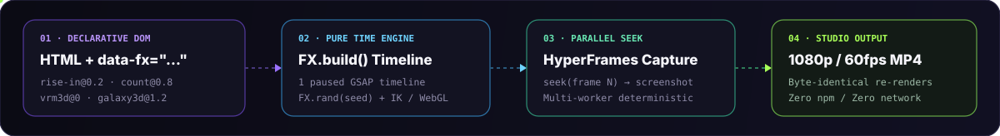
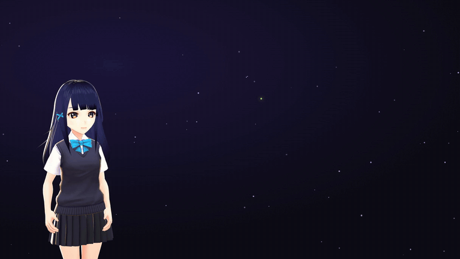

<div align="center">


<br />

[简体中文](README.md) · [繁體中文](README.zh-TW.md) · **English** · [日本語](README.ja.md)

[](LICENSE)
[](#effect-catalog-153-effects--20-transitions)
[](#transitions-20)
[](#1-real-3d-anime-vrm-presenter-fx-vrmjs)
[](#quick-start)
[](https://hrouter.net/)

[Quick Start](#-quick-start) · [Theme Gallery](#-theme--3d-gallery) · [AI Video Pipeline](#-ai-video-automation-workflow) · [Core Syntax](#-core-syntax) · [2D Rig & 3D VRM](#-advanced-visual--character-modules) · [Effect Catalog](#effect-catalog-153-effects--20-transitions)

</div>

---

<!-- HROUTER SPONSOR BANNER -->
<div align="center">
  <a href="https://hrouter.net/" target="_blank" rel="noopener">
    
  </a>
</div>

> ⚡ **Official Compute Partner — [HRouter](https://hrouter.net/)**: **One API Key for Claude, GPT, Gemini & Grok**. Pay-as-you-go with instant balance top-up, transparent per-request billing, and zero wasted monthly subscriptions. Plugs natively into **[Claude Code](https://hrouter.net/docs/claude-code/)**, **[Codex](https://hrouter.net/docs/codex/)**, **[Gemini CLI](https://hrouter.net/docs/gemini-cli/)**, and Image/Video APIs — let your AI coding agent author `data-fx` scenes and batch-render MP4s automatically! 👉 **[hrouter.net](https://hrouter.net/)** · **[Models & Pricing](https://hrouter.net/models/)** · **[Quick Setup Docs](https://hrouter.net/docs/index/)**

---

## 🎬 Live Showcase

**A declarative motion library for HTML → video.** Write a single `data-fx="effect-name@seconds"` attribute on ordinary DOM elements to produce talking-head explainers, tech breakdowns, data stories, deep-space particle worlds, and real 3D anime presenters — rendered deterministically frame-by-frame to 1080p / 60fps MP4 with [HyperFrames](https://hyperframes.heygen.com).

<div align="center">
  <a href="promo/motion-lib-promo.mp4">
    
  </a>
  <p>
    <sub>▲ Live rendered preview (Click for full HD promo <a href="promo/motion-lib-promo.mp4"><code>promo/motion-lib-promo.mp4</code></a> · Source <a href="promo/index.html"><code>promo/index.html</code></a> · 6-clip showreel <a href="examples/showreel.mp4"><code>examples/showreel.mp4</code></a>)</sub>
  </p>
</div>

<!-- STATS:START -->
| | Count |
|---|---|
| Effects | **217** (Enter 26 · Exit 10 · Emphasis 41 · Text 9 · Data 7 · Camera 14 · Character 25 · Papercut 10 · Particles 8 · 3D 12 · Space 21 · Stage 10 · Hand-drawn 5 · Chat & code 8 · Diagrams 3 · Shapes 3 · Sound 1 · Components 4) |
| Transitions | **23** |
| Component generators | **40** (`bars` `wave` `steps` `chapters` `ring` `wall` `dust` `line` `pixels` `circle-text` `retro-grid` `papercut` `hills` `torn` `switches` `space` `stage3d` `tunnel` `helix` `flipboard` `fan` `slices` `road` `bignum` `segments` `actor` `puppet` `backdrop` `device` `menu` `mini` `house` `letterbox` `chat` `terminal` `code` `agent` `surround` `hub` `shape`) |
| Skins | **6** themes (violet tech · black-gold cinema · retro pixel · papercut collage · deep-space particles · studio) |
<!-- STATS:END -->

<details open>
<summary><b>✨ Release Highlights (v1.4: Real 3D VRM Presenters + 2D RubberHose IK + 12 New FX & Transitions)</b></summary>
<br />

- **New in v2.3**: blink with a closed-eye image — give each pose a `<src>_blink.png` and write `data-lid="1"` (or `lid: true` in a scripted pose); during a blink the eye areas switch to that image, which suits detailed painted art better than squashing the eyes.
- **New in v2.2 (depth)**: `data-depth` on a scene backdrop (mark the back wall indoors, the horizon outdoors, or supply a depth image) gives WebGL depth parallax: near things move and grow more than far ones when the camera moves. One-take wide shots turn the building to a 3/4 view, props turn slightly toward the camera, and characters become the nearest layer.
- **New in v2.1 (free GSAP plugins + beat sync)**: optional module [`fx-shape.js`](fx-shape.js) (shape morphing, motion along a path, springy wiggles) and the ranking `reorder` effect; `FX.snapBeat` beat sync, with one-take room changes and push-ins landing on beats automatically; cinematic stage props for the black-gold skin.
- **New in v2.0 (parts for AI videos)**: three optional modules, [`fx-ink.js`](fx-ink.js) (hand-drawn notes), [`fx-chat.js`](fx-chat.js) (chat window, typed prompt, terminal, code diff, agent cursor) and [`fx-diagram.js`](fx-diagram.js) (surround, overload, hub), plus pixel dithering and light sweeps / leaks in the stage module: 19 effects and 6 generators. Rhythm and algorithms learned from the [HyperFrames component registry](https://github.com/heygen-com/hyperframes) (Apache-2.0).
- **New in v1.9 (one take)**: optional module [`fx-oner.js`](fx-oner.js): every scene is a room in the same building and **the whole film is one unbroken shot**. The camera pushes in from outside, tracks through walls and cranes through floors to reach the next room, pushes into a photo and back out on the way, and finally pulls back outside. Directional motion blur, parallax between props and room, and a letterbox frame are included. Three new camera effects (`cam`, `shot`, `push-into`) and two generators (`house`, `letterbox`); the core gains `FX.onFrame`, a callback that runs after every tween has updated for the frame.
- **New in v1.8 (sound and atmosphere)**: optional module [`fx-sound.js`](fx-sound.js): **every effect carries its own sound** (a pop for pop-ins, a thump for landings, a swish for slides, a whoosh for transitions, ticks for typing). 27 sounds in 4 palettes, all synthesised in code with no audio files; `node sfx.mjs <project>` writes an effects track timed to the effects. Scene backdrops gain an **atmosphere layer**: colour grade and vignette, tilt-shift focus, breathing light sources and weather particles (dust, rain, snow, fireflies, embers, stars, light rays), so a still background comes alive. The self-check gains a reading-time rule. The ideas in this release were learned from [Lemo-Opuscar](https://github.com/lemomo-ai/lemo-opuscar) (MIT).
- **New in v1.5 (World & Camera)**: optional module [`fx-world.js`](fx-world.js). Put `data-world` on the root element and every scene sits on one big canvas, so **changing scenes means the camera travels there** instead of flipping pages. Ships 21 new effects (in-place zoom, push-back blur, rack focus, deal-in, skeleton fill, depth tunnel, helix, 3D flip board, lift and make way, slice swap, walk-in road and more), 7 new generators, a 6th theme `theme-studio`, and a page lint `FX.lint()` (add `?lint` to the URL: it reports text that is too small, empty frames on camera arrival and clipped text).
- **New in v1.4 (3D VRM Avatars & 2D Soft Rig & Cyber Transitions)**:
  - **Real 3D Anime VRM Module [`fx-vrm.js`](fx-vrm.js)**: Built on `@pixiv/three-vrm` (MIT) with a closed-form two-bone 3D analytical IK solver (`FX.ik3d`), universal cross-model retargeting, 6-segment spine wave, auto-clavicle coupling, 13 full-body presenter poses, C¹ 5-vowel lip-sync (`aa/ih/ou/ee/oh`), MToon cel-shading, 2× Retina supersampling, and continuous 60Hz `SpringBone` hair/skirt physics. Ships with two Pixiv **CC0 1.0 Public Domain** sample avatars (`assets/shino.vrm` & `assets/vita.vrm`).
  - **2D Soft-Bone & RubberHose Module [`fx-rig.js`](fx-rig.js)**: Generic 2D two-bone IK (`FX.ik2`) + seamless continuous Bezier soft-sleeve limbs (`FX.hose`) + declarative `[data-bone]` / `[data-follow]` / `[data-hose]` for any custom SVG character.
  - **12 New Effects & Transitions**: 6 transitions (`shatter` `diagonal-split` `blinds` `crt-off` `portal-spin` `halftone`) + 6 effects (`circuit` `overload` `scan` `callout` `scatter-out` `toggle`) + the `switches` generator.
- **New in v1.3**: Optional WebGL 3D scene module [`fx-3d.js`](fx-3d.js) (galaxy, energy orb, tunnel, black hole, city fly-through, dot globe, 3D particle text, bloom, and programmable camera `cam3d` / `orbit3d`).
- **New in v1.2**: Optional Canvas 2D particle module [`fx-particles.js`](fx-particles.js) + 5th theme `theme-space` (deep-space particles).
- **New in v1.1**: 40 effects + 4 transitions + 5 component generators + Text & Papercut categories + 4th theme `theme-paper`.

</details>

---

## 💡 Why `motion-lib`? (Architecture)

When turning HTML into video, layout is easy — **deterministic time** is the hard part:

- **Headless renderers work via `seek(frame N) → screenshot`**: Native CSS `animation`, `setTimeout`, and `Math.random()` run outside the frame clock, producing frozen frames or non-reproducible glitches across parallel workers.
- **Hand-coding GSAP timelines doesn't scale**: A 60-second explainer takes hundreds of hand-calculated timestamps.

<div align="center">
  
</div>

`motion-lib` compiles every DOM animation, Canvas particle, WebGL 3D camera move, and VRM bone solver onto **one paused master GSAP timeline**:

```html
<h1 data-fx="blur-rise-in@0.2">What is the hardest part of chasing trends?</h1>
<b  data-fx="count@0.6 marker@1.6">7,000</b>
<ul data-fx="each:pop-in@1(stagger=0.1)"> <li>Chips</li><li>Compute</li><li>LLMs</li> </ul>
```

- 🎯 **Frame-Accurate Seeking**: Jump to any frame `N` and DOM, particles, 3D cameras, and hair physics match sequential playback identically.
- 🎲 **Seeded Reproducible Randomness**: Particles, text scrambles, waveforms, and eye blinks all use `FX.rand(seed)`.
- 📦 **100% Offline & Self-Contained**: GSAP, three.js, three-vrm, 4 commercial-friendly fonts, and CC0 sample models live right in the repo.
- ⚡ **Zero Build Step**: Drop `<script>` and `<link>` into plain HTML — no npm bundler, Webpack, or Vite required.

---

## 🎨 Theme & 3D Gallery

Each of the 5 built-in themes plus the real-3D module comes with a complete example video and editable HTML source:

<table>
  <tr>
    <td width="33%" align="center">
      <a href="examples/violet/violet.mp4"></a><br />
      <b>Violet Tech</b> <code>theme-violet</code><br />
      <sub><a href="examples/violet/violet.mp4">▶ Watch MP4</a> · <a href="examples/violet/index.html">Source</a></sub>
    </td>
    <td width="33%" align="center">
      <a href="examples/gold/gold.mp4"></a><br />
      <b>Black-Gold Cinema</b> <code>theme-gold</code><br />
      <sub><a href="examples/gold/gold.mp4">▶ Watch MP4</a> · <a href="examples/gold/index.html">Source</a></sub>
    </td>
    <td width="33%" align="center">
      <a href="examples/pixel/pixel.mp4"></a><br />
      <b>Retro Pixel</b> <code>theme-pixel</code><br />
      <sub><a href="examples/pixel/pixel.mp4">▶ Watch MP4</a> · <a href="examples/pixel/index.html">Source</a></sub>
    </td>
  </tr>
  <tr>
    <td width="33%" align="center">
      <a href="examples/paper/paper.mp4"></a><br />
      <b>Papercut Collage</b> <code>theme-paper</code><br />
      <sub><a href="examples/paper/paper.mp4">▶ Watch MP4</a> · <a href="examples/paper/index.html">Source</a></sub>
    </td>
    <td width="33%" align="center">
      <a href="examples/space/space.mp4"></a><br />
      <b>Deep-Space Particles</b> <code>theme-space</code><br />
      <sub><a href="examples/space/space.mp4">▶ Watch MP4</a> · <a href="examples/space/index.html">Source</a></sub>
    </td>
    <td width="33%" align="center">
      <a href="examples/three/three.mp4"></a><br />
      <b>Real 3D Stage</b> <code>fx-3d.js</code><br />
      <sub><a href="examples/three/three.mp4">▶ Watch MP4</a> · <a href="examples/three/index.html">Source</a></sub>
    </td>
  </tr>
</table>

---

## 📂 Repository Structure

```text
motion-lib/
├── fx.js            core engine: effect scheduler, transitions, generators, subtitles, browser preview player
├── fx.css           typography, UI components, and 5 CSS-variable themes
├── fx-particles.js  optional Canvas 2D particle module (starfield, nebula, vortex, blackhole, burst, form-text)
├── fx-3d.js         optional WebGL 3D stage, UnrealBloom, anime lighting, programmable camera
├── fx-rig.js        optional 2D two-bone IK (FX.ik2) & continuous Bezier RubberHose limbs (FX.hose)
├── fx-vrm.js        optional real 3D VRM avatar module (FX.ik3d analytical IK, 5-vowel lip-sync, 60Hz hair physics)
├── fx-world.js      optional module: world canvas, camera moves and image-set effects (scene change = camera travel)
├── fx-puppet.js     optional module: sprite puppets (blink, breathe, lip-sync) and actors that follow the content
├── fx-stage.js      optional module: stage play (backdrops, mosaic scene change, device picture-in-picture, illustration inserts, mini actors)
├── fx-oner.js       optional module: one-take camera (a building in cross-section; push-ins, tracks through walls, cranes through floors, pushes into pictures, never a cut)
├── fx-ink.js        optional module: hand-drawn notes (loop, underline, box, arrow, Vox-style marker notes; lines boil)
├── fx-chat.js       optional module: AI chat window, typed prompt, terminal, code diff, agent cursor
├── fx-diagram.js    optional module: surround, overload, hub-and-spoke
├── fx-shape.js      optional module: shape morphing, motion along a path, springy wiggles (free GSAP plugins in vendor/gsap-plugins/)
├── fx-sound.js      optional module: sound layer (every effect carries a sound; 27 sounds × 4 palettes, synthesised in code)
├── sfx.mjs          writes the effects track: node sfx.mjs <project> → audio/sfx.wav
├── assets/          built-in CC0 1.0 Public Domain 3D VRM sample avatars (shino.vrm, vita.vrm)
├── fonts/           YouSheBiaoTiHei, Smiley Sans, Fusion Pixel, ZCOOL KuaiLe (licenses in fonts/README.md)
├── vendor/          GSAP 3.15 (gsap-plugins/: MorphSVG, MotionPath, CustomEase, CustomWiggle), three.js r187 (three-fx.min.js), @pixiv/three-vrm 3.5 (three-vrm.min.js)
├── new-project.sh   copies/updates the runtime into a video project (./new-project.sh my-video)
├── chrome-tall.sh   headless Chrome viewport wrapper (prevents bottom subtitle clipping)
├── gen-readme.mjs   auto-generates multi-language stats & full effect catalogs from source
├── demo/            starter 6-scene multi-theme demo project
├── promo/           official promo source + rendered MP4
└── examples/        5 theme films + real-3D film + combined showreel
```

---

## 🚀 Quick Start

### Requirements
- **Node.js 18+** (runs `npx hyperframes`, auto-downloads CLI on first run)
- **FFmpeg**
- **Google Chrome** (auto-detected on macOS; set `REAL_CHROME` elsewhere)

### 1. Initialize a Video Project

```bash
mkdir my-video
./new-project.sh my-video        # syncs fx*.js / fx.css / fonts / vendor / CC0 avatars into my-video/lib/
```

> 💡 HyperFrames only serves files inside the project directory, so `new-project.sh` copies the runtime into `my-video/lib/` (run it again anytime to update). Run `./new-project.sh demo` and `./new-project.sh promo` before opening them for the first time.

### 2. Author `my-video/index.html`

```html
<!doctype html>
<html lang="en">
<head>
  <meta charset="UTF-8">
  <link rel="stylesheet" href="lib/fx.css">
  <script src="lib/vendor/gsap.min.js"></script>
  <script src="lib/fx.js"></script>
</head>
<body>
<div id="root" class="theme-violet" data-composition-id="main" data-width="1920" data-height="1080" data-fps="60">

  <section class="scene dark center" data-d="3.5">
    <h1 class="t-title" data-fx="mask-rise@0.2">Automated Video <span class="accent">Skill</span></h1>
    <p class="t-body" data-fx="rise-in@0.6 marker@1.4">One HTML file, studio-grade motion</p>
  </section>

  <section class="scene light" data-d="4" data-in="blur-cross">
    <div class="abs" style="left:200px;top:300px;width:1200px;height:400px"
         data-make="bars" data-values="3,8,21,40,26,12" data-hi="4"
         data-fx="each:grow-y@0.3(stagger=0.05)"></div>
  </section>

</div>
<script>
  FX.subtitles([
    [0.2, 3.4, 'One HTML file, studio-grade motion'],
    [3.5, 7.4, 'Views peak in the {first few hours} after launch']
  ], { style: 'pill' });
  FX.build();
</script>
</body>
</html>
```

### 3. Preview, Snapshot & Render MP4

```bash
cd my-video
open "index.html?play"                       # browser preview: Space play/pause, ←/→ step frames, ↑/↓ jump scenes
npx hyperframes snapshot --at 1,3,5          # grab quick check frames
HYPERFRAMES_BROWSER_PATH="$PWD/lib/chrome-tall.sh" \
  npx hyperframes render -o out.mp4 --experimental-fast-capture=false
```

> ⚠️ Always pass `chrome-tall.sh` when rendering so headless Chrome's window chrome does not crop bottom subtitles.

---

## 🤖 AI Video Automation Workflow

Because an entire video in `motion-lib` is a single declarative HTML file (`data-fx` + `FX.subtitles`), AI coding agents can generate complete 60fps videos in one shot without writing brittle imperative animation code.

Pair **[HRouter (hrouter.net)](https://hrouter.net/)** with **Claude Code / Codex / Gemini CLI** using a single pay-as-you-go API key:

```bash
# 1. Create an API key at https://hrouter.net and connect Claude Code
export ANTHROPIC_BASE_URL="https://hrouter.net"
export ANTHROPIC_AUTH_TOKEN="sk-your-hrouter-key"

# 2. Batch-generate and render motion-lib explainer videos from plain scripts
claude "Read motion-lib/README.en.md and fx-vrm.js, turn script.md into a 60fps index.html video and render MP4"
```

---

## 📐 Core Syntax

### Scenes `<section class="scene">`

| Syntax | Meaning |
|---|---|
| `data-d="4"` | Scene duration (4 seconds) |
| `data-t="12.5"` | Explicit start second (if omitted, follows the previous scene) |
| `data-in="blur-cross(dur=0.5)"` | Transition entering this scene (see Transitions catalog) |
| `class="scene dark"` / `"scene light"` | Per-scene dark / light background override |
| `class="scene overlay"` | Persistent global overlay (corner 3D presenter, watermarks, chapter bar) |

### Effects `data-fx="[target:]name@time(params)"`

Chain multiple effects separated by spaces: `data-fx="rise-in@0.2 pulse@1.5 fade-out@-0.3"`.

| Part | Syntax | Meaning |
|---|---|---|
| **Time** | `@1.2` / `@+0.3` / `@-0.4` | 1.2s from scene start / 0.3s after previous effect / 0.4s before scene end |
| **Target** | *(omitted)* / `each:` / `chars:` `words:` `lines:` | Element itself / staggered children / split text units |
| **Params** | `dur=0.8` `ease=spring` `stagger=0.1` `order=center` | Duration, easing alias (or raw GSAP ease), stagger step & order |

<details>
<summary><b>View all 12 built-in Easing Aliases</b></summary>
<br />

| Alias | GSAP Curve | Feel |
|---|---|---|
| `out` (default) | `power3.out` | Fast start, smooth settle |
| `soft` | `power2.out` | Gentle deceleration |
| `snap` | `expo.out` | Ultra-snappy arrival |
| `sharp` | `power4.out` | Crisp, decisive stop |
| `inout` | `power3.inOut` | Smooth ease-in-out for camera moves |
| `in` | `power2.in` | Accelerating exit |
| `spring` | `back.out(1.7)` | Subtle overshoot |
| `bounce` | `back.out(2.8)` | Lively overshoot |
| `elastic` | `elastic.out(1,0.55)` | Elastic spring |
| `drop` | `bounce.out` | Gravity landing bounce |
| `linear` | `none` | Constant velocity |
| `pixel` | `steps(5)` | Retro stepped motion |

</details>

### Component Generators `data-make="name"` (17 Generators)

| Name | Attributes | Pairs with | Purpose |
|---|---|---|---|
| `bars` | `data-values` `data-labels` `data-hi="2,3"` `data-max` | `each:grow-y` | Vertical bar chart / histogram |
| `line` | `data-values` `data-w` `data-h` `data-smooth` | `draw` | Polyline / smooth Bezier trend line |
| `ring` | `data-size` `data-stroke` `data-dash` | `ring(to=0.7)` | Circular progress & donut ring |
| `wave` | `data-n` `data-seed` | `each:grow-y`, `wave-live` | Audio waveform bars |
| `steps` | `data-labels="Topic,Script,Voice"` | `step(i=2)` | Step navigation pills |
| `chapters` | `data-labels` | `chapter(i=3)` | Top chapter progress bar |
| `switches` | `data-labels="Search,Memory,Tools"` `data-on="1,3"` | `toggle(i=2,on=1)` | Toggle switch list (supports batch `i=1/2/3`) |
| `pixels` | `data-text="SKILL?"` `data-size` `data-colors` | `each:pixel-in(order=random)` | 5×7 dot-matrix block text |
| `wall` | `data-cols` `data-rows` `data-seed` | `drift` | Ambient background card grid |
| `dust` | `data-n` `data-seed` | `drift`, `float` | Floating ambient particles |
| `circle-text` | `data-text` `data-r` | `spin` | Circular badge / stamp text |
| `retro-grid` | `data-cell` `data-color` `data-angle` | `bg-scroll` | Synthwave perspective grid |
| `papercut` | `data-size` `data-fold` `data-shape` `data-color` `data-seed` | `cut-in`, `spin`, `jitter` | Symmetric paper-cut window flower |
| `hills` | `data-layers` `data-colors` `data-seed` | `layer-rise`, `parallax` | Layered paper hills |
| `torn` | `data-edges` `data-depth` `data-teeth` `data-seed` | `stick-on`, `rise-in` | Torn-paper ragged edge mask |
| `space` | particle effects in `data-fx` (`fx-particles.js`) | `nebula` `starfield` `vortex` `form-text` | Multi-layer Canvas 2D particle stage |
| `stage3d` | `data-bloom` `data-alpha` `data-light` `data-cam` `data-look` | `galaxy3d` `city3d` `cam3d` `vrm3d` | WebGL 3D stage (supports alpha overlay & anime lighting) |

---

## 🌟 Advanced Visual & Character Modules

### 0. World Canvas & Camera (`fx-world.js`, new in v1.5)

A film where scenes take turns as full-screen pages looks like a slide deck. Load `fx-world.js` and put `data-world` on the root element, and every scene becomes **a station on one big canvas**: on a scene change the camera travels diagonally to the next station (a slight pull-back first, 0.8 s), and keeps pushing in slowly while it rests. Existing scene markup does not change.

```html
<script src="lib/fx.js"></script>
<script src="lib/fx-world.js"></script>

<div id="root" class="theme-studio" data-composition-id="main" data-width="1920" data-height="1080"
     data-world="snake" data-cols="4" data-wall="MOTION">
  <section class="scene center" data-d="4.6" data-fx="cam-wide@0 cam-home@1.5">…</section>
  <section class="scene" data-d="5.2">
    <div class="abs" style="left:160px;top:260px;width:1600px;height:560px" data-make="fan"
         data-fx="pick@0.8(i=2) pick@2.1(i=3)">
        
    </div>
  </section>
</div>
```

| Where | Syntax | What it does |
|---|---|---|
| Root | `data-world="snake\|row\|depth"` | Stations laid out as a snake / in a row / along depth (the camera flies inward) |
| Root | `data-cols` `data-wall` `data-tilt` `data-travel` `data-drift` | Stations per row, background word wall, station tilt, travel time, push-in speed while resting |
| Scene | `data-in="cam-jump"` | Hard cut for this change (the default `cam-to` travel needs no attribute) |
| Element | `cam-look@t` / `cam-home@t` / `cam-wide@t` | Push in on an element / pull back / pull out to the whole canvas |
| Element | `wake` `zoom-here` `push-back` `depth` `rack-focus` `bg-tint` | Place first and light up later, in-place zoom, background blur, depth layers, rack focus, background tint |
| Image sets | `deal-in` `skeleton` `drop-gather` · `tunnel`+`fly` · `helix`+`helix-spin` · `flipboard`+`flip-to` · `fan`+`pick` · `slices`+`slice-to` · `road`+`road-walk` | Nine ways to enter, arrange, switch and walk through sets of images |

Full example: [`examples/world/`](examples/world/index.html) ([▶ MP4](examples/world/world.mp4)).

**Page lint**: open `index.html?lint` in a browser (or call `FX.lint()` in the console). The library seeks each scene to the camera-arrival moment and to a late moment and reports from the real layout: text under 32px, an empty frame on arrival, clipped or overlapping text, text under the subtitle band, and whether real imagery is present. The report is also written to `<script id="fx-lint">` for command-line tools.

### 0.5 Sprite Puppets & Actors That Follow the Content (`fx-puppet.js`, new in v1.6)

With just three images per pose (mouth closed / half open / wide open) and no layers or bones, a still sprite can **blink, breathe, sway its head, lip-sync, nod and lean**, and pop hand-drawn emotion marks above its head (no emoji, so it renders the same everywhere). The blink is computed by squashing the eye region into a line; you only tell it where the two eyes are.

Declare an actor once in a persistent overlay; **whenever an element is being discussed, put `call` on that element** and the actor ducks where it is and pops up next to it, so the character follows the content instead of sitting in a corner. Use `dismiss` when the whole frame should go to the content.

```html
<script src="lib/fx-puppet.js"></script>

<section class="scene" data-d="7.4" data-fx="pup-talk@0.3(who=bot,dur=6.8)">
  <div class="shot" data-fx="call@0.2(who=bot)"></div>              <!-- peeks over this image -->
  <div class="shot" data-fx="call@2.6(who=bot) pup-emote@3(who=bot,kind=idea)"></div>
</section>
<section class="scene overlay" data-t="0" data-d="19">
  <div data-make="actor" data-name="bot" data-src="assets/bot" data-eyes="238,236,64,76/362,236,64,76" data-neck="300,400" data-home="80,0,460"></div>
</section>
```

`data-src` is the path without suffix (the library reads `_m0.png` / `_m1.png` / `_m2.png`), `data-eyes` lists each eye as "centre x, centre y, width, height", and `data-neck` is the neck position, all in source-image pixels. For multiple poses and voice-driven scheduling use the script API `FX.actor()` / `FX.puppet()` (see the header of `fx-puppet.js`). Full example: [`examples/puppet/`](examples/puppet/index.html) ([▶ MP4](examples/puppet/puppet.mp4)); the little robot in it is original artwork that ships with the repo (`assets/puppet/`).

### 0.6 Stage Play: Presenter + Scenes + Picture-in-Picture (`fx-stage.js`, new in v1.7)

Another common format: **a half-body presenter stays in the foreground, the background is a series of scenes, information arrives as picture-in-picture, and every so often a full-screen illustration cuts in**. Scenes hard-cut, scene changes use a mosaic, and the presenter changes pose on every sentence, so something on screen changes every 2–3 seconds. Use it without `data-world`.

```html
<script src="lib/fx-puppet.js"></script>
<script src="lib/fx-stage.js"></script>

<div id="root" class="theme-pixel" data-composition-id="main" data-width="1920" data-height="1080" data-mode="stage">
  <section class="scene" data-d="6.4" data-fx="call@0(who=bot) pup-talk@0.3(who=bot,dur=5.4) pup-pose@3(who=bot,pose=point)">
    <div class="abs" style="left:700px;top:230px;width:960px;height:620px" data-make="device" data-kind="laptop"
         data-fx="screen-to@1.6 screen-to@3.0 dive@5.9">
      <div data-make="backdrop" data-kind="field"></div>
    </div>
  </section>
  <section class="scene" data-d="7.2" data-fx="pup-pose@1.6(who=bot,pose=think)">
    <div data-make="backdrop" data-kind="field"></div>
    <div class="abs" style="left:1940px;top:508px;width:200px;height:250px" data-make="mini" data-src="lib/assets/puppet/mini" data-fx="mini-walk@0.3(x=-700)"></div>
    
  </section>
  <section class="scene" data-d="7" data-in="mosaic"> … </section>
  <section class="scene overlay" data-t="0" data-d="20.6">
    <div data-make="actor" data-name="bot" data-src="lib/assets/puppet/bot" data-poses="wave/point/think/cheer"
         data-eyes="238,236,64,76/362,236,64,76" data-neck="300,400" data-home="-10,0,640"></div>
  </section>
</div>
```

| Part | Syntax | What it does |
|---|---|---|
| Backdrop | `data-make="backdrop"` | `data-src` uses a picture; otherwise `data-kind="field\|room\|city\|night"` draws a pixel scene procedurally, no assets needed |
| Scene atmosphere | `data-grade` `data-focus` `data-lights` `data-weather` (on the backdrop) | Colour grade + vignette, tilt-shift focus, breathing light sources, weather particles: the background is no longer a dead picture |
| Scene change | `data-in="mosaic"` | Paper-coloured blocks cover and uncover; the presenter is never covered |
| Device | `data-make="device"` + `screen-to` / `dive` | Content inside a laptop / phone / window; hard cuts on screen; dive into the screen until it fills the frame |
| Frame sequence | `frames@0(fps=20)` | Plays a series of stills as video (screen recordings) |
| Illustration insert | `cutaway@t(dur=1.8)` | A full-screen picture cuts in, pushes in slowly, cuts out |
| Choice panel | `data-make="menu"` + `choose` | The highlight bar jumps to an item and ticks it |
| Mini actor | `data-make="mini"` + `mini-walk` / `mini-pose` | A small full-body character walks with a two-frame cycle and switches actions |
| Presenter pose | `pup-pose@t(who=bot,pose=point)` | Hard cut with an automatic blink at the swap |

**Scene atmosphere**: a still background goes dead after a few seconds. Four attributes on the `backdrop` give it light, air and depth (all computed from timeline seconds, so frames can be rendered in any order):

```html
<div data-make="backdrop" data-src="office.jpg" data-focus="tilt" data-grade="warm" data-weather="dust rays"
     data-lights="684,480,#ffc860,270; 1224,516,#9fd8ff,210,slow"></div>
```

| Attribute | Values |
|---|---|
| `data-focus` | `tilt` for tilt-shift focus (top and bottom bands soft, middle sharp); a number sets the blur in pixels |
| `data-grade` | `warm` `cool` `dusk` `night` `neon` for a colour grade plus vignette; `plain` for the vignette alone |
| `data-weather` | `dust` · `rays` · `rain` · `snow` · `fireflies` · `embers` · `stars`; several can be combined |
| `data-lights` | `x,y,colour,radius` for a breathing glow, separated by semicolons; add `,slow` for the slow swell of a screen or window |
| `data-depth` | `box:x0,y0,x1,y1` (interior: the back wall's rectangle in the picture, in source pixels), `ground:y` (exterior: the horizon height) or a depth image (white near, black far). When the camera moves, the near floor, walls and furniture shift and grow more than the back wall, so a flat picture gains depth (WebGL; the one-take camera drives it automatically) |

Full example: [`examples/stage/`](examples/stage/index.html) ([▶ MP4](examples/stage/stage.mp4)). The little robot in it (four half-body poses, a full-body mini and one illustration) is original artwork that ships with the repo; sources are in `assets/puppet/src/`.

### 0.7 Sound Layer: Every Effect Carries Its Own Sound (`fx-sound.js`, new in v1.8)

A good picture with no sound still plays like a silent film. Load `fx-sound.js` and **every effect gets a sound at the moment it fires**: no timing to write, no samples to find. Every sound is synthesised in code.

```html
<script src="lib/fx-sound.js"></script>

<div data-fx="pop-in@1.2">…</div>                 <!-- pops by default -->
<div data-fx="drop-bounce@2(sfx=ding)">…</div>    <!-- use another sound -->
<div data-fx="rise-in@3(sfx=none)">…</div>        <!-- silent this time -->
<div data-fx="sfx@4.5(kind=chime)"></div>         <!-- a sound with no motion on screen -->
```

```bash
node lib/sfx.mjs my-video                  # → my-video/audio/sfx.wav (an effects track as long as the film)
node sfx.mjs --audition out/               # one audition file per palette, every sound in turn
```

| Item | Notes |
|---|---|
| 27 sounds | `pop` `tick` `click` `swish` `whoosh` `thump` `snap` `hit` `ding` `chime` `blip` `rise` `fall` `buzz` `sparkle` `zap` `glitch` `paper` `flap` `card` `rumble` `swellup` `shimmer` `type` `roll` `step` `dots` |
| 4 palettes | `soft` clean interface sounds (default) · `pixel` square waves and a noise channel, like an 8-bit console (used automatically with `theme-pixel`) · `cinema` lower, with a little room (`theme-gold` / `theme-space`) · `paper` paper and wood (`theme-paper`). Set `data-sound="pixel"` on the root to choose one, `data-sound="off"` for no sound at all |
| Handled for you | A staggered group rises in pitch step by step; a repeated sound rotates its pitch; sounds that crowd each other are dropped; each sound is panned by where its element sits on screen |
| Preview | Add `?play` to the URL and press play |
| Mixing | The track peaks around −13 dB and sits under the voice as it is: `ffmpeg -i voice.wav -i audio/sfx.wav -filter_complex "amix=inputs=2:normalize=0" mix.wav` |

### 0.8 One Take: One Building, One Camera That Never Cuts (`fx-oner.js`, new in v1.9)

The cinematic version of the stage play: **every scene is a room in the same building, and the whole film is one unbroken shot**. The camera pushes in from outside into the first room, tracks sideways through walls and cranes down through floors to reach the next, pushes into a photo on the way and pulls back out, and finally pulls back outside to echo the opening.

```html
<script src="lib/fx-oner.js"></script>     <!-- after fx-stage.js, before fx-sound.js -->

<div id="root" class="theme-pixel" data-composition-id="main" data-width="1920" data-height="1080" data-mode="stage">
  <!-- The world: one persistent layer placed first. Each backdrop is a room; data-cell="column,floor" lays the rooms out, which decides how the camera travels -->
  <section class="scene overlay" data-t="0" data-d="60">
    <div data-make="house">
      <div data-make="backdrop" data-cell="0,0" data-src="a.jpg" data-focus="tilt" data-weather="dust"></div>
      <div data-make="backdrop" data-cell="1,0" data-src="b.jpg" data-grade="warm" data-weather="rays"></div>
      <div data-make="backdrop" data-cell="1,1" data-src="c.jpg" data-lights="684,480,#ffc860,270"></div>
    </div>
  </section>
  <!-- Scenes: transparent (scene clear), props only; data-room says which room the scene is in -->
  <section class="scene clear" data-d="7" data-room="all"> … </section>                 <!-- wide shot outside; pushes into room 1 at the end -->
  <section class="scene clear" data-d="6" data-room="1" data-fx="cam@2.3(y=-40,z=1.1)"> … </section>
  <section class="scene clear" data-d="6" data-room="2">                                  <!-- new room: the camera tracks through the wall by itself -->
    
  </section>
  <section class="scene clear" data-d="7" data-room="3" data-fx="shot@5(room=all)"> … </section>   <!-- cranes down through the floor; pulls back to the wide shot at the end -->
  <section class="scene overlay" data-t="0" data-d="60"><div data-make="letterbox"></div></section>
</div>
```

| Camera | How to write it | What it does |
|---|---|---|
| Changing rooms | Happens when `data-room` changes on a scene | Wide to room is a push-in; rooms on one floor are joined by a lateral track through the wall; floors by a crane through the slab. The fastest frames get directional motion blur and a near slice of wall sweeps past the lens |
| Moves inside a room | `cam@t(x=,y=,z=,blur=)` | Pan, push in, soften the background. Props sit nearer the lens than the room, so they move more when the camera moves (parallax) |
| Push into a picture | `push-into@t(dur=2)` | A photo appears as a framed print, the camera pushes in until it fills the screen, then pulls back out: the replacement for a hard-cut full-screen insert |
| Mid-scene shot change | `shot@t(room=all)` | For example pulling back to the wide shot at the end |
| Cinema frame | `data-make="letterbox"` | Black bars top and bottom; the self-check reports text that slips under them |
| Depth | `data-depth` on the backdrops; the rest is automatic | Room pictures get depth parallax from their perspective; the building turns to a 3/4 view in wide shots and slowly turns back; props behave like boards standing in space, turning slightly toward where the camera looks; characters are the nearest layer and move most when the camera pans |
| Always alive | Nothing to write | The camera keeps a very slow push and a hand-held sway; each room's back wall shifts slightly inside its frame, like looking into a shadow box |

### 0.9 Parts for AI Videos: Hand-drawn Notes, AI Chat, Code, Diagrams (new in v2.0)

The screens that keep coming back in videos about AI, built as parts that move with the rhythm of the real software. The timing constants (a message grows from 0.75 in 0.12 s, the measured token-gap table of a streamed answer, people typing one to three characters at a time, removed code lines collapsing in 0.55 s and added ones expanding in 0.6 s, hand-drawn lines boiling ten times a second…) were learned from the [HyperFrames component registry](https://github.com/heygen-com/hyperframes) (Apache-2.0); the code is rewritten in this library's declarative style.

```html
<script src="lib/fx-ink.js"></script>       <!-- hand-drawn notes -->
<script src="lib/fx-chat.js"></script>      <!-- chat, prompt, terminal, code, agent cursor -->
<script src="lib/fx-diagram.js"></script>   <!-- surround, overload, hub -->

<div class="fx-prompt" data-fx="prompt@0.6(fix=reprot)">write my report</div>          <!-- types a typo, then fixes it -->
<div data-make="chat" data-title="Assistant" data-fx="msg@2.9(i=1) typing@3.3(i=2,dur=1.1) stream-in@4.4(i=2)">
  <p data-from="me">write my report</p>
  <p data-from="ai" data-av="AI">Sure: three wins first, then next week's plan.</p>
</div>
<div data-make="code" data-title="cart.py" data-fx="diff@1 code-focus@3.6(i=2)"><pre>def total(items):
-     return sum(items)
+     return sum(i.price for i in items)</pre></div>
<div class="fx-sign" data-fx="ink-arrow@4.2(to=#code,tx=0.08,ty=0.3,curve=swoop)">one line changed</div>
<div data-make="surround" data-center="You" data-chips="Chat,Tasks,Meetings,Email" data-fx="overwhelm@0.3(n=16)"></div>
<div data-make="backdrop" data-src="sunset.jpg" data-dither="4" data-fx="dither-in@0"></div>
```

| Part | How to write it | What it does |
|---|---|---|
| Hand-drawn notes | `ink-circle` `ink-underline` `ink-box` `ink-arrow` `ink-mark` | Loop, underline, box, arrow, and the Vox-style marker with a leader line to a note; lines wobble, draw on in stroke order and boil once drawn |
| Chat window | `data-make="chat"` + `msg` `typing` `stream-in` | Messages grow from the sender's corner; a typing bubble; AI answers arrive in bursts, fresh text inking from grey |
| Prompt | `class="fx-prompt"` + `prompt` | Human typing in one-to-three-character chunks; the caret blinks while typing and stays on after; `fix=` types a typo first |
| Terminal | `data-make="terminal"` + `run` | Type the command, a beat, output line by line, a fresh prompt |
| Code | `data-make="code"` + `diff` `code-focus` | Lines starting `- ` turn red and collapse, `+ ` turn green and expand; a highlight sweeps one line |
| Agent cursor | `data-make="agent"` + `agent-go` | The name tag types the next action, the cursor moves over and clicks |
| Diagrams | `data-make="surround"` / `"hub"` + `surround-in` `overwhelm` `hub-node` | Surrounded, overwhelmed, hub-and-spoke; the center never moves |
| Pixel dithering | `data-dither` on a backdrop + `dither-in` | Turns photo-like pictures into consistent pixel art; resolves from two-tone noise |
| Light | `light-sweep` `light-leak` | One soft diagonal light pass (a premium touch); a film light leak (memories, turns) |

Full example: [`examples/kit/`](examples/kit/index.html) ([▶ MP4](examples/kit/kit.mp4)).

### 0.10 Free GSAP Plugins, Beat Sync, Cinematic Stage Props (new in v2.1)

**Shapes (`fx-shape.js`)**: GSAP's MorphSVG, MotionPath, CustomEase and CustomWiggle are now free for commercial use; `vendor/gsap-plugins/` ships them at the same version as the core.

```html
<script src="lib/vendor/gsap-plugins/MorphSVGPlugin.min.js"></script>
<script src="lib/vendor/gsap-plugins/MotionPathPlugin.min.js"></script>
<script src="lib/vendor/gsap-plugins/CustomEase.min.js"></script>
<script src="lib/vendor/gsap-plugins/CustomWiggle.min.js"></script>
<script src="lib/fx-shape.js"></script>

<div data-make="shape" data-shape="cross" data-color="#ff5a52" data-fx="shape-morph@1(to=check,color=#3ddc84) wiggle@3"></div>   <!-- ✗ becomes ✓, then a wiggle -->
                                                     <!-- fly along #route, drawing it -->
<div class="rank" data-fx="reorder@2.5(order=3/1/2)"><div>Claude</div><div>GPT</div><div>DeepSeek</div></div>                   <!-- a ranking changes (no plugin needed) -->
```

**Beat sync**: once the page loads a beat table, `window.FX_BEATS = { bpm, beats: [...], downbeats: [...], hits: [...] }` (`bgm.mjs pick` in [auto-video-workflow](https://github.com/honestTai/auto-video-workflow) measures it from the music and writes `beats.js`), `FX.snapBeat(t, window)` moves a moment onto the nearest beat. One-take room changes (`fx-oner.js`) then land the camera on a beat automatically (chapter changes prefer the first beat of a bar), and push-ins reach full frame on a beat. Set `data-beats="off"` on the root to turn it off.

**Cinematic stage props**: under `theme-gold`, `.fx-sign`, `.fx-score`, the choice menu, the chapter bar and the one-take building get a cinematic look (dark glass plates, thin gold rules, serif type, gold gradient numbers).

### 1. Real 3D Anime VRM Presenter (`fx-vrm.js`)

Place a real 3D anime presenter in the corner of your video with **closed-form two-bone 3D IK (`FX.ik3d`), MToon cel-shading, 5-vowel lip-sync, comic emotes, and silky 60Hz `SpringBone` hair/skirt physics**:

<div align="center">
  
  <p><sub>▲ Built-in CC0 avatar <code>assets/shino.vrm</code> + <code>circuit</code> packet flow + <code>switches</code> rendered with HyperFrames</sub></p>
</div>

```html
<script src="lib/vendor/gsap.min.js"></script>
<script src="lib/vendor/three-fx.min.js"></script>
<script src="lib/vendor/three-vrm.min.js"></script>
<script src="lib/fx.js"></script>
<script src="lib/fx-3d.js"></script>
<script src="lib/fx-vrm.js"></script>

<section class="scene overlay" data-t="0" data-d="30">
  <div class="abs" style="left:20px;bottom:0;width:580px;height:900px;pointer-events:none"
       data-make="stage3d" data-alpha="1" data-light="anime"
       data-fov="26" data-cam="0,1.34,2.85" data-look="0,1.30,0"
       data-fx="vrm3d@0(src=shino,headscale=1.18,ry=12)
                vrm-pose@0(pose=wave,expr=happy,dur=0.45)
                vrm-pose@4.0(pose=explain,expr=relaxed,look=right,emote=sparkle)
                vrm-pose@9.0(pose=think,expr=sad,look=up,emote=question)
                vrm-talk@0.3(dur=12.0,rate=7.5)"></div>
</section>
```

- **Analytical 3D Two-Bone IK (`FX.ik3d`) & Full-Body Coordination**: Zero gimbal lock, paired with a 6-segment phase-delayed spine wave (`hips → spine → chest → upperChest → neck → head`), auto-clavicle lift, contrapposto hip sway, and 30-joint finger wave.
- **Universal VRM 0.x / 1.0 Retargeting**: Works out-of-the-box with [VRoid Studio](https://vroid.com) exports, community `.vrm` models, and `.vrma` mocap clips (`vrm-anim`); auto-normalizes root offsets, eye height, and shoulder/arm span (`headscale` & `padz` supported).
- **13 Presenter Poses & Comic Emotes**: `idle` `wave` `explain` `point` `point-up` `think` `shock` `clasp` `reject` `shrug` `proud` `cheer` `bow` (or custom 3D wrist targets `lx/ly/lz/rx/ry/rz`) + `sweat` `question` `idea` `anger` `sparkle` `excl`.

### 2. 2D Soft-Bone & RubberHose Characters (`fx-rig.js`)

For flat rounded 2D SVG characters, [`fx-rig.js`](fx-rig.js) provides 2D two-bone IK (`FX.ik2`) and seamless cubic-Bezier soft-sleeve limbs (`FX.hose`) — eliminating puppet joint seams (`rig-idle`, `rig-pose`, `rig-talk`, `rig-nod`, `rig-wave`).

### 3. WebGL Real 3D Scenes (`fx-3d.js`) & Canvas 2D Particles (`fx-particles.js`)

- **`fx-3d.js` (`data-make="stage3d"`)**: Supports `data-alpha="1"` (transparent overlay + automatic 2× Retina supersampling), `data-light="anime"`, `data-bloom`, `data-fog`, `data-cam`, `data-look`, and pure-time camera moves (`cam3d`, `orbit3d`).
- **`fx-particles.js` (`data-make="space"`)**: Lightweight zero-WebGL layered 2D particles (`starfield`, `nebula`, `vortex`, `blackhole`, `orb`, `burst`, `form-text`, `stream`).
- **Custom GSAP / `FX.register`**: Extend via `FX.build({ extra(tl, at) {} })` or `FX.register(name, catKey, desc, fn)`. Keep the 3 deterministic rules: no CSS `animation`/`transition`, no `setTimeout`/`rAF`, and always use `FX.rand(seed)`.

---

## 🎭 Five Themes & FAQ

| Theme class | Style | Background | Title font | Accent | Best for |
|---|---|---|---|---|---|
| `theme-violet` | Violet Tech | `#fdfdfd` / `#171719` | YouSheBiaoTiHei | `#8453e8` | AI tools, SaaS, workflow explainers |
| `theme-gold` | Black-Gold Cinema | `#080a0f` + vignette | Gold italic gradient | `#e4b256` | Finance, industry reports, rankings |
| `theme-pixel` | Retro Pixel | `#efe9dc` halftone | Fusion Pixel | `#9fe07a` | Tech trivia, retro gaming, anime hosts |
| `theme-paper` | Papercut Collage | `#efe6d6` paper grain | ZCOOL KuaiLe | `#c8322b` · `#2f6b6e` | Culture, storytelling, handcrafted brands |
| `theme-space` | Deep-Space | `#061226` radial glow | Cyan `.t-glow` | `#6fd3ff` · `#ff8a4d` | Space, science, keynote openers |

<details>
<summary><b>Common Troubleshooting (Subtitles cropped / Missing effects / 3D black screen)</b></summary>
<br />

- **Bottom subtitles cut off in rendered MP4?** Always pass `HYPERFRAMES_BROWSER_PATH="$PWD/lib/chrome-tall.sh"`.
- **Gradient text vanishes with `chars:` / `type`?** `background-clip: text` cannot inherit through split character spans; use a solid color (e.g. `color: #e4b256`) on per-char animated titles.
- **3D / VRM stage blank?** Load scripts strictly in order: `gsap.min.js` → `three-fx.min.js` → (`three-vrm.min.js`) → `fx.js` → `fx-3d.js` → (`fx-vrm.js`), and keep `stage3d` instances ≤ 7 per video.

</details>

---

## 📜 License & Credits

- **Core Library (`fx*.js`, `fx.css`)**: [MIT License](LICENSE); third-party notices in [NOTICE](NOTICE).
- **3D & VRM Runtime**: [three.js](https://github.com/mrdoob/three.js) (MIT, [vendor/three-LICENSE.txt](vendor/three-LICENSE.txt)) & [@pixiv/three-vrm](https://github.com/pixiv/three-vrm) (MIT, [vendor/three-vrm-LICENSE.txt](vendor/three-vrm-LICENSE.txt)).
- **Sample 3D Avatars (`assets/shino.vrm`, `assets/vita.vrm`)**: Released under **CC0 1.0 Public Domain** by pixiv Inc. ([assets/README.md](assets/README.md)).
- **Parts adapted from HyperFrames**: `fx-ink.js`, `fx-chat.js`, `fx-diagram.js` and the dithering / light sweep / light leak parts of `fx-stage.js` learn from the [HyperFrames component registry](https://github.com/heygen-com/hyperframes) (Apache-2.0, license text in [vendor/hyperframes-LICENSE.txt](vendor/hyperframes-LICENSE.txt)); the code is rewritten, with the source named in each file header and in [NOTICE](NOTICE).
- **GSAP & Fonts**: GSAP under GreenSock [Standard License](https://gsap.com/standard-license); font licenses in [fonts/README.md](fonts/README.md).
- **Credits & Sponsor**: Effect ideas in v1.1 were inspired by [animate.css](https://github.com/animate-css/animate.css), [Magic UI](https://github.com/magicuidesign/magicui), and [React Bits](https://github.com/DavidHDev/react-bits) (all independently re-implemented from scratch for frame-accurate seeking). Powered & sponsored by **[HRouter (hrouter.net)](https://hrouter.net/)** — one API key for Claude, GPT, Gemini & Grok.

---

<!-- CATALOG:START -->
## Effect catalog (217 effects + 23 transitions)

> This section is generated from `fx.js` by `node gen-readme.mjs`. Do not edit it by hand.
> All effects accept the common parameters `dur` (duration), `ease` (easing) and `stagger`; the tables below list only each effect's own parameters.

### Enter (26)

How elements appear. By default they animate from a "pre-entry" state back to the element's own look, so any CSS position or rotation you set on the element is preserved.

| Name | What it does / parameters |
|---|---|
| `fade-in` | Plain fade-in, the most restrained; for subtitles and secondary notes |
| `rise-in` | Slide up from below + fade in, the most versatile entrance. Param: dist=offset in px |
| `drop-in` | Drop in from above + fade in; for tags and badges |
| `slide-in` | Slide in from one side. Params: dir=left/right/up/down (direction of motion), dist |
| `blur-in` | Blur to sharp, appearing in place; for big titles and screenshot cards |
| `blur-rise-in` | Blur + slide up + fade in, the standard cinematic title entrance |
| `scale-in` | Scale up from slightly smaller into place, the standard entrance for cards and images. Param: from=starting scale |
| `pop-in` | Pop: scale up from small with an overshoot bounce; for callout pills, icons, checks and crosses |
| `zoom-settle` | Settle from an enlarged, blurred state (like a lens snapping into focus); for opening headlines |
| `wipe-in` | Reveal with a mask wipe. Param: dir=right/left/up/down (direction the wipe advances) |
| `mask-rise` | Text rises from beneath an invisible baseline (mask slide-up); the strongest title feel |
| `flip-in` | Flip upright around the horizontal axis (3D); for card flips and revealing question cards |
| `tilt-in` | Fly in tilted with perspective (a 3D card turning to face front from the side); for UI screenshots |
| `stamp-in` | Stamp: slams down from very large and shakes when it lands; for conclusions, seals, checks and crosses |
| `drop-bounce` | Falls from above the frame and bounces twice on landing; for stacking objects and pixel blocks |
| `swing-in` | Swings down from the top edge like a hanging sign and settles |
| `focus-in` | Letter-spacing tightens from very wide + blur to sharp; common for small English titles and subtitles |
| `grow-x` | Grow from 0 along the horizontal axis (bars, dividers, progress bars). Param: origin=left/center/right |
| `grow-y` | Grow from 0 along the vertical axis (bar charts). Param: origin=bottom/top |
| `fan-in` | A stack of cards fans out from the center to their own positions (use with each:); final positions and angles follow your CSS |
| `type` | Typewriter: types out character by character. Params: cps=characters per second, caret=1 to show the cursor |
| `draw` | Line drawing: an SVG stroke is drawn along its path (connectors, arrows, circled callouts, line charts) |
| `pixel-in` | Pixel-style entrance: appears in 4-5 discrete steps (not smooth); with each: it can assemble block lettering |
| `scramble` | Scramble decode: each character first flickers through random glyphs (gray), then locks into the correct character (white) from left to right. Params: dur, chars=pool of scramble characters |
| `light-speed-in` | Light-speed entrance: rushes in from one side with a skew, overshoots, then straightens (animate.css lightSpeedIn). Params: dir=left/right (direction of motion), dist |
| `jack-in` | Jack-in-the-box: pops up gradually from the bottom, wobbles left and right twice and settles (animate.css jackInTheBox) |

### Exit (10)

How elements leave. Usually written as `@-0.4` (0.4 s before the scene ends).

| Name | What it does / parameters |
|---|---|
| `fade-out` | Fade out |
| `rise-out` | Slide up and away + fade out |
| `drop-out` | Slide down and away + fade out |
| `blur-out` | Blur + fade out (recedes into the background) |
| `scale-out` | Shrink + fade out. Param: to=ending scale (>1 means it grows as it disappears) |
| `slide-out` | Slide out to one side. Param: dir |
| `wipe-out` | Disappear with a mask wipe |
| `hinge` | Hinge drop: pinned at the top-left corner, it swings twice, then falls out of frame (animate.css hinge). Param: dist |
| `fall-out` | Falling text: each character tumbles down out of frame with some rotation (FallingText); usually used with chars:. Params: dist, seed |
| `scatter-out` | Scatter burst exit: elements fly outward in all directions with rotation and parabolic gravity (great for clearing clutter or busting myths). Params: power=force, dur, seed |

### Emphasis (41)

For elements already on screen: emphasize them when the narration reaches them. Also covers movement, color changes and content swaps.

| Name | What it does / parameters |
|---|---|
| `pulse` | Scale up briefly and back (a tap when the narration hits this word). Param: to=peak scale |
| `shake` | Shake left and right (negation, errors, warnings) |
| `nod` | A small up-and-down hop (character nod, icon bounce) |
| `blink` | Blink a few times (cursor, warnings). Param: n=count |
| `color` | Change text / background color. Params: to=color, bg=background color |
| `marker` | Highlighter: a color block sweeps left to right across the bottom of the text. Params: color, h=block height in % |
| `underline` | Underline grows from left to right. Params: color, w=thickness in px |
| `strike` | A strikethrough sweeps across (the old plan is void) |
| `box` | Highlight box: draws an outline around the element (circle the key point on a screenshot). Params: color, pad, w, r |
| `glow` | Glow breathing: the halo lights up then fades. Params: color, n=count |
| `sheen` | Shine sweep: a highlight sweeps diagonally across a card / button |
| `ping` | Ripple: a ring expands from the element's center (click feedback, marking a location) |
| `dim` | Dim (demote to secondary). Param: to=opacity |
| `undim` | Restore brightness |
| `spot` | Spotlight: use with each:; the i-th child stays bright and slightly enlarged while the rest are dimmed. Param: i (1-based) |
| `float` | Continuous up-and-down floating (idle feel). Params: amp=amplitude, period=seconds per cycle, dur=how long it lasts |
| `spin` | Rotate. Params: deg=total angle, dur |
| `move` | Move the element to another element's position (cursor moves to a button, a tag flies into a card). Params: to=#target or x, y |
| `click` | Click: press-down shrink + ripple (use with the .fx-cursor component) |
| `swap` | Swap content in place: fades itself out and fades the target element in. Param: to=#target |
| `squash` | Card squash-and-spring: narrows horizontally then springs back (about 3 frames squash + 4 frames spring), often used together with a content swap. Param: to=narrowest ratio |
| `cycle` | Hard-cut carousel over children: one visible at a time, switching to the next every `every` seconds (a thumbnail whose picture keeps changing). Params: every, loop=1 to loop, stop=which item to stop on |
| `text` | Hard-cut text to new content (clock ticks, label changes). Param: v=new text |
| `to` | Universal tween: write GSAP properties directly. Example: to@2(x=120,scale=1.2,opacity=0.5,dur=0.6,ease=inout) |
| `tada` | Tada: shrinks slightly, then scales up and sways left and right (animate.css tada) |
| `jello` | Jello: skews back and forth with decreasing amplitude (animate.css jello) |
| `rubber-band` | Rubber band: stretches horizontally, squashes vertically, and bounces a few times (animate.css rubberBand) |
| `heartbeat` | Heartbeat: two quick scale-ups in a row (animate.css heartBeat) |
| `head-shake` | Head shake: a left-right shake with a bit of 3D rotation (for "no" or "wrong") (animate.css headShake) |
| `wobble` | Wobble: translates while tilting back and forth (animate.css wobble) |
| `border-beam` | Border beam: a short streak of light runs around the element's border (BorderBeam / StarBorder). Params: color, w=thickness, len=beam length as a fraction of the perimeter, n=laps, dur=seconds per lap, keep=1 to stay visible after finishing |
| `spotlight` | Spotlight: dims the screen and leaves one circular bright area over the target; calling it again in the same scene moves the spot to the new target (Spotlight). Put it on the element to light, or use to=#id. Params: r=radius, dim=darkness 0~1, off=1 to turn it off |
| `confetti` | Confetti: bursts a handful of confetti from the element's center, tossed up and falling back down (Confetti / ClickSpark). Params: n, colors=c1/c2/c3, power, seed |
| `sparkle` | Sparkle: little stars pop up at random around the element and twinkle (SparklesText). Params: n, color, dur, seed |
| `orbit` | Orbit: spreads the container's children evenly on a circle and rotates them around the center while keeping each child upright (OrbitingCircles). Put it on the container. Params: r=radius, turns=number of turns, dur, reverse=1 to reverse |
| `beam` | Connecting beam: draws an arc between two elements and a glow flows along it (AnimatedBeam, good for "A sends data to B"). Put it on the start element, to=#end. Params: curve=curvature, color, n=number of flows, dur |
| `flip-swap` | Flip and swap: the element flips around its vertical axis, the back shows the second child, then flips back (flip cards, reveal an answer). Put two children inside: the first is the front, the second is the back. Param: axis=y/x |
| `circuit` | Orthogonal circuit link: draws a Manhattan right-angled trace between two elements and sends glowing data packets along it (architecture diagrams, protocol flows). Put it on the start element, to=#end. Params: mid=bend ratio, packets=pulse count, color, dur |
| `overload` | Overload alarm: rapid jitter + flashing red warning glow (context overflow, system overload, errors). Params: amp, color, dur, seed |
| `scan` | Laser scanline: a glowing scanner band sweeps across a window or card (code reading, document retrieval, chart diagnostics). Params: dir=down/right, color, n=count, dur |
| `callout` | Leader-line callout: pulls an angled leader line from an element's edge and pops a text label (chart peaks, key data notes). Params: text, dx, dy, color |

### Text (9)

Made for text: shimmer, glitch, word swap, delete-and-retype, split-flap, stroke, echo.

| Name | What it does / parameters |
|---|---|
| `shimmer` | Shimmer text: a highlight sweeps across the text from left to right (ShinyText). Params: color=highlight color, n=number of sweeps, gap=pause between sweeps |
| `glitch` | Glitch text: red/blue split + jitter + skew for a short burst, then settles (GlitchText). Params: amp=split in px, dur, seed. Note: it zeroes the element's x, so wrap the element in a shell if it needs to move itself |
| `rotate-words` | Word rotate: the word flips up and away, the next one flips in at the same spot (WordRotate). Params: words=B/C/D (separated by /, the element's original text is the first), every=seconds each word stays |
| `morph` | Morphing words: the old word blurs and disperses, the new one condenses out of the blur (MorphingText). Params: words=B/C, every |
| `retype` | Delete and retype: erases the existing text character by character from the end, then types the new text (TextType). Params: v=new text, cps=characters typed per second, del=characters deleted per second |
| `true-focus` | Word-by-word focus: only one word is sharp at a time, the rest blur, and a focus frame jumps to the active word (TrueFocus). For Chinese separate words with / (e.g. AI/won't/replace/you); English splits on spaces. Params: every, blur, color |
| `split-flap` | Split-flap board: each character flips through random glyphs, then settles on the right one from left to right (SplitFlap, airport departure board). Use as an entrance. Params: dur, stagger, chars=glyph pool |
| `stroke-in` | Stroke text: draws a hollow outline in one direction first, then fills in the color (StrokeText). Params: w=stroke width, color=stroke color, hold=seconds to stay hollow |
| `echo` | Echo entrance: several translucent copies trail behind and slide in together, then fade away once in place (EchoText). Params: n=number of echo layers, dist, dir |

### Data (7)

Numbers, progress and charts. Number effects automatically keep decimal places and thousands separators.

| Name | What it does / parameters |
|---|---|
| `count` | Number counter. Put the final number in the element, or set it with to=; from=starting value. Automatically keeps decimal places and thousands separators |
| `roll` | Digit-by-digit vertical roll: each digit is a 0-9 vertical strip that scrolls with blur and then stops from left to right (the $7,000 in the black-gold theme). Params: dur, stagger, spins=extra full turns |
| `clock` | Clock dial-in: from=23:28 to to=01:23 (crosses midnight automatically) |
| `fill` | Progress bar fill: grows the element's width (or height with dir=y) from from% to to% |
| `ring` | Ring progress: use with data-make="ring". Params: from, to (0-1) |
| `wave-live` | Waveform jumping: use with data-make="wave"; each bar fluctuates randomly from a seed. Params: dur, seed |
| `reorder` | A ranking changes: the children of a column (or row) slide to their new places; the one that climbs grows slightly. Put it on the list container. Params: order (the new order as original positions separated by /, e.g. 3/1/2), dur (default 0.8) |

### Camera (14)

Applied to a whole container: push in, pan, 3D tilt, shake.

| Name | What it does / parameters |
|---|---|
| `push` | Slow push-in (Ken Burns): the whole container scales up slightly at constant speed over time. Params: from, to, dur |
| `pan` | Slow pan. Params: x, y (total displacement in px), dur |
| `zoom-to` | Zoom to a region: scales and pans the container so the target area fills the frame. Params: to=#target or x,y,w,h (px inside the container), fill=fraction of the frame |
| `zoom-reset` | Pull back from a close-up to the full view |
| `tilt` | Place at a 3D tilt and slowly rotate (a floating UI card). Params: rx, ry start angles; rx2, ry2 end angles |
| `drift` | Slow background drift (blurred card wall, particle layer). Params: x, y, rot, dur |
| `cam-shake` | Camera shake (heavy hit, error) |
| `meteors` | Meteor shower: streaks of light slanting across the screen (Meteors); put it on a full-bleed background layer. Params: n, angle=direction in degrees (default 135 = toward bottom-left), color, dur, seed |
| `marquee` | Marquee: a row of content scrolls horizontally in an endless loop (Marquee / LogoLoop). Put it on a single-row container; children are duplicated automatically to fill the width. Params: speed=px per second, reverse=1 to reverse |
| `bg-scroll` | Background pattern scroll: keeps the background (grid, texture, stripes) translating at a set speed; use it with the retro-grid component. Params: x, y=px per second |
| `parallax` | Parallax: layers inside the container translate at different speeds by order (back layers move less, front layers more); use it with the hills layered paper hills. Put it on the container. Params: x, y=total displacement of the front layer, dur |
| `cam` | In a one-take film, a camera move inside a room: pan, push in, soften the background. Put it on the scene. Params: x / y (screen pixels; positive looks right / down), z (push-in factor, 1 is neutral), blur (background blur in pixels), to=#element (aim at it; pull=0.5 goes halfway), reset=1 to return to neutral, dur |
| `shot` | In a one-take film, change the camera position mid-scene: push into a room, or pull back to the wide shot outside the building. Put it on the scene. Params: room=number/all, dur |
| `push-into` | Push into a picture: the element first appears as a framed photo, the camera pushes in until it fills the screen, holds, then pulls back out. Put it on an absolutely positioned image inside the scene (left/top/width/height). Params: dur (total seconds from the push to the end of the pull), in / out (seconds for the push and the pull), cast=keep (characters stay), stay=1 (the frame remains after pulling out) |

### Character (25)

For stand-up portraits and little characters: switch poses, lip sync, nod, hop, walk.

| Name | What it does / parameters |
|---|---|
| `pose` | Switch character pose: put several [data-pose] images in a .host and hard-cut to the one named by name (talking-head portraits are normally hard cuts); bounce=1 adds a squash-and-spring |
| `lipsync` | Lip sync: hard-cuts between several [data-mouth] images in the container every `frames` frames (usually 2-4), returning to the first when done. Params: dur, frames, seed |
| `talk` | Small up-and-down bobbing while talking. Params: dur=how long it talks, rate=bobs per second |
| `hop` | Hop in place (surprise, joy). Params: h=height, n=count |
| `walk` | Walk over: horizontal movement + a bounce per step. Params: x=displacement or to=#target, steps=number of steps; for pixel characters add ease=steps(8) |
| `rig-idle` | Soft rig breathing: drives natural chest breathing, subtle hair sway, and seeded blinking on any bound SVG character. Params: dur, seed |
| `rig-pose` | Soft rig pose: smoothly transitions to a named pose or IK hand targets (lx, ly, rx, ry) with seamless continuous Bezier sleeves. Params: pose, lx/ly/rx/ry, look, face, emote, dur |
| `rig-talk` | Multi-viseme lip-sync: cycles naturally through [data-viseme] mouth shapes with subtle head rhythm, returning to the resting mouth when done. Params: dur, frames, nod=1, seed |
| `rig-nod` | Soft nod / head-shake: drives neck pivot and triggers spring follow-through on hair and accessories. Params: shake=1 (head-shake), n, amp, dur |
| `rig-wave` | Soft arm wave: arcs the IK hand target back and forth on a soft limb (arm=R/L) so the entire sleeve sways fluidly. Params: arm=R/L, n, amp, dur |
| `vrm3d` | 3D VRM anime avatar: loads any standard .vrm model onto a stage3d (MToon cel-shading + 54 humanoid bones + 5-vowel lip-sync + deterministic SpringBone hair physics). Params: src, ry, x/y/z, s, breathe/blink/sway/spring |
| `vrm-pose` | 3D VRM pose & expression: smoothly blends across 13 full-body anime presenter poses (idle, wave, explain, point, point-up, think, shock, clasp, reject, shrug, proud, cheer, bow), facial expressions (neutral, happy, relaxed, angry, sad, surprised), and eye gaze (look=cam/right/left/up/down, ry) |
| `vrm-talk` | 3D VRM 5-vowel lip-sync: drives aa/ih/ou/ee/oh morph targets with seeded syllable pauses and subtle speech head rhythm. Params: dur, rate, amp, seed |
| `vrm-nod` | 3D VRM head nod/shake/tilt: layers an additive 3D head/neck impulse on top of the active pose. Params: kind=nod/shake/tilt, n, amp, dur |
| `vrm-move` | 3D VRM stage move: translates or pops the 3D avatar root (e.g. pop-in from bottom or side step). Params: x/y/z, fromY, dur, ease |
| `vrm-anim` | 3D VRM mocap clip: plays standard .vrma (VRM Animation) motion-capture files deterministically on the timeline. Params: src, dur |
| `call` | Calls an actor over to this element (use it when the element is being discussed): the actor ducks where it is and pops up next to this element. Put it on the element being discussed; on a `<section>` it sends the actor back to its home. Params: who (actor name), at=top/left/right/below (default top: peeks over the element's top edge), size (default 340 for top, 420 otherwise), align (left-right position for at=top, 0–1), dx, dy, flip=1 (mirror so it faces the content), pose (switch pose at the same time) |
| `closeup` | Face close-up (reaction shot): hard-cuts to this actor's face, large, on a radial-burst background, holds, then hard-cuts back. Works with the existing bust sprites, no new art needed. Put it in the `data-fx` of the `<section>`. Params: who (actor name), dur (hold, default 1.1), pose (pose / expression during the close-up), kind (emotion mark to pop at the same time), color (background, default orange; also red / blue / green / purple), size (zoom size, default 1300) |
| `dismiss` | Makes an actor duck out of frame (when the whole frame should go to the content). Param: who |
| `pup-talk` | Sprite talks: swaps the three mouth frames from a mouth track while the head sways with the volume. Put it on `data-make="puppet"`, or target an actor with `who=name`. Params: dur (how long, defaults to the end of the scene); the track comes from `FX.mouthTrack = { fps, frames }` (produced by your voice tool), otherwise it is generated |
| `pup-pose` | Sprite pose change (hard cut, with an automatic blink and a tiny bounce at the swap). Put it on `data-make="puppet"`, or target an actor with `who=name`. Params: pose, pop=0 (no bounce) |
| `pup-nod` | Sprite nods once (a listener agreeing, a speaker stressing a point). Put it on `data-make="puppet"`, or use `who=name`. Param: amp (default 1) |
| `pup-lean` | Sprite leans its whole body to one side (toward the person speaking). Put it on `data-make="puppet"`, or use `who=name`. Params: deg (positive leans right, 0 returns upright), dur |
| `pup-emote` | A hand-drawn emotion mark pops up above the sprite's head. Put it on `data-make="puppet"`, or use `who=name`. Params: kind=question/exclaim/sweat/anger/sparkle/idea/heart/zap/dots, hold (seconds, default 1.6) |
| `pup-idle` | Just keeps the sprite alive (blinking, breathing, slow head sway) without talking. Put it on `data-make="puppet"`; not needed if any of pup-talk / pup-nod / pup-lean / pup-emote is used |

### Papercut (10)

Papercut / paper-craft collage style: unfold, cut open, tear, stick on, layers rising one by one, plus a handmade stop-motion feel at 12 fps. Pairs best with the `theme-paper` skin, but works with any skin.

| Name | What it does / parameters |
|---|---|
| `paper-unfold` | Paper unfold: like folded paper opening flat from the crease, with a bit of rebound. Param: dir=down/up/left/right (direction of unfolding) |
| `cut-in` | Scissor cut: "cuts" the element out snip by snip along a zigzag edge, advancing frame by frame for a papercut feel. Params: dir=right/left/down/up, teeth=number of teeth, jag=tooth depth (%), snips=number of cuts |
| `peel-in` | Corner peel: a sticker lifted at one corner settles back and is pressed flat. Param: corner=tl/tr/bl/br (which corner) |
| `layer-rise` | Layer rise: paper layers in the container rise from below one after another, back to front; the nearer the layer, the later and farther it rises (layered paper hills, paper stage). Put it on the container. Params: dist, stagger |
| `stick-on` | Sticker slap: slaps onto the paper from in front of the camera with a big shadow that tightens on landing (labels, photos). Params: from=starting scale, rot=starting tilt angle |
| `stop-in` | Stop-motion entrance: jumps in at the pace of 12 fps stop-motion, each frame with a random bit of tilt (handmade animation feel). Params: dist, steps=number of jumps, fps, seed |
| `jitter` | Stop-motion jitter: keeps tilting and shifting slightly at 12 fps, as if shot frame by frame by hand (boiling). Best added to an outer container so it does not fight an entrance effect for position. Params: amp=angle, px=offset, fps, dur |
| `lift` | Paper lift: floats up slightly while the shadow grows larger and fainter, as if pinched up by a finger; down=1 puts it back. Param: dist |
| `flutter` | Flutter: like a paper caught by a gust, it swings side to side a few times and slowly settles. Params: deg, n=number of swings, origin |
| `sway` | Hanging sway: hanging things (lanterns, tags, window flowers) keep swaying slowly left and right. Params: deg, period=seconds per swing, dur |

### Particles (8)

Canvas particles; requires loading the extra `fx-particles.js`. Write them on a canvas container made with `data-make="space"`: each effect is one layer of the canvas, stacked from bottom to top in the order written. Common parameters: `dur` (how long this layer lasts), `fade` / `out` (fade in / out seconds), `x` / `y` (center position in percent), `seed`.

| Name | What it does / parameters |
|---|---|
| `starfield` | Starfield: stars fly toward the camera from far away (with speed=0 it is a static twinkling sky). Params: n, speed, streak=trail length (1 or more makes a warp-speed beam), size, colors=color1/color2 |
| `nebula` | Nebula: a few large soft clouds of colored haze drift slowly; use it as the bottom-most background. Params: n=number of clouds, colors, alpha=density |
| `vortex` | Particle vortex: particles surge from the center toward the camera along spiral arms, with glowing streamlines (a space-time tunnel). Params: arms=number of arms, n, speed, twist=number of turns, spin=overall rotation speed, r=outer radius, colors (alternate per arm), lines=0 turns streamlines off |
| `blackhole` | Black hole: black disc + glowing halo + tilted accretion disk; particles orbit faster on the inner ring and slower on the outer one, and the near half passes in front of the hole. Params: r=hole radius, tilt=how flattened the disk is, rot=tilt angle, n, speed, c1=inner color, c2=outer color |
| `orb` | Energy orb: a glowing sphere built from triangular shards, slowly spinning with a bright core; it can gather from scattered shards into a sphere, or blow apart. Params: r=radius, detail=subdivision (1=80 shards, 2=320 shards), gap=gap between shards, spin, in=gather seconds, explode=second at which it blows apart, c1=lit-face color, c2=dark-face color, edge=outline color, core=core color |
| `burst` | Explosion: a cloud of particles and triangular shards blows out from the center with a white flash and a shockwave ring, slowing down until it fades away. Params: n, power=force, shards=share of shards 0~1, life=duration in seconds, colors, ring=0 turns the shockwave off, flash=0 turns the flash off |
| `form-text` | Particle text: tumbling little squares fly in from all sides and assemble a line of text (Chinese or English). Params: text, size=font size, font, weight, color, n=max particle count, start=how long they drift first, conv=gather seconds, glow=0 turns the text halo off, spacing=letter spacing in px |
| `stream` | Particle stream: trailing points of light flow sideways across the frame along wavy streamlines (data flow, signals). Params: n, speed, amp=wave amplitude, waves=number of waves across, tail=trail length, colors, reverse=1 reverses direction |

### 3D (12)

Real 3D scenes (three.js); requires loading the extra `vendor/three-fx.min.js` and `fx-3d.js`. Write them on a stage made with `data-make="stage3d"`: some effects put objects into the stage, others move the camera (`cam3d`, `orbit3d`). Common parameters for objects: `dur` (how long it exists), `fade` / `out` (fade in / out seconds), `px` / `py` / `pz` (placement), `s` (overall scale), `seed`.

| Name | What it does / parameters |
|---|---|
| `stars3d` | 3D starfield: a large cloud of stars scattered through space, with depth layers as the camera moves. Params: n, r=spread radius, size, colors |
| `galaxy3d` | Spiral galaxy: tens of thousands of particles arranged in spiral arms rotating around the center, faster inside and slower outside. Params: n, arms=number of arms, r=radius, inner=empty radius at the center, spin=rotation speed, twist=how much the arms curve, colors (alternate per arm), size, bright |
| `orb3d` | 3D energy orb: a sphere built from metallic triangular shards with real lighting and a glowing core; the shards can gather from scattered pieces into a sphere, or blow apart. Params: r=radius, detail=subdivision (1=80 shards, 2=320 shards), gap=gap between shards, spin, in=seconds to gather, explode=at which second to blow apart, power=blast strength, color=shard color, emissive=self-glow color, core=core color |
| `tunnel3d` | Particle tunnel: particles and light rings line up in a tunnel rushing toward the camera (put the camera inside the tunnel looking down it). Params: n, r=tunnel radius, len=length, speed, twist=how much it spirals, rings=number of rings (0 for none), colors |
| `waves3d` | Wave grid: a large ground of dots that undulates like water. Params: nx / nz=number of dots, w / d=width and depth, amp=wave height, freq=wave density, speed, c1=color at the troughs, c2=color at the crests |
| `globe3d` | Dot globe: a sphere made of dots that rotates slowly, with arcs of light flying between pairs of points on its surface (global network, data links). Params: r=radius, n=number of dots, arcs=number of arcs, spin, color=dot color, arc=arc color |
| `blackhole3d` | 3D black hole: a black sphere + a light ring that always faces the camera + a particle accretion disk; the camera can orbit around it. Params: r=black hole radius, n, disk=outer radius of the disk (multiple of r), speed, c1=inner color, c2=outer color |
| `burst3d` | 3D explosion: tens of thousands of particles blast outward in every direction, slowing as they fly, with one strong flash. Params: n, power=strength, life=duration in seconds, colors |
| `text3d` | 3D particle text: particles in space converge from all directions into a line of text with thickness, and the camera can circle it (Chinese and English both work). Params: text, w=text width in the scene, depth=number of thickness layers, start=how long they drift first, conv=seconds to converge, color, n=max particle count, font, weight, scatter=scatter radius |
| `city3d` | City: a street lined with buildings on both sides, lit windows, outlined walls, headlights flowing along the road, and an optional setting sun at the far end. Pair it with cam3d to fly down the street. The street runs along -z. Params: rows=how many rows deep, cols=how many columns per side, road=road width, lit=fraction of lit windows, colors=window colors, wall=wall color, edge=outline color (edge=0 for no outline), sun=sun color (sun=0 for none), traffic=0 turns off the traffic |
| `cam3d` | Move the camera: fly from the current position to a new one while turning the view toward a new target. Params: x / y / z=where to fly to, lx / ly / lz=where to look, fov=field of view, dur, ease (dur=0 cuts straight there). Any parameter you omit stays unchanged |
| `orbit3d` | Orbit camera: the camera circles a target, optionally moving in or rising at the same time. Params: turn=degrees to turn (negative goes the other way), from=start angle (omit to start from the current position), r=distance from the target at the end, h=height at the end, lx / ly / lz=what to circle around, dur, ease |

### Space (21)

World canvas, camera and image-set moves; requires loading the extra `fx-world.js`. Put `data-world` on the root element and every scene becomes a station on one big canvas: changing scenes means the camera travels there. Camera effects need `data-world`; the focus and image-set effects work on any page.

| Name | What it does / parameters |
|---|---|
| `cam-look` | Camera pushes in on one element inside the station (use it when the voice-over reaches that element); follow with `cam-home` to pull back. Params: to (selector, defaults to the element itself), fit (how much of the frame it should fill, default 0.6), max (maximum zoom, default 1.4), dur |
| `cam-home` | Camera returns to the full view of the current station (use after `cam-look`). Param: dur |
| `cam-wide` | Camera pulls out to show the whole canvas (opening overview, closing recap). Written as `cam-wide@0` the film starts on the overview; push in with `cam-home`. Param: dur |
| `wake` | Place first, talk later: the element is on screen from the start but dimmed, and lights up when mentioned. Params: dim (brightness before it lights up, default 0.3), solid=1 (darken and desaturate instead of fading, so a card never shows the backdrop through it; on automatically in stage mode) |
| `zoom-here` | In-place zoom: pick one item out of a group and enlarge it where it sits while the rest fade to 30% and step back. Params: s (scale, default 2.4), hold (seconds before it returns automatically; omit to keep it), dim |
| `push-back` | Background blur: when new content arrives, push the previous layer back as a whole (scale to 94%, blur 4px, darken to 55%). Params: s, blur, dim, dur |
| `bring-front` | Bring back a layer that `push-back` pushed away |
| `depth` | Depth layers: children carry `data-depth="near/mid/far"`; the farther from focus the blurrier (0 / 4 / 8px), with per-layer parallax drift. Params: focus (which layer is sharp, default mid), shift (parallax amount, default 40), blur |
| `rack-focus` | Rack focus: move the sharp layer to another one (used with `depth`). Params: to=near/mid/far, dur |
| `bg-tint` | Background colour swap: when the image changes, the whole background changes to its dominant colour so viewers see the switch at a glance. Params: color (`reset` restores the original), dur (default 0.5), to (element to tint, defaults to the whole canvas) |
| `skeleton` | Skeleton fill: a complex interface first appears as grey skeleton blocks, then real content fills in block by block in reading order. Put it on the container; its children are the blocks. Params: gap (delay between blocks, default 0.15), hold (how long the skeleton stays first, default 0.5) |
| `deal-in` | Deal-in: a set of images does not appear at once; they fly in one after another along an arc to their places. Use with `each:`. Params: stagger (default 0.1), from=left/right, dur |
| `drop-gather` | Drop and gather: a pile of images drops from above, gathers into a fan, keeps only the few to be discussed and lets the rest fall away. Put it on the container; add `data-keep` to children to keep (otherwise the first `keep` are kept). Param: keep (default 3) |
| `fly` | Depth tunnel: the camera flies continuously inward; the item it passes scales up and blurs, the next fades in from the depth. Put it on `data-make="tunnel"`. Params: to (fly to which item, counted from 1), each (seconds per item, default 0.7) |
| `helix-spin` | Helix: the camera orbits a cylinder of images, fast then slow, then keeps turning slowly. Put it on `data-make="helix"`. Params: turn (degrees of the fast turn, default 300), dur (fast-turn time, default 2.4), slow (degrees per second afterwards, default 10) |
| `flip-to` | 3D flip board: panels roll upward one after another, each flipping around the horizontal axis; the one facing the camera shows in full colour, the rest dim to 30%. Put it on `data-make="flipboard"`. Params: i (flip to which panel, counted from 1), dur |
| `pick` | Lift and make way: in a fan of images, the one being discussed lifts and enlarges while its neighbours slide aside; all others stay visible. Put it on `data-make="fan"`. Params: i (which one, counted from 1; 0 = put all back), s (default 1.3), gap (how far the others move, default 90), lift (default 70) |
| `slice-to` | Slice swap: the new image is cut into strips that grow up from the bottom one by one, with the number label flipping in sync. Put it on `data-make="slices"`. Params: i (which image, counted from 1; omit for the next one), stagger (default 0.07), dur |
| `road-walk` | Walk into the picture: the camera moves along a road close to the ground; each step lights up as it is reached. Put it on `data-make="road"`. Params: i (walk to which step, counted from 1), dur |
| `bignum` | Chapter card entrance: the big number drops in, the title slides out after it. Put it on `data-make="bignum"`. Param: dock (seconds before it shrinks into a small top-left label; omit to keep it) |
| `segment` | Progress line advances to segment i (counted from 1). Put it on `data-make="segments"`, usually in a persistent overlay layer |

### Stage (10)

Stage-play parts for "presenter in front, scene behind, information as picture-in-picture" explainers; requires loading the extra `fx-stage.js`. Scene backdrops (`backdrop`), devices with on-screen content (`device`), full-screen illustration inserts, a choice panel (`menu`) and small full-body actors (`mini`). Use it without `data-world`: scenes hard-cut, and `data-in="mosaic"` changes the backdrop.

| Name | What it does / parameters |
|---|---|
| `dither-in` | The picture resolves from two-tone pixel noise to clear (like an old console booting or a signal locking on). Put it on a data-make="backdrop"; with data-dither it ends as pixel art, otherwise on the original picture. Params: dur (default 1.6) |
| `light-sweep` | A soft diagonal light sweeps across once (a premium touch for a conclusion, a product or a ranking). Put it on a scene, a backdrop or any element. Params: dur (default 1.6), angle (band angle, default 115), color, strength (0–1, default 0.5) |
| `light-leak` | A film light leak: warm light washes in from one side and fades (memories, turns, emotional peaks). Put it on a scene or a backdrop. Params: dur (default 4), tone=warm/cool, strength (0–1, default 0.9) |
| `cutaway` | Illustration insert: a full-screen picture cuts in hard, pushes in very slowly, then cuts back out; it covers the actors while subtitles and the chapter bar stay. Put it on an `` inside the scene. Params: dur (hold, 1.2–2.5 s), zoom (default 1.07), x / y (pan in percent), under=1 (sit below the actors so the presenter keeps talking over it; good for full-screen screen recordings) |
| `screen-to` | On-screen cut: the content inside a device screen hard-cuts to item i (counted from 1; omit for the next one) with a faint flash. Put it on `data-make="device"` |
| `dive` | Dive into the screen: the device zooms toward the camera until its screen fills the frame (give the next scene the same picture as its backdrop and it feels like walking into the screen). Put it on `data-make="device"`, usually in the last 0.5 s of the scene. Param: dur (default 0.5) |
| `frames` | Frame-sequence playback: plays a series of stills as video (gameplay, screen recordings), frame-accurate. Put `data-frames="dir/f_%03d.jpg" data-n="count"` on the element. Params: fps (default 15), dur (defaults to the end of the scene; loops) |
| `choose` | Pick an option: the highlight bar of a choice panel jumps to item i and ticks it. Put it on `data-make="menu"`. Params: i (counted from 1; `2/4/1/3` makes several quick picks in a row), every (interval between quick picks, default 0.28 s) |
| `mini-walk` | A mini actor walks over: two alternating walk frames plus horizontal movement, then stands still. Put it on `data-make="mini"`. Params: x (distance, negative goes left) or to=#target, dur, step (seconds per step, default 0.16) |
| `mini-pose` | A mini actor switches action (raise hand, cheer, sit…) with a small squash-and-bounce. Put it on `data-make="mini"`. Params: name (an action listed in `data-poses`), hold (seconds before returning to idle; omit to keep it) |

### Hand-drawn (5)

Hand-drawn annotation, loaded from `fx-ink.js`. Lines wobble a little, draw on in stroke order, and once drawn they "boil" (re-pose ten times a second). Put them on the element you annotate; shared params `color` (defaults to the skin accent), `w` (line width), `dur`, `boil=calm|lively|off`.

| Name | What it does / parameters |
|---|---|
| `ink-circle` | Hand-draw a loop around the element (pen starts at the upper left and overshoots a little), with an optional note beside it. Params: label (the note), at=right/left/top/bottom (where the note goes), pad (how much larger than the element, default 18), color, w, dur |
| `ink-underline` | Hand-drawn lines: squiggly underline, strike-through, left bracket. Params: kind=squiggle/double/strike/bracket, color, w, dur |
| `ink-box` | Hand-draw a box around the element, with an optional tab label at the top left. Params: label, pad (default 14), color, w, dur |
| `ink-arrow` | Draw a hand-drawn arrow from this element to another. Params: to=#target (or dx / dy offsets in pixels), tx / ty (which point inside the target, 0–1; omit to point at the nearest point on the target's edge), curve=straight/gentle/swoop, side=1/-1 (which way it bends), gap (space left at both ends), color, w, dur |
| `ink-mark` | Vox-style annotation: a marker stroke on one word of a sentence while a thin line draws out to a short note. Params: word (the word to mark; omit to mark the whole element), style=highlight/circle/underline/scribble, note (the note; omit for the mark alone), color, dur |

### Chat & code (8)

The screens that keep appearing in AI videos, loaded from `fx-chat.js`: a chat window (`data-make="chat"`), a typed prompt, a terminal (`data-make="terminal"`), code (`data-make="code"`) and an agent cursor (`data-make="agent"`). They move like the real software: messages grow from the sender's corner, AI answers arrive in bursts, people type in uneven chunks.

| Name | What it does / parameters |
|---|---|
| `msg` | One chat message arrives, growing from the sender's corner in 0.12 s. Put it on data-make="chat". Params: i (which message, counted from 1) |
| `typing` | The "typing…" bubble: three dots pop in where message i will appear and leave after dur seconds (usually followed by msg / stream-in for the same message). Put it on data-make="chat". Params: i, dur (default 1.2) |
| `stream-in` | An AI answer arrives in bursts the way streamed tokens do; fresh text lands grey and inks to full colour over 0.27 s. Put it on data-make="chat" (message i) or on any block of text. Params: i, speed (default 1) |
| `prompt` | Type into a prompt like a person: one to three characters at a time with uneven pauses; the caret blinks while typing and stays on after. Put it on an element that holds only text (add class="fx-prompt" for an input box). Params: fix (a mistyped word, typed first, deleted and corrected), glyph (leading glyph, default ›, none to hide), speed |
| `run` | Run a command in a terminal: type it, pause a beat, print the output line by line, then show a fresh prompt. Put it on data-make="terminal". Params: every (seconds between output lines, default 0.22), speed (typing speed) |
| `diff` | A code change: lines to remove turn red and collapse, lines to add turn green and expand. Put it on data-make="code" (lines starting with "- " are removed, "+ " added) |
| `code-focus` | A highlight band sweeps across one line of code and the other lines dim. Put it on data-make="code". Params: i (line number as finally shown, from 1; 0 restores all) |
| `agent-go` | Agent cursor: the name tag types out what the agent is about to do, then the cursor moves to the target and clicks with a ripple. Put it on data-make="agent"; write it several times in a row. Params: to=#target (omit to stay), say (text on the tag), click=0 (no click), done=1 (a check mark for a finished step) |

### Diagrams (3)

Relationship diagrams, loaded from `fx-diagram.js`: surround (`data-make="surround"`) and hub-and-spoke (`data-make="hub"`). The center never moves; only what surrounds it does.

| Name | What it does / parameters |
|---|---|
| `surround-in` | The center settles, then the chips around it arrive one by one; with close=1 they then close in together while the edges darken. Put it on data-make="surround". Params: gap (seconds between chips, default 0.3), close=1 |
| `overwhelm` | A crowd of chips rushes in from every side, faster and faster, and crowds the still center (overload, too much at once). Put it on data-make="surround" (labels cycle through data-chips). Params: n (8–24, default 16), intensity (0.5–2: higher packs tighter and faster), dur (how long the rush takes, default 2.2) |
| `hub-node` | Node i of a hub diagram: its connector draws out from the center and the node pops on. Put it on data-make="hub", one per node as the narration reaches it. Params: i (from 1) |

### Shapes (3)

Shape morphing, motion along a path and springy wiggles, loaded from `fx-shape.js` plus the matching GSAP plugins in `vendor/gsap-plugins/` (MorphSVG, MotionPath, CustomEase, CustomWiggle, now free for commercial use). Twelve built-in shapes (`data-make="shape"`): check cross circle square triangle star heart bolt arrow-up arrow-down play bulb.

| Name | What it does / parameters |
|---|---|
| `shape-morph` | A shape smoothly turns into another (✗ into ✓, a circle into a star…), optionally changing colour. Put it on data-make="shape" or on any svg holding one <path>. Params: to (a built-in shape: check cross circle square triangle star heart bolt arrow-up arrow-down play bulb, or #id of another path), color, dur (default 0.6). Needs MorphSVGPlugin |
| `path-move` | Move along an SVG path, turning to follow it (a paper plane, a data packet, a delivery route). Put it on the moving element. Params: path=#path id (required), dur (default 1.6), rotate=0 (no turning), draw=1 (draw the path as it goes), from / to (which part of the path, 0–1). Needs MotionPathPlugin |
| `wiggle` | A springy wiggle that settles (when something is called out, mocked or goes wrong). Params: n (how many swings, default 6), amp (degrees, default 8), dur (default 0.8), prop=rotation/x. Needs CustomEase + CustomWiggle |

### Sound (1)

The sound layer, loaded from `fx-sound.js`. Once loaded, **every effect carries its own sound** (a pop for pop-ins, a thump for landings, a swish for slides, a whoosh for transitions, ticks for typing…), all synthesised in code with no audio files. Any effect takes `sfx=name` to use another sound or `sfx=none` to stay silent. The effect below places a sound where nothing moves on screen. Add `?play` to the URL to hear it in the preview; `node lib/sfx.mjs <project>` writes the effects track for the final film.

| Name | What it does / parameters |
|---|---|
| `sfx` | Play one sound effect on its own (it sounds even when nothing moves on screen). Params: kind=pop/tick/click/swish/whoosh/thump/snap/hit/ding/chime/blip/rise/fall/buzz/sparkle/zap/glitch/paper/flap/card/rumble/swellup/shimmer/type/roll/step/dots, vol (volume multiplier), pitch (pitch multiplier), dur (seconds, for sustained sounds) |

### Components (4)

Used together with components generated by `data-make`.

| Name | What it does / parameters |
|---|---|
| `step` | Step navigation switch: use with data-make="steps"; lights up the i-th pill (1-based) and turns the rest off |
| `chapter` | Chapter progress bar: use with data-make="chapters"; the highlight block slides to chapter i (1-based) |
| `check` | Checklist tick: use with the .fx-check component; the check mark is drawn and the text turns solid |
| `toggle` | Flip switches: pair with data-make="switches" to flip switch i (supports 2/3/5 batch) ON (on=1) or OFF (on=0). Params: i, on=0/1, stagger |

### Transitions (23)

Written on the **later** scene: `<section class="scene" data-in="blur-cross(dur=0.5)">`.

| Name | What it does / parameters |
|---|---|
| `cut` | Hard cut (default). The most common and fastest-paced |
| `fade` | Cross-fade |
| `blur-cross` | Blur cross: the previous shot blurs and fades out while the next goes from blurred to sharp |
| `zoom-through` | Zoom through: the previous shot scales up and rushes out of frame while the next scales up from small into place |
| `push` | Push: the new scene pushes the old one out. Param: dir=left/right/up/down |
| `wipe` | Wipe: the new scene covers the old one along a direction. Param: dir |
| `iris` | Iris: the new scene expands from a point to full screen. Params: x, y (percent) |
| `flash` | Flash to white (or any color): for key sentences and chapter openings. Param: color |
| `dip` | Dip to black: fades to dark then back up (change of topic). Param: color |
| `pixelate` | Pixel dissolve: blocks cover the screen in random order and then disperse (scene change for the pixel style). Params: cols, color |
| `paper-slide` | Paper pull: a new sheet slides in from one side over the old one, with a shadow along the edge and the old sheet slightly darkened. Param: dir=left/right/up/down |
| `tear` | Paper tear: the new scene is revealed from one side along a jagged torn edge (papercut-style scene change). Params: dir=right/left/down/up, jag, teeth |
| `glitch-cut` | Glitch cut: the new scene flickers a few times with a red/blue split, then stabilizes (tech-style cut) |
| `open` | Doors open: the new scene opens outward from a slit in the middle. Param: dir=x (opens left/right)/y (opens up/down) |
| `shatter` | 3D shatter: fractures the frame into 3D shards that tumble and fall away to reveal the next scene. Params: cols, colors=c1/c2, dur, seed |
| `diagonal-split` | Diagonal slash split: a glowing diagonal slash cuts the frame and pulls apart to reveal the next scene. Params: angle, color, dur |
| `blinds` | Venetian blinds: slices the incoming scene into slats that flip open in a wave over the previous scene. Params: n=slats, dir=x/y, dur |
| `crt-off` | Retro CRT switch: collapses the outgoing scene into a bright horizontal scanline before flashing open the next scene. Params: color, dur |
| `portal-spin` | Vortex spin: twists the outgoing scene into the center while untwisting the incoming scene into focus. Params: deg, dur |
| `halftone` | Comic halftone wave: a grid of dots expands diagonally to cover the screen and shrinks away to unveil the next scene. Params: cols, color, dur |
| `cam-to` | World canvas only (default): the camera travels diagonally to the next station, pulling back slightly first, slow-fast-slow. Params: dur (0.6–0.9), arc (extra degrees swung on the way, default 8), pull (pull-back amount, default 0.07) |
| `cam-jump` | World canvas only: the camera jumps straight to the next station (hard cut); only for major chapter changes |
| `mosaic` | Mosaic scene change: paper-coloured blocks cover the frame roughly top to bottom in random order, then uncover the new scene at random; the blocks sit below the actors and persistent overlays, so the presenter is never covered (use for chapter or backdrop changes). Params: cols (blocks per row, default 24), color, dur, seed |
<!-- CATALOG:END -->
