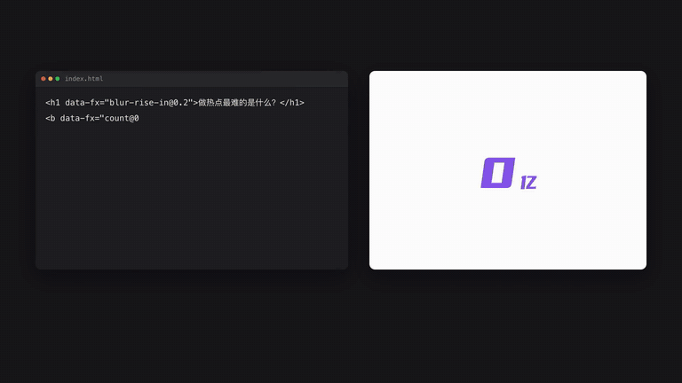
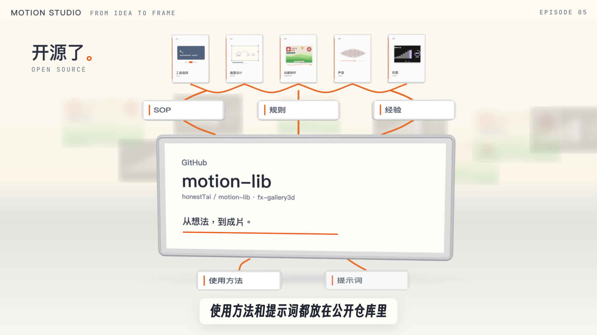
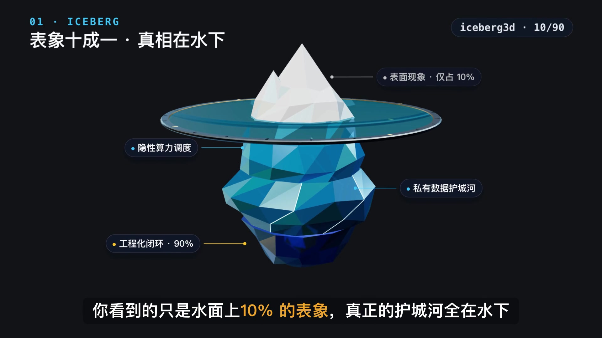
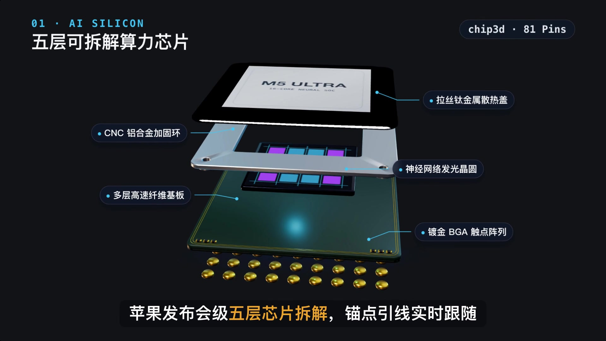
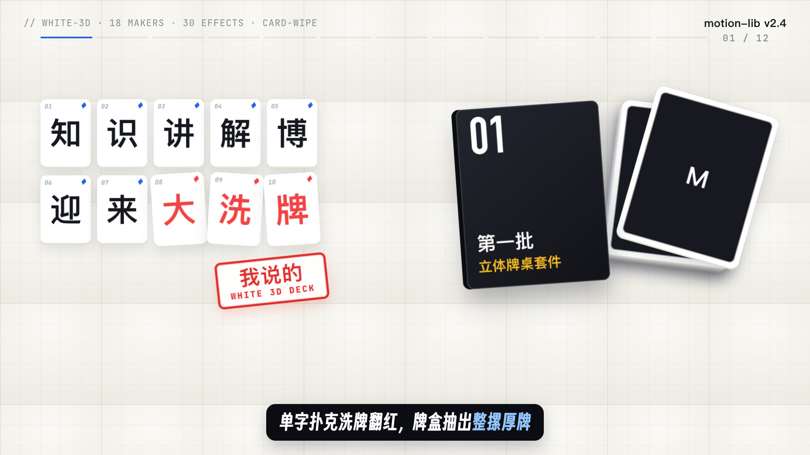
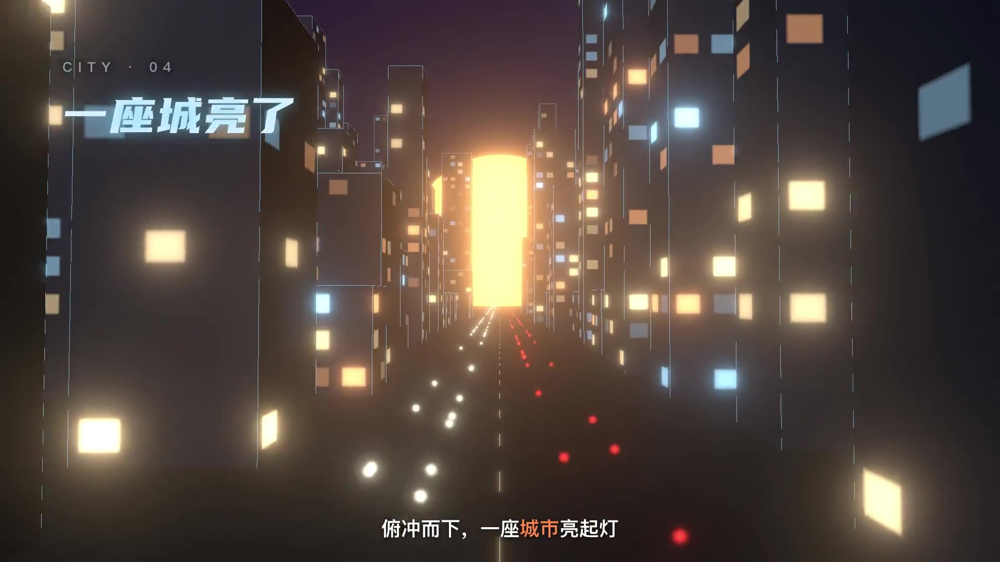
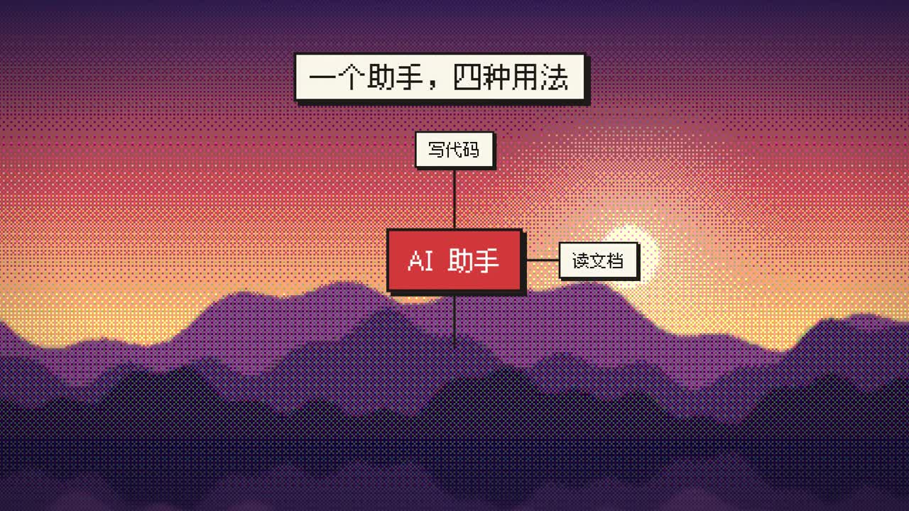
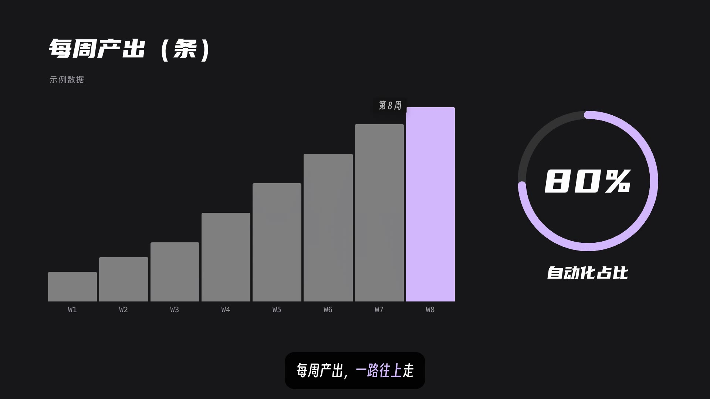

<div align="center">



<br />

[简体中文](README.md) · [繁體中文](README.zh-TW.md) · [English](README.en.md) · **日本語**

[](LICENSE)
[](docs/CATALOG.ja.md)
[](docs/CATALOG.ja.md)
[](examples/gallery3d/index.html)
[](#-クイックスタート)
[](https://hrouter.net/)

[ギャラリー](#-サンプルギャラリー) · [ディレクトリ構成](#-ディレクトリ構成) · [クイックスタート](#-クイックスタート) · [構文とモジュール](#-基本構文とモジュール) · [全エフェクト一覧](docs/CATALOG.ja.md)

</div>

---

<div align="center">
  <a href="https://hrouter.net/" target="_blank" rel="noopener">
    
  </a>
</div>

> ⚡ **公式コンピュートパートナー [HRouter](https://hrouter.net/)**：**1 つの API キーで Claude / GPT / Gemini / Grok に直結**。[Claude Code](https://hrouter.net/docs/claude-code/)・[Codex](https://hrouter.net/docs/codex/)・[Gemini CLI](https://hrouter.net/docs/gemini-cli/)・[DeepSeek](https://hrouter.net/docs/deepseek/) にネイティブ対応。

---

## 🎬 概要

**HTML → 動画のための宣言型モーションライブラリです。** DOM 要素に `data-fx="エフェクト名@秒数"` と書くだけで、タイポグラフィ・パーティクル・Three.js 3D ギャラリー・VRM キャラクターを単一の決定論的 GSAP タイムラインに統合し、[HyperFrames](https://hyperframes.heygen.com) で 1080p / 60fps MP4 を出力します。

<div align="center">
  <a href="promo/motion-lib-promo.mp4">
    
  </a>
  <sub>▲ フルプロモ <a href="promo/motion-lib-promo.mp4"><code>promo/motion-lib-promo.mp4</code></a> · ショーリール <a href="examples/showreel.mp4"><code>examples/showreel.mp4</code></a></sub>
</div>

<br />

<!-- STATS:START -->
| | 数 |
|---|---|
| エフェクト | **282** 種（入場 26 · 退場 10 · 強調 41 · テキスト 9 · データ 7 · カメラ 14 · キャラクター 25 · 切り紙 10 · パーティクル 8 · 3D 37 · ホワイト立体 40 · 空間 21 · ステージ 10 · 手描き 5 · チャットとコード 8 · 図解 3 · 図形 3 · サウンド 1 · コンポーネント 4） · [全カタログ →](docs/CATALOG.ja.md) |
| トランジション | **24** 種 |
| コンポーネントジェネレーター | **76** |
| スキン | **7** テーマ（ホワイトバイオレット · ブラックゴールド · レトロピクセル · 切り絵コラージュ · ディープスペース · スタジオ · ホワイト立体） |
<!-- STATS:END -->

---

## 🎨 サンプルギャラリー

<table>
  <tr>
    <td width="33%" align="center">
      <a href="examples/gallery3d/gallery3d.mp4"></a><br />
      <b>ウォーム 3D ギャラリー</b> <code>fx-gallery3d.js</code><br />
      <sub><a href="examples/gallery3d/gallery3d.mp4">▶ MP4</a> · <a href="examples/gallery3d/index.html">ソース</a></sub>
    </td>
    <td width="33%" align="center">
      <a href="examples/narrative3d/narrative3d.mp4"></a><br />
      <b>解説 3D ナラティブ</b> <code>fx-narrative3d.js</code><br />
      <sub><a href="examples/narrative3d/narrative3d.mp4">▶ MP4</a> · <a href="examples/narrative3d/index.html">ソース</a></sub>
    </td>
    <td width="33%" align="center">
      <a href="examples/showcase3d/showcase3d.mp4"></a><br />
      <b>ハードウェア 3D 分解</b> <code>fx-showcase3d.js</code><br />
      <sub><a href="examples/showcase3d/showcase3d.mp4">▶ MP4</a> · <a href="examples/showcase3d/index.html">ソース</a></sub>
    </td>
  </tr>
  <tr>
    <td width="33%" align="center">
      <a href="examples/white3d/white3d.mp4"></a><br />
      <b>ホワイト立体デスク</b> <code>fx-desk3d.js</code><br />
      <sub><a href="examples/white3d/white3d.mp4">▶ MP4</a> · <a href="examples/white3d/index.html">ソース</a></sub>
    </td>
    <td width="33%" align="center">
      <a href="examples/world/world.mp4"></a><br />
      <b>ワールドキャンバス</b> <code>fx-world.js</code><br />
      <sub><a href="examples/world/world.mp4">▶ MP4</a> · <a href="examples/world/index.html">ソース</a></sub>
    </td>
    <td width="33%" align="center">
      <a href="examples/stage/stage.mp4"></a><br />
      <b>ステージ劇 PiP</b> <code>fx-stage.js</code><br />
      <sub><a href="examples/stage/stage.mp4">▶ MP4</a> · <a href="examples/stage/index.html">ソース</a></sub>
    </td>
  </tr>
  <tr>
    <td width="33%" align="center">
      <a href="examples/three/three.mp4"></a><br />
      <b>WebGL 3D シーン</b> <code>fx-3d.js</code><br />
      <sub><a href="examples/three/three.mp4">▶ MP4</a> · <a href="examples/three/index.html">ソース</a></sub>
    </td>
    <td width="33%" align="center">
      <a href="examples/kit/kit.mp4"></a><br />
      <b>AI 解説パーツ集</b> <code>kit/*</code><br />
      <sub><a href="examples/kit/kit.mp4">▶ MP4</a> · <a href="examples/kit/index.html">ソース</a></sub>
    </td>
    <td width="33%" align="center">
      <a href="examples/violet/violet.mp4"></a><br />
      <b>ホワイト＆バイオレット</b> <code>theme-violet</code><br />
      <sub><a href="examples/violet/violet.mp4">▶ MP4</a> · <a href="examples/violet/index.html">ソース</a></sub>
    </td>
  </tr>
</table>

---

## 📂 ディレクトリ構成

```text
motion-lib/
├── src/
│   ├── core/               # コアエンジン fx.js + タイポグラフィ＆7テーマ fx.css
│   └── modules/            # 役割別の5つの拡張モジュール群
│       ├── spatial/        # 空間＆ステージカメラ：fx-world.js · fx-stage.js · fx-oner.js
│       ├── three/          # 3D＆立体スタジオ：fx-3d.js · fx-desk3d.js · fx-gallery3d.js · fx-showcase3d.js · fx-narrative3d.js · fx-particles.js
│       ├── character/      # アバター＆IK：fx-puppet.js · fx-rig.js · fx-vrm.js
│       ├── kit/            # 解説UIキット：fx-chat.js · fx-diagram.js · fx-ink.js · fx-shape.js
│       └── audio/          # コード合成効果音：fx-sound.js
├── scripts/                # CLIツール：new-project.sh · sfx.mjs · chrome-tall.sh · gen-readme.mjs
├── assets/ · fonts/ · vendor/  # オフライン3Dモデル（VRM / GLB）・商用無料フォント・依存ライブラリ
├── examples/ · demo/ · promo/  # サンプルプロジェクト一式
└── docs/                   # アーキテクチャ図・全エフェクト一覧 docs/CATALOG.ja.md
```

---

## 🚀 クイックスタート

**動作環境**：Node.js 18+、FFmpeg、Google Chrome。

```bash
# 1. プロジェクトを作成し my-video/lib/ にランタイムを同期
mkdir my-video && ./scripts/new-project.sh my-video

# 2. プレビュー・効果音合成・1080p 60fps MP4 書き出し
cd my-video
open "index.html?play"                                    # スペースで再生、←/→ でコマ送り
node lib/sfx.mjs .                                        # audio/sfx.wav を自動合成
HYPERFRAMES_BROWSER_PATH="$PWD/lib/chrome-tall.sh" \
  npx hyperframes render -o out.mp4 --fps 60 --experimental-fast-capture=false
```

---

## 📐 基本構文とモジュール

- **時間と対象**：`data-fx="[each:|chars:|words:|lines:]名前@秒数(dur=0.8,ease=spring,stagger=0.08)"`。
- **7 つのテーマ**：`#root` に `theme-studio`、`theme-white3d`（`desk` / `gallery` 併用可）、`theme-violet`、`theme-gold`、`theme-paper`、`theme-pixel`、`theme-space` を指定。
- **拡張モジュール**（`lib/` 配下）：空間カメラ（`fx-world.js` / `fx-stage.js` / `fx-oner.js`）、3D・立体スタジオ（`fx-3d.js` / `fx-desk3d.js` / `fx-gallery3d.js` / `fx-showcase3d.js` / `fx-narrative3d.js` / `fx-particles.js`）、キャラ・IK（`fx-puppet.js` / `fx-rig.js` / `fx-vrm.js`）、解説パーツ（`fx-chat.js` / `fx-diagram.js` / `fx-ink.js` / `fx-shape.js`）、効果音（`fx-sound.js`）。

👉 **全エフェクト・トランジション・パラメータ一覧：[docs/CATALOG.ja.md](docs/CATALOG.ja.md)**

---

## 📜 ライセンス

コードは **[MIT License](LICENSE)** で公開されています。同梱ライブラリ・CC0 モデル・フォントのライセンスは [NOTICE](NOTICE)、[assets/README.md](assets/README.md)、[fonts/README.md](fonts/README.md) を参照してください。
