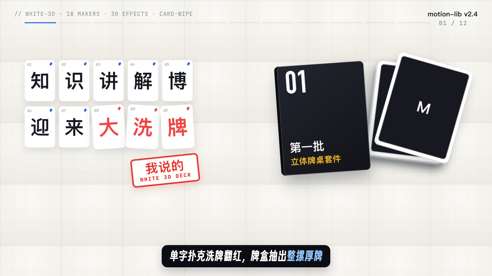

<div align="center">


<br />

**简体中文** · [繁體中文](README.zh-TW.md) · [English](README.en.md) · [日本語](README.ja.md)

[](LICENSE)
[](#动效目录153-种动效--20-种转场)
[](#转场20)
[](#1-真-3d-二次元口播角色fx-vrmjs)
[](#🚀-快速开始)
[](https://hrouter.net/)

[快速开始](#-快速开始) · [主题画廊](#-主题与-3d-示例画廊) · [AI 批量出片](#-ai-批量生成视频工作流) · [核心写法](#-核心写法) · [2D 软骨骼 & 3D VRM](#-进阶视觉与角色模块) · [动效全目录](#动效目录153-种动效--20-种转场)

</div>

---

<!-- HROUTER SPONSOR BANNER -->
<div align="center">
  <a href="https://hrouter.net/" target="_blank" rel="noopener">
    
  </a>
</div>

> ⚡ **官方算力合作伙伴 [HRouter](https://hrouter.net/)**：**一把 API Key 直连 Claude / GPT / Gemini / Grok**。无需分别订阅昂贵月费，余额实时到账、消费逐笔可查、用多少付多少。原生兼容 **[Claude Code](https://hrouter.net/docs/claude-code/)**、**[Codex](https://hrouter.net/docs/codex/)**、**[Gemini CLI](https://hrouter.net/docs/gemini-cli/)**, **[DeepSeek](https://hrouter.net/docs/deepseek/)** 与生图生视频 API —— 让大模型一句话直接写出 `data-fx` 分镜，全自动批量出片！👉 **[官网 hrouter.net](https://hrouter.net/)** · **[模型与实时价格](https://hrouter.net/models/)** · **[四步接入教程](https://hrouter.net/docs/index/)**

---

## 🎬 实机效果预览

**HTML → 视频的声明式动效库。** 在普通 DOM 元素上写一行 `data-fx="动效名@秒数"`，就能做出知识口播、科技解说、数据榜单、深空粒子与真 3D 二次元角色视频，再用 [HyperFrames](https://hyperframes.heygen.com) 逐帧确定性渲染成 1080p / 60fps MP4。

<div align="center">
  <a href="promo/motion-lib-promo.mp4">
    
  </a>
  <p>
    <sub>▲ 实机渲染预览（点击查看完整高清宣传片 <a href="promo/motion-lib-promo.mp4"><code>promo/motion-lib-promo.mp4</code></a> · 源码 <a href="promo/index.html"><code>promo/index.html</code></a> · 六片合集 <a href="examples/showreel.mp4"><code>examples/showreel.mp4</code></a>）</sub>
  </p>
</div>

<!-- STATS:START -->
| | 数量 |
|---|---|
| 动效 | **251** 种（入场 26 · 退场 10 · 强调 41 · 文字 9 · 数据 7 · 镜头 14 · 角色 25 · 剪纸 10 · 粒子 8 · 3D 12 · 立体 34 · 空间 21 · 舞台 10 · 手绘 5 · 对话 8 · 图解 3 · 形状 3 · 声音 1 · 组件 4） |
| 转场 | **24** 种 |
| 组件生成器 | **60** 个（`bars` `wave` `steps` `chapters` `ring` `wall` `dust` `line` `pixels` `circle-text` `retro-grid` `papercut` `hills` `torn` `switches` `space` `stage3d` `tunnel` `helix` `flipboard` `fan` `slices` `road` `bignum` `segments` `actor` `puppet` `backdrop` `device` `menu` `mini` `house` `letterbox` `chat` `terminal` `code` `agent` `surround` `hub` `shape` `phone3d` `card3d` `box3d` `layers3d` `deck3d` `wall3d` `flap3d` `letterdeck` `sleeve3d` `carousel3d` `slabs3d` `coins3d` `timeline3d` `paperstack` `callouts3d` `youarehere` `calgrid3d` `ctabar` `steplist3d` `blueprint3d`） |
| 皮肤 | **7** 套（白紫科技 · 黑金电影 · 像素复古 · 剪纸拼贴 · 深空粒子 · 演播室 · 白底立体） |
<!-- STATS:END -->

<details open>
<summary><b>✨ 版本更新亮点（v1.4 全新升级：真 3D VRM 口播角色 + 2D 软管骨骼 IK + 12 种新特效/转场）</b></summary>
<br />

- **v2.4 新增（白底立体全系套件：18 组件 + 30 动效 + 巨卡转场）**：可选模块 [`fx-desk3d.js`](fx-desk3d.js) + 第 7 套皮肤 `theme-white3d`（默认**纯白无影棚**，加 `.desk` 切换为随相机视差平移的**白格立体牌桌**）——完整覆盖单字扑克牌阵（`letterdeck`）、牌盒抽牌（`sleeve3d`）、双面厚卡（`card3d`）、台面拍立得连切轮播（`carousel3d`）、马蹄弧厚牌堆（`deck3d`）、六面体包装盒（`box3d`）、3D 厚石碑撞碎（`slabs3d`）、立体金币弹跳（`coins3d`）、三维爆炸分层（`layers3d`）、面板仰倒变时间轴（`timeline3d`）、白纸叠高衰减（`paperstack`）、四角取景引线组（`callouts3d`）、全片路标游标（`youarehere`）、倾斜卡片墙（`wall3d`）、真厚度 3D 手机群（`phone3d` + 居中分身 / 屏幕局部剥离 / 波浪列队 / 聊天气泡破框弹出）、机械翻牌格（`flap3d`）、30 天日历翻牌狂飙（`calgrid3d`）、拟物交互胶囊爆彩带（`ctabar`）、白黑桌面反相（`desk-invert`）与 `card-wipe` 3D 巨卡贴脸擦镜转场（见 [`examples/white3d/`](examples/white3d/index.html)）。
- **v2.3 新增**：立绘眨眼可以用一张闭眼图——每个姿势多给一张 `<src>_blink.png`，写 `data-lid="1"`（脚本接口里姿势写 `lid: true`），眨眼时在眼睛的位置直接换成闭眼图，比把眼睛压扁更适合精细的厚涂画风。
- **v2.2 新增（立体感）**：场景背景写 `data-depth`（室内标后墙、户外标地平线，或给一张深度图），镜头一动近处比远处移得多、推近时放大得多（WebGL 景深视差）；一镜到底的楼外全景转成 3/4 视角，道具朝镜头微转，角色成为最近的一层。
- **v2.1 新增（GSAP 免费插件 + 卡点）**：可选模块 [`fx-shape.js`](fx-shape.js)（图形变形、沿路径运动、弹性摇摆）和榜单换名次 `reorder`；`FX.snapBeat` 卡点，一镜到底的换场和推进自动对拍；黑金电影皮肤的舞台道具样式。
- **v2.0 新增（讲 AI 的零件）**：三个可选模块 [`fx-ink.js`](fx-ink.js)（手绘批注）、[`fx-chat.js`](fx-chat.js)（聊天窗、输入框打字、终端、代码 diff、Agent 光标）、[`fx-diagram.js`](fx-diagram.js)（包围、信息过载、中心辐射），舞台模块新增像素抖动、扫光、漏光，共 19 个动效、6 个组件。节奏和算法参考了 [HyperFrames 组件库](https://github.com/heygen-com/hyperframes)（Apache-2.0）。
- **v1.9 新增（一镜到底）**：可选模块 [`fx-oner.js`](fx-oner.js)——所有场景是同一栋楼里的房间，**整条片子是一个不剪的长镜头**：从楼外推进第一个房间，横移穿墙、升降穿楼板走到下一间，中途推进墙上的照片再拉出来，最后拉回楼外。带方向性运动模糊、道具与房间之间的视差、电影黑边。新增 `cam` / `shot` / `push-into` 三个镜头动效和 `house` / `letterbox` 两个组件；核心新增 `FX.onFrame`（每帧所有补间更新之后的收尾回调）。
- **v1.8 新增（声音与氛围）**：可选模块 [`fx-sound.js`](fx-sound.js)——**每个动效自带声音**（弹出「啵」、落地「咚」、划入「唰」、转场「哗」、打字「哒哒」），27 种音效、4 套音色全部用代码合成，不带任何音频文件；`node sfx.mjs <工程>` 按动效的触发时间生成一条音效轨。场景背景（`backdrop`）新增**氛围层**：调色暗角、移轴景深、会呼吸的光源、天气粒子（灰尘 / 雨 / 雪 / 萤火虫 / 火星 / 星星 / 光柱），一张静止的背景图就活了。自检新增「阅读时间」规则。这一版的思路参考了 [Lemo-Opuscar](https://github.com/lemomo-ai/lemo-opuscar)（MIT）。
- **v1.5 新增（空间镜头）**：可选模块 [`fx-world.js`](fx-world.js)——根元素写一个 `data-world`，所有分镜就摆到同一块大画布上，**换分镜 = 镜头斜着推过去**，不再一页页翻。附带 21 个新动效（原位放大、背景虚化、景深移焦、发牌入场、骨架填充、纵深穿梭、环筒螺旋、三维翻转、放大让位、切片换图、走进画面……）、7 个新组件、第 6 套皮肤 `theme-studio`，以及页面自检 `FX.lint()`（网址加 `?lint`：字太小、镜头到位时空屏、文字出画都能查出来）。
- **v1.4 新增（3D 角色 & 2D 软骨骼 & 科技转场）**：
  - **真 3D 二次元角色模块 [`fx-vrm.js`](fx-vrm.js)**：基于 `@pixiv/three-vrm`（MIT），内置解析式双骨 3D IK 求解器 `FX.ik3d`、跨模型身高/臂展自动重定向、6 节脊柱相位波、锁骨自动联动、13 套口播姿态、C¹ 五元音口型同步（`aa/ih/ou/ee/oh`）、MToon 赛璐璐描边、2× 超采样抗锯齿与连续 60Hz `SpringBone` 头发/裙摆物理；仓库自带两套 Pixiv 官方 **CC0 公共领域**模型 `assets/shino.vrm` 与 `assets/vita.vrm`。
  - **2D 柔性骨骼与连续软袖管模块 [`fx-rig.js`](fx-rig.js)**：通用双骨 IK `FX.ik2` + RubberHose 连续贝塞尔无接缝软蒙皮 `FX.hose` + 声明式 `[data-bone]` / `[data-follow]` / `[data-hose]`，适用于任意自定义 SVG 角色，彻底告别木偶关节割裂感。
  - **12 种新特效与转场**：新增 6 种转场（`shatter` `diagonal-split` `blinds` `crt-off` `portal-spin` `halftone`）+ 6 种动效（`circuit` `overload` `scan` `callout` `scatter-out` `toggle`）+ `switches` 拨动开关组件。
- **v1.3 新增**：可选真 3D 场景模块 [`fx-3d.js`](fx-3d.js)（星系、能量球、隧道、黑洞、城市沿街飞行、点阵球、立体粒子字等 12 个 WebGL 动效，带 Bloom 辉光与可编程摄像机 `cam3d` / `orbit3d`）。
- **v1.2 新增**：可选 Canvas 2D 粒子模块 [`fx-particles.js`](fx-particles.js)（8 个粒子动效）+ 第 5 套皮肤 `theme-space`（深空粒子）。
- **v1.1 新增**：40 种动效 + 4 个转场 + 5 个组件生成器 + 「文字」「剪纸」两大分类 + 第 4 套皮肤 `theme-paper`（剪纸拼贴）。

</details>

---

## 💡 为什么要用它（架构原理）

用 HTML 做视频，难的从来不是排版，而是**可复现的时间控制**：

- **无头渲染器是「跳到第 N 帧 → 截图」**：原生 CSS `animation`、`setTimeout`、`Math.random()` 不受帧时钟控制，多进程并发截帧时要么静止不动，要么每次渲染对不上。
- **手写 GSAP 时间线极度繁琐**：一条一分钟的口播片要手动计算几百个绝对秒数，改一句配音全片重算。

<div align="center">
  
</div>

`motion-lib` 把所有 DOM、Canvas 粒子、WebGL 3D 镜头与 VRM 骨骼物理统一编排进**唯一一条暂停的 GSAP 主时间线**，你只需在元素上声明「什么动效、第几秒」：

```html
<h1 data-fx="blur-rise-in@0.2">做热点最难的是什么？</h1>
<b  data-fx="count@0.6 marker@1.6">7,000</b>
<ul data-fx="each:pop-in@1(stagger=0.1)"> <li>芯片</li><li>算力</li><li>大模型</li> </ul>
```

- 🎯 **任意帧精准可 Seek**：跳到任意第 `N` 帧，DOM、粒子、3D 摄像机与头发物理均与顺序播放完全一致，多核并行渲染零闪烁。
- 🎲 **带种子可复现随机**：粒子、乱码、波形、眨眼一律走确定性伪随机 `FX.rand(seed)`，同一帧渲染一百次逐字节相同。
- 📦 **100% 离线自包含**：GSAP、three.js、three-vrm、四款商用免费字体与 CC0 示例模型全部打包在库内，渲染不依赖任何外网请求。
- ⚡ **零构建零配置**：直接引入 `.js` 与 `.css` 即可在浏览器按空格实时预览，无需 npm 打包或 Webpack/Vite。

---

## 🎨 主题与 3D 示例画廊

五套内建视觉皮肤 + 真 3D 场景各附有一条完整示例成片与源码，改几行文案就能直接出片：

<table>
  <tr>
    <td width="33%" align="center">
      <a href="examples/violet/violet.mp4"></a><br />
      <b>白紫科技</b> <code>theme-violet</code><br />
      <sub><a href="examples/violet/violet.mp4">▶ 观看成片</a> · <a href="examples/violet/index.html">查看源码</a></sub>
    </td>
    <td width="33%" align="center">
      <a href="examples/gold/gold.mp4"></a><br />
      <b>黑金电影</b> <code>theme-gold</code><br />
      <sub><a href="examples/gold/gold.mp4">▶ 观看成片</a> · <a href="examples/gold/index.html">查看源码</a></sub>
    </td>
    <td width="33%" align="center">
      <a href="examples/pixel/pixel.mp4"></a><br />
      <b>像素复古</b> <code>theme-pixel</code><br />
      <sub><a href="examples/pixel/pixel.mp4">▶ 观看成片</a> · <a href="examples/pixel/index.html">查看源码</a></sub>
    </td>
  </tr>
  <tr>
    <td width="33%" align="center">
      <a href="examples/paper/paper.mp4"></a><br />
      <b>剪纸拼贴</b> <code>theme-paper</code><br />
      <sub><a href="examples/paper/paper.mp4">▶ 观看成片</a> · <a href="examples/paper/index.html">查看源码</a></sub>
    </td>
    <td width="33%" align="center">
      <a href="examples/space/space.mp4"></a><br />
      <b>深空粒子</b> <code>theme-space</code><br />
      <sub><a href="examples/space/space.mp4">▶ 观看成片</a> · <a href="examples/space/index.html">查看源码</a></sub>
    </td>
    <td width="33%" align="center">
      <a href="examples/three/three.mp4"></a><br />
      <b>真 3D 场景</b> <code>fx-3d.js</code><br />
      <sub><a href="examples/three/three.mp4">▶ 观看成片</a> · <a href="examples/three/index.html">查看源码</a></sub>
    </td>
  </tr>
  <tr>
    <td width="33%" align="center">
      <a href="examples/white3d/white3d.mp4"></a><br />
      <b>白底立体</b> <code>theme-white3d</code><br />
      <sub><a href="examples/white3d/white3d.mp4">▶ 观看成片</a> · <a href="examples/white3d/index.html">查看源码</a></sub>
    </td>
    <td width="33%" align="center">
      <a href="examples/world/world.mp4"></a><br />
      <b>空间镜头</b> <code>theme-studio</code><br />
      <sub><a href="examples/world/world.mp4">▶ 观看成片</a> · <a href="examples/world/index.html">查看源码</a></sub>
    </td>
    <td width="33%" align="center">
      <a href="examples/kit/kit.mp4"></a><br />
      <b>AI 讲解套件</b> <code>fx-chat / fx-ink</code><br />
      <sub><a href="examples/kit/kit.mp4">▶ 观看成片</a> · <a href="examples/kit/index.html">查看源码</a></sub>
    </td>
  </tr>
</table>

---

## 📂 仓库目录结构

```text
motion-lib/
├── fx.js            核心引擎：动效调度、转场、组件生成器、字幕系统、浏览器预览器
├── fx.css           排版系统、UI 组件样式、五套主题皮肤 CSS 变量
├── fx-particles.js  可选模块：Canvas 2D 粒子（星空、星云、旋涡、黑洞、爆炸、粒子聚字）
├── fx-3d.js         可选模块：WebGL 真 3D 舞台、Bloom 辉光、动漫打光、可编程摄像机
├── fx-rig.js        可选模块：2D 双骨 IK（FX.ik2）与连续贝塞尔软袖管蒙皮（FX.hose）
├── fx-vrm.js        可选模块：真 3D VRM 角色（FX.ik3d 解析解 IK、五元音口型、60Hz 头发物理）
├── fx-world.js      可选模块：世界画布 + 相机运镜 + 图片组动效（换分镜 = 镜头走过去）
├── fx-puppet.js     可选模块：立绘木偶（眨眼、呼吸、对口型）+ 演员走位（角色跟着内容走）
├── fx-stage.js      可选模块：舞台剧（场景背景、马赛克换场、设备屏画中画、插画特写、小演员）
├── fx-oner.js       可选模块：一镜到底（一栋楼的剖面 + 推进 / 横移穿墙 / 升降穿楼板 / 推进画里，全程不剪）
├── fx-ink.js        可选模块：手绘批注（圈、划、框、箭头、Vox 式马克笔注释，线条会沸腾）
├── fx-chat.js       可选模块：AI 聊天窗、输入框打字、终端、代码 diff、Agent 光标
├── fx-diagram.js    可选模块：包围、信息过载、中心辐射
├── fx-shape.js      可选模块：图形变形、沿路径运动、弹性摇摆（用 vendor/gsap-plugins/ 里的 GSAP 免费插件）
├── fx-desk3d.js     可选模块：白底立体影棚与白格牌桌（真厚度 3D 手机、双面扑克、六面体盒、爆炸分层、机械翻牌）
├── fx-sound.js      可选模块：音效层（每个动效自带声音，27 种音效 × 4 套音色，纯代码合成）
├── sfx.mjs          生成音效轨：node sfx.mjs <工程目录> → audio/sfx.wav
├── assets/          内置 CC0 1.0 公共领域 3D VRM 示例角色（shino.vrm、vita.vrm）
├── fonts/           优设标题黑、得意黑、Fusion Pixel 像素体、站酷快乐体（许可见 fonts/README.md）
├── vendor/          GSAP 3.15（gsap-plugins/：MorphSVG、MotionPath、CustomEase、CustomWiggle）、three.js r187（three-fx.min.js）、@pixiv/three-vrm 3.5（three-vrm.min.js）
├── new-project.sh   一键将运行库安装/同步到任意视频项目目录（./new-project.sh my-video）
├── chrome-tall.sh   无头渲染 Chrome 视口包装器（防止成片底部字幕被裁切）
├── gen-readme.mjs   从源码自动提取并同步四语种 README 统计表与全量动效目录
├── demo/            入门演示工程（6 个分镜串联多套皮肤）
├── promo/           官方宣传片源码与成片
└── examples/        五套皮肤完整示例片 + 真 3D 场景示例片 + 六片合集 showreel
```

---

## 🚀 快速开始

### 环境要求
- **Node.js 18+**（运行 `npx hyperframes`，首次执行会自动拉取 CLI）
- **FFmpeg**
- **Google Chrome**（macOS 默认路径自动识别；其他路径可设环境变量 `REAL_CHROME`）

### 1. 初始化视频项目

```bash
mkdir my-video
./new-project.sh my-video        # 自动将 fx*.js / fx.css / 字体 / vendor / CC0 模型同步到 my-video/lib/
```

> 💡 HyperFrames 安全沙箱仅读取项目目录内的静态资源，因此运行库采用**拷入 `lib/`** 的方式而非 `../` 跨目录引用。升级 `motion-lib` 后，对已有项目重跑一次 `./new-project.sh my-video` 即可无损热更新（仓库自带的 `demo/` 与 `promo/` 首次预览前也请先执行一次）。

### 2. 编写分镜 `my-video/index.html`

```html
<!doctype html>
<html lang="zh">
<head>
  <meta charset="UTF-8">
  <link rel="stylesheet" href="lib/fx.css">
  <script src="lib/vendor/gsap.min.js"></script>
  <script src="lib/fx.js"></script>
</head>
<body>
<div id="root" class="theme-violet" data-composition-id="main" data-width="1920" data-height="1080" data-fps="60">

  <section class="scene dark center" data-d="3.5">
    <h1 class="t-title" data-fx="mask-rise@0.2">全自动剪辑 <span class="accent">Skill</span></h1>
    <p class="t-body" data-fx="rise-in@0.6 marker@1.4">看完这期，你也可以</p>
  </section>

  <section class="scene light" data-d="4" data-in="blur-cross">
    <div class="abs" style="left:200px;top:300px;width:1200px;height:400px"
         data-make="bars" data-values="3,8,21,40,26,12" data-hi="4"
         data-fx="each:grow-y@0.3(stagger=0.05)"></div>
  </section>

</div>
<script>
  FX.subtitles([
    [0.2, 3.4, '看完这期，你也可以'],
    [3.5, 7.4, '播放集中在{开播后}几小时']
  ], { style: 'pill' });
  FX.build();
</script>
</body>
</html>
```

### 3. 浏览器实时预览、抽帧检查与导出 MP4

```bash
cd my-video
open "index.html?play"                       # 浏览器预览：空格播放/暂停，←/→ 逐帧微调，↑/↓ 跳分镜
npx hyperframes snapshot --at 1,3,5          # 秒级抽帧截图检查排版
HYPERFRAMES_BROWSER_PATH="$PWD/lib/chrome-tall.sh" \
  npx hyperframes render -o out.mp4 --experimental-fast-capture=false
```

> ⚠️ **出片必带 `chrome-tall.sh`**：桌面版 Chrome 在无头模式下可视视口比窗口高度矮约 90px，直接渲染会导致底部字幕被截断；`chrome-tall.sh` 会自动补偿视口高度。

---

## 🤖 AI 批量生成视频工作流

`motion-lib` 的声明式语法（一个 HTML 文件 = 完整分镜 + 排版 + 动效时间轴 + 角色口型）专为 **AI Coding Agent 批量产片**而设计——无需让大模型编写脆弱的复杂 JS 动画逻辑，只需让 AI 读取本仓库的动效表即可一次性直出高质量视频源码。

推荐使用 **[HRouter (hrouter.net)](https://hrouter.net/)** 一把 API Key 接入 **Claude Code / Codex / Gemini CLI**，按量付费驱动自动化视频流水线：

```bash
# 1. 在 https://hrouter.net 创建 API Key，两行配置接入 Claude Code
export ANTHROPIC_BASE_URL="https://hrouter.net"
export ANTHROPIC_AUTH_TOKEN="sk-你的-HRouter-Key"

# 2. 让 AI 直接基于 motion-lib 批量生成分镜并渲染成片
claude "参考 motion-lib/README.md 的动效目录和 fx-vrm.js，把 script.md 改写成 60fps 口播视频 index.html 并渲染 MP4"
```

---

## 📐 核心写法

### 场景 `<section class="scene">`

一个 `<section class="scene">` 就是一个独立镜头，默认按书写顺序首尾相接：

| 写法 | 含义 |
|---|---|
| `data-d="4"` | 当前场景持续 4 秒 |
| `data-t="12.5"` | 显式指定开始秒数（省略则自动紧接上一幕结尾） |
| `data-in="blur-cross(dur=0.5)"` | 进入本场景时的转场效果，详见文末「转场」目录 |
| `class="scene dark"` / `"scene light"` | 单个场景切换深色 / 浅色背景 |
| `class="scene overlay"` | 全局叠加层：不占顺序时长，与其他分镜同时显示（常驻 3D 主持人、角标、章节条） |

根容器 `#root` 需声明 `data-composition-id="main"`、`data-width`、`data-height`（可选 `data-fps="60"`），全片总时长自动求和。

### 动效声明 `data-fx="[目标:]名字@时间(参数)"`

同一个元素可串联任意多个动效，以空格分隔：`data-fx="rise-in@0.2 pulse@1.5 fade-out@-0.3"`。

| 组成 | 写法 | 含义 |
|---|---|---|
| **时间** | `@1.2` | 场景开始后 1.2 秒触发 |
| | `@+0.3` | 比同一元素上的前一个动效晚 0.3 秒触发 |
| | `@-0.4` | 场景结束前 0.4 秒触发（专为退场动效设计） |
| **目标** | （省略） | 作用在当前元素自身 |
| | `each:` | 作用在每个直接子元素并自动错峰（卡片组、清单、柱状图） |
| | `chars:` / `words:` / `lines:` | 自动拆分为单字 / 单词 / 行（按 `<br>`）并逐个动画 |
| **参数** | `dur=0.8` | 动效时长（秒） |
| | `ease=spring` | 缓动曲线别名或原生 GSAP 缓动名（见下表） |
| | `stagger=0.1` | 子元素错峰间隔秒数（配合 `each:` / `chars:`） |
| | `order=center` | 错峰推进顺序：`start` `end` `center` `edges` `random` |

<details>
<summary><b>查看全部 12 种内置缓动别名（Easing Aliases）</b></summary>
<br />

| 别名 | 等价 GSAP 曲线 | 运动手感与适用场景 |
|---|---|---|
| `out`（默认） | `power3.out` | 急起缓停，最自然的通用入场曲线 |
| `soft` | `power2.out` | 轻柔克制 |
| `snap` | `expo.out` | 极快冲刺到位后细腻停稳，科技感强 |
| `sharp` | `power4.out` | 比 `out` 更干脆利落 |
| `inout` | `power3.inOut` | 两头慢中间快，适合摄像机推拉摇移 |
| `in` | `power2.in` | 加速离开，适合退场 |
| `spring` | `back.out(1.7)` | 轻微过冲回弹，灵动不夸张 |
| `bounce` | `back.out(2.8)` | 明显Q弹过冲 |
| `elastic` | `elastic.out(1,0.55)` | 弹簧振荡回正 |
| `drop` | `bounce.out` | 重力落地弹跳 |
| `linear` | `none` | 严格匀速（持续旋转、跑马灯、背景滚动） |
| `pixel` | `steps(5)` | 阶梯定格跳变（像素复古风） |

</details>

### 组件生成器 `data-make="名字"`（17 个）

把重复繁琐的图表、装饰与画布 DOM 交给库生成，再直接挂 `data-fx` 驱动动画：

| 名字 | 属性配置 | 最佳搭档动效 | 用途说明 |
|---|---|---|---|
| `bars` | `data-values` `data-labels` `data-hi="2,3"` `data-max` | `each:grow-y` | 柱状图 / 直方图（支持高亮指定柱） |
| `line` | `data-values` `data-w` `data-h` `data-smooth` | `draw` | 折线图 / 平滑贝塞尔趋势曲线 |
| `ring` | `data-size` `data-stroke` `data-dash` | `ring(to=0.7)` | 圆环进度条、占比环、倒计时 |
| `wave` | `data-n` `data-seed` | `each:grow-y`、`wave-live` | 音频声波条 |
| `steps` | `data-labels="选题,写稿,配音"` | `step(i=2)` | 流程步骤胶囊导航 |
| `chapters` | `data-labels` | `chapter(i=3)` | 画面顶部常驻章节进度条 |
| `switches` | `data-labels="联网,记忆,工具"` `data-on="1,3"` | `toggle(i=2,on=1)` | iOS 风拨动开关列表（支持 `i=1/2/3` 批量联动） |
| `pixels` | `data-text="SKILL?"` `data-size` `data-colors` | `each:pixel-in(order=random)` | 5×7 点阵像素拼字 |
| `wall` | `data-cols` `data-rows` `data-seed` | `drift` | 景深背景卡片墙 |
| `dust` | `data-n` `data-seed` | `drift`、`float` | 氛围悬浮微粒 |
| `circle-text` | `data-text` `data-r`（半径） | `spin` | 环形旋转文字徽章、印章 |
| `retro-grid` | `data-cell` `data-color` `data-angle` | `bg-scroll` | 复古合成波透视流动网格 |
| `papercut` | `data-size` `data-fold`（6/8/12）`data-shape` `data-color` `data-seed` | `cut-in`、`spin`、`jitter` | 对称剪纸窗花（每个 `seed` 图案唯一） |
| `hills` | `data-layers` `data-colors` `data-seed` | `layer-rise`、`parallax` | 多层剪纸视差远山 |
| `torn` | `data-edges` `data-depth` `data-teeth` `data-seed` | `stick-on`、`rise-in` | 毛边撕纸裁切（需投影时外包 `.fx-torn-shadow`） |
| `space` | 在 `data-fx` 中串联粒子动效（需 `fx-particles.js`） | `nebula` `starfield` `vortex` `form-text` 等 | Canvas 2D 多层粒子画布容器 |
| `stage3d` | `data-bloom` `data-alpha` `data-light` `data-cam` `data-look` `data-fog` | `galaxy3d` `city3d` `cam3d` `vrm3d` 等 | WebGL 真 3D 舞台（支持透明叠加层与动漫打光） |

### 字幕系统 `FX.subtitles()`

```js
FX.subtitles([
  [0.2, 3.4, '普通台词，{花括号}里的重点词自动染成主题强调色'],
], { style: 'pill', pop: false });
```

内置 4 种字幕样式：`pill`（黑底圆角胶囊，配 `theme-violet`）、`bar`（半透明黑带，配 `theme-pixel`）、`plain`（无底描影白字，配 `theme-gold` / `theme-space`）、`paper`（米色毛边纸条，配 `theme-paper`）。设 `pop: true` 可开启轻柔上浮入场。

---

## 🌟 进阶视觉与角色模块

### 0. 世界画布与相机（`fx-world.js`，v1.5 新增）

「一个分镜一页、轮流显示」的片子看起来像翻 PPT。加载 `fx-world.js` 并在根元素写上 `data-world` 之后，所有分镜变成**同一块大画布上的机位**：换分镜时镜头斜着推过去（先往后拉一点再推进，0.8 秒），停留时也在缓慢往前推。分镜原来的写法完全不用改。

```html
<script src="lib/fx.js"></script>
<script src="lib/fx-world.js"></script>

<div id="root" class="theme-studio" data-composition-id="main" data-width="1920" data-height="1080"
     data-world="snake" data-cols="4" data-wall="MOTION">
  <section class="scene center" data-d="4.6" data-fx="cam-wide@0 cam-home@1.5">…</section>
  <section class="scene" data-d="5.2">
    <div class="abs" style="left:160px;top:260px;width:1600px;height:560px" data-make="fan"
         data-fx="pick@0.8(i=2) pick@2.1(i=3)">
        
    </div>
  </section>
</div>
```

| 写在哪 | 写法 | 作用 |
|---|---|---|
| 根元素 | `data-world="snake\|row\|depth"` | 机位蛇形排开 / 一字排开 / 沿纵深排开（镜头往里穿） |
| 根元素 | `data-cols` `data-wall` `data-tilt` `data-travel` `data-drift` | 每行几个机位、背景字墙、机位倾角、换机位用时、停留时的推进速度 |
| 分镜 | `data-in="cam-jump"` | 这一次硬切（默认是 `cam-to` 运镜，不用写） |
| 元素 | `cam-look@t` / `cam-home@t` / `cam-wide@t` | 镜头推到某个元素 / 拉回 / 拉远看整块画布 |
| 元素 | `wake` `zoom-here` `push-back` `depth` `rack-focus` `bg-tint` | 先摆后讲、原位放大、背景虚化、景深分层、移焦、背景换色 |
| 图片组 | `deal-in` `skeleton` `drop-gather` · `tunnel`+`fly` · `helix`+`helix-spin` · `flipboard`+`flip-to` · `fan`+`pick` · `slices`+`slice-to` · `road`+`road-walk` | 出场 / 排布 / 切换 / 流程的 9 种做法 |

完整示例：[`examples/world/`](examples/world/index.html)（[▶ 成片](examples/world/world.mp4)）。

**页面自检**：浏览器打开 `index.html?lint`（或在控制台调 `FX.lint()`），库会逐个分镜跳到「镜头到位」和「后段」两个时刻，按真实排版报告：字小于 32px、到位时画面是空的、文字出画或互相压住、被字幕压住、有没有真素材。结果同时写进 `<script id="fx-lint">`，方便命令行工具读取。

### 0.5 立绘木偶与演员走位（`fx-puppet.js`，v1.6 新增）

每个姿势只要 3 张图（闭嘴 / 半张 / 张大），不用分层、不用骨骼，立绘就能**眨眼、呼吸、摆头、对口型、点头、倾身**，头顶还能弹出手绘情绪符号（不用 emoji，各台机器渲染一致）。眨眼是把眼睛区域纵向压成一条线算出来的，只需要告诉它两只眼睛在哪。

演员声明一次放在常驻层里；**讲到画面里的哪个元素，就在那个元素上写 `call`**，演员会在原地蹲下、从那个元素旁边重新冒出来——角色跟着内容走，而不是钉在角落。要把整块画面让给内容时写 `dismiss`。

```html
<script src="lib/fx-puppet.js"></script>

<section class="scene" data-d="7.4" data-fx="pup-talk@0.3(who=bot,dur=6.8)">
  <div class="shot" data-fx="call@0.2(who=bot)"></div>              <!-- 从这张图上沿探出来 -->
  <div class="shot" data-fx="call@2.6(who=bot) pup-emote@3(who=bot,kind=idea)"></div>
</section>
<section class="scene overlay" data-t="0" data-d="19">
  <div data-make="actor" data-name="bot" data-src="assets/bot" data-eyes="238,236,64,76/362,236,64,76" data-neck="300,400" data-home="80,0,460"></div>
</section>
```

`data-src` 是不带后缀的路径（库会读 `_m0.png` / `_m1.png` / `_m2.png`），`data-eyes` 是两只眼睛的「中心 x, 中心 y, 宽, 高」，`data-neck` 是脖子位置，单位都是原图像素。多姿势、按配音时间轴编排用脚本接口 `FX.actor()` / `FX.puppet()`（见 `fx-puppet.js` 文件头）。完整示例：[`examples/puppet/`](examples/puppet/index.html)（[▶ 成片](examples/puppet/puppet.mp4)），示例里的小机器人是仓库原创素材（`assets/puppet/`）。

### 0.6 舞台剧：主持人 + 场景 + 画中画（`fx-stage.js`，v1.7 新增）

另一种常见的片型：**主持人半身立绘常驻前景，背景是一个个场景，信息用画中画给，隔一会儿切一张全屏插画**。分镜之间硬切，换场景用马赛克，主持人每句话换一次姿势，所以画面每 2–3 秒必有变化。不写 `data-world` 时使用。

```html
<script src="lib/fx-puppet.js"></script>
<script src="lib/fx-stage.js"></script>

<div id="root" class="theme-pixel" data-composition-id="main" data-width="1920" data-height="1080" data-mode="stage">
  <section class="scene" data-d="6.4" data-fx="call@0(who=bot) pup-talk@0.3(who=bot,dur=5.4) pup-pose@3(who=bot,pose=point)">
    <div class="abs" style="left:700px;top:230px;width:960px;height:620px" data-make="device" data-kind="laptop"
         data-fx="screen-to@1.6 screen-to@3.0 dive@5.9">
      <div data-make="backdrop" data-kind="field"></div>
    </div>
  </section>
  <section class="scene" data-d="7.2" data-fx="pup-pose@1.6(who=bot,pose=think)">
    <div data-make="backdrop" data-kind="field"></div>
    <div class="abs" style="left:1940px;top:508px;width:200px;height:250px" data-make="mini" data-src="lib/assets/puppet/mini" data-fx="mini-walk@0.3(x=-700)"></div>
    
  </section>
  <section class="scene" data-d="7" data-in="mosaic"> … </section>
  <section class="scene overlay" data-t="0" data-d="20.6">
    <div data-make="actor" data-name="bot" data-src="lib/assets/puppet/bot" data-poses="wave/point/think/cheer"
         data-eyes="238,236,64,76/362,236,64,76" data-neck="300,400" data-home="-10,0,640"></div>
  </section>
</div>
```

| 零件 | 写法 | 作用 |
|---|---|---|
| 场景背景 | `data-make="backdrop"` | `data-src` 用图片；不写就按 `data-kind="field\|room\|city\|night"` 程序画一张像素场景，不需要素材 |
| 场景氛围 | `data-grade` `data-focus` `data-lights` `data-weather`（写在 backdrop 上） | 调色 + 暗角、移轴景深、会呼吸的光源、天气粒子，背景不再是一张死图 |
| 换场 | `data-in="mosaic"` | 纸色方块盖满再揭开，主持人不会被盖住 |
| 设备屏 | `data-make="device"` + `screen-to` / `dive` | 笔记本 / 手机 / 窗口里放内容；屏内硬切；钻进屏幕铺满全屏 |
| 序列帧 | `frames@0(fps=20)` | 把一串截图当视频播（实机录屏） |
| 插画特写 | `cutaway@t(dur=1.8)` | 全屏插画硬切进来、慢推、硬切回去 |
| 选择面板 | `data-make="menu"` + `choose` | 高亮条跳到某一项并打勾 |
| 小演员 | `data-make="mini"` + `mini-walk` / `mini-pose` | 全身小人两帧步态走过去、换动作 |
| 主持人换姿势 | `pup-pose@t(who=bot,pose=point)` | 硬切，换的瞬间自动眨眼 |

**场景氛围**：一张静止的背景放几秒就「死」了。在 `backdrop` 上加四个属性，背景就有了光、空气和远近（全部按时间线秒数计算，可以跳帧渲染）：

```html
<div data-make="backdrop" data-src="office.jpg" data-focus="tilt" data-grade="warm" data-weather="dust rays"
     data-lights="684,480,#ffc860,270; 1224,516,#9fd8ff,210,slow"></div>
```

| 属性 | 取值 |
|---|---|
| `data-focus` | `tilt` 移轴景深（上下两条虚、中间实）；写数字是模糊像素数 |
| `data-grade` | `warm` `cool` `dusk` `night` `neon` 调色 + 暗角；`plain` 只要暗角 |
| `data-weather` | `dust` 灰尘 · `rays` 光柱 · `rain` 雨 · `snow` 雪 · `fireflies` 萤火虫 · `embers` 火星 · `stars` 星星，可以写多个 |
| `data-lights` | `x,y,颜色,半径` 一团会呼吸的光，分号隔开；末尾加 `,slow` 是屏幕 / 窗户那种慢慢起伏的光 |
| `data-depth` | `box:x0,y0,x1,y1`（室内：后墙在图里的矩形，原图像素）、`ground:y`（户外：地平线高度）或一张深度图（白近黑远）。镜头一动，近处的地板、墙、家具比后墙移得多、推近时放大得多，一张平面的图就有了纵深（WebGL；一镜到底的镜头会自动驱动它） |

完整示例：[`examples/stage/`](examples/stage/index.html)（[▶ 成片](examples/stage/stage.mp4)）。示例里的小机器人（4 个半身姿势、全身小人、一张插画）是仓库原创素材，源文件在 `assets/puppet/src/`。

### 0.7 音效层：每个动效自带声音（`fx-sound.js`，v1.8 新增）

画面再好，没有声音也像默片。加载 `fx-sound.js` 之后，**每个动效按触发时间自动配一个音效**，不用手写时间、不用找素材——声音全部是代码合成的。

```html
<script src="lib/fx-sound.js"></script>

<div data-fx="pop-in@1.2">…</div>                 <!-- 自带「啵」 -->
<div data-fx="drop-bounce@2(sfx=ding)">…</div>    <!-- 换一个声音 -->
<div data-fx="rise-in@3(sfx=none)">…</div>        <!-- 这一次不出声 -->
<div data-fx="sfx@4.5(kind=chime)"></div>         <!-- 画面没动作，单独放一个声音 -->
```

```bash
node lib/sfx.mjs my-video                  # → my-video/audio/sfx.wav（和画面等长的音效轨）
node sfx.mjs --audition out/               # 每套音色导出一条试听文件，所有声音挨个响一遍
```

| 项目 | 说明 |
|---|---|
| 27 种声音 | `pop` `tick` `click` `swish` `whoosh` `thump` `snap` `hit` `ding` `chime` `blip` `rise` `fall` `buzz` `sparkle` `zap` `glitch` `paper` `flap` `card` `rumble` `swellup` `shimmer` `type` `roll` `step` `dots` |
| 4 套音色 | `soft` 干净的界面音（默认）· `pixel` 方波 + 噪声通道的 8-bit 游戏机音色（`theme-pixel` 自动使用）· `cinema` 低沉带空间感（`theme-gold` / `theme-space`）· `paper` 纸和木头（`theme-paper`）。根元素写 `data-sound="pixel"` 可以指定，`data-sound="off"` 整片不要音效 |
| 自动处理 | 一组元素错峰入场时音高逐级上行；同一种声音反复出现时音高轮换；太密的自动删；声音按元素在画面上的左右位置分声道 |
| 预览 | 网址加 `?play`，点播放就能听到 |
| 混音 | 音效轨峰值约 −13 dB，直接垫在配音下面：`ffmpeg -i voice.wav -i audio/sfx.wav -filter_complex "amix=inputs=2:normalize=0" mix.wav` |

### 0.8 一镜到底：一栋楼 + 一台不剪的摄影机（`fx-oner.js`，v1.9 新增）

舞台剧片型的电影感版本：**所有场景是同一栋楼里的房间，整条片子是一个不剪的长镜头**。镜头从楼外推进第一个房间，之后横移穿墙、下降穿楼板走到下一间，中途推进墙上的照片再拉出来，最后拉回楼外和开场呼应。

```html
<script src="lib/fx-oner.js"></script>     <!-- 放在 fx-stage.js 之后、fx-sound.js 之前 -->

<div id="root" class="theme-pixel" data-composition-id="main" data-width="1920" data-height="1080" data-mode="stage">
  <!-- 世界：最前面的一个常驻层，每个 backdrop 是一个房间；data-cell="列,层" 决定房间怎么摆，也就决定了镜头怎么走 -->
  <section class="scene overlay" data-t="0" data-d="60">
    <div data-make="house">
      <div data-make="backdrop" data-cell="0,0" data-src="a.jpg" data-focus="tilt" data-weather="dust"></div>
      <div data-make="backdrop" data-cell="1,0" data-src="b.jpg" data-grade="warm" data-weather="rays"></div>
      <div data-make="backdrop" data-cell="1,1" data-src="c.jpg" data-lights="684,480,#ffc860,270"></div>
    </div>
  </section>
  <!-- 分镜：透明（scene clear），只放道具；data-room 说这一镜在哪个房间 -->
  <section class="scene clear" data-d="7" data-room="all"> … </section>                 <!-- 楼外全景，结束时自动推进 1 号房 -->
  <section class="scene clear" data-d="6" data-room="1" data-fx="cam@2.3(y=-40,z=1.1)"> … </section>
  <section class="scene clear" data-d="6" data-room="2">                                  <!-- 换房间：镜头自己横移穿墙 -->
    
  </section>
  <section class="scene clear" data-d="7" data-room="3" data-fx="shot@5(room=all)"> … </section>   <!-- 下降穿楼板；最后拉回全景 -->
  <section class="scene overlay" data-t="0" data-d="60"><div data-make="letterbox"></div></section>
</div>
```

| 镜头 | 写法 | 作用 |
|---|---|---|
| 换房间 | 分镜上的 `data-room` 变了就自动走 | 全景 → 房间是推进；同一层是横移穿墙；上下层是升降穿楼板。最快的几帧带方向性运动模糊，一截近处的墙贴着镜头扫过 |
| 房间里的小运动 | `cam@t(x=,y=,z=,blur=)` | 平移、推近、虚化背景。道具比房间离镜头近，镜头一动它们动得更多（视差） |
| 推进画里 | `push-into@t(dur=2)` | 一张照片先以相框大小出现，镜头推进去直到铺满全屏，再拉出来——代替「全屏插画硬切」 |
| 中途换机位 | `shot@t(room=all)` | 比如片尾拉回楼外全景 |
| 电影画幅 | `data-make="letterbox"` | 上下黑边；自检会查「文字进了黑边」 |
| 立体感 | 背景写 `data-depth`；其余自动 | 房间背景按透视结构做景深视差；楼外全景时整栋楼转成 3/4 视角慢慢转回；道具像立在空间里的板，镜头往哪看就朝那边微微转过来；角色是最近的一层，镜头平移时移得最多 |
| 一直在动 | 不用写 | 镜头始终有很慢的推近和手持微晃；每个房间的背景在窗框里有浅浅的错位，像看一个立体盒子 |

### 0.9 讲 AI 的零件：手绘批注、AI 对话、代码、图解（v2.0 新增）

讲 AI 的片子里反复出现的画面，按真实软件的节奏做成了零件。节奏数值（消息 0.12 秒从 0.75 倍长出、AI 吐字的间隔表、真人打字一次 1–3 个字、代码删行 0.55 秒 / 加行 0.6 秒、手画线每秒「沸腾」10 次……）参考了 [HyperFrames 组件库](https://github.com/heygen-com/hyperframes)（Apache-2.0），代码按本库的声明式写法重新写过。

```html
<script src="lib/fx-ink.js"></script>       <!-- 手绘批注 -->
<script src="lib/fx-chat.js"></script>      <!-- 聊天窗、输入框、终端、代码、Agent 光标 -->
<script src="lib/fx-diagram.js"></script>   <!-- 包围、过载、中心辐射 -->

<div class="fx-prompt" data-fx="prompt@0.6(fix=周包)">帮我写一份周报</div>          <!-- 先打错再改对 -->
<div data-make="chat" data-title="AI 助手" data-fx="msg@2.9(i=1) typing@3.3(i=2,dur=1.1) stream-in@4.4(i=2)">
  <p data-from="me">帮我写一份周报</p>
  <p data-from="ai" data-av="AI">好的：先列三件事，再写下周计划。</p>
</div>
<div data-make="code" data-title="cart.py" data-fx="diff@1 code-focus@3.6(i=2)"><pre>def total(items):
-     return sum(items)
+     return sum(i.price for i in items)</pre></div>
<div class="fx-sign" data-fx="ink-arrow@4.2(to=#code,tx=0.08,ty=0.3,curve=swoop)">只改一行</div>
<div data-make="surround" data-center="你" data-chips="消息,待办,会议,邮件" data-fx="overwhelm@0.3(n=16)"></div>
<div data-make="backdrop" data-src="sunset.jpg" data-dither="4" data-fx="dither-in@0"></div>
```

| 零件 | 写法 | 作用 |
|---|---|---|
| 手绘批注 | `ink-circle` `ink-underline` `ink-box` `ink-arrow` `ink-mark` | 圈、划、框、箭头、Vox 式「马克笔 + 引线注释」，线条带抖、按笔顺描出、画好后轻轻沸腾 |
| 聊天窗 | `data-make="chat"` + `msg` `typing` `stream-in` | 消息从发送者一角长出；「正在输入…」；AI 回答成段蹦出、新字由灰变黑 |
| 输入框 | `class="fx-prompt"` + `prompt` | 一次 1–3 个字的真人节奏，光标打字时闪、打完常亮；`fix=` 先打错再改 |
| 终端 | `data-make="terminal"` + `run` | 敲命令、停一拍、逐行输出、新提示符 |
| 代码 | `data-make="code"` + `diff` `code-focus` | 行首 `- ` 变红收起、`+ ` 变绿展开；高光扫过某一行 |
| Agent 光标 | `data-make="agent"` + `agent-go` | 名牌打出要做的事，光标移过去点一下 |
| 图解 | `data-make="surround"` / `"hub"` + `surround-in` `overwhelm` `hub-node` | 被包围、被淹没、中心辐射；中心永远不动 |
| 像素抖动 | backdrop 上 `data-dither` + `dither-in` | 照片感的图统一成像素画；从双色噪点一路清晰出来 |
| 光 | `light-sweep` `light-leak` | 扫过一道斜光（高级感）；胶片漏光（回忆、转折） |

完整示例：[`examples/kit/`](examples/kit/index.html)（[▶ 成片](examples/kit/kit.mp4)）。

### 0.10 GSAP 免费插件、卡点、黑金电影皮肤的舞台道具（v2.1 新增）

**形状（`fx-shape.js`）**：GSAP 的 MorphSVG、MotionPath、CustomEase、CustomWiggle 现在免费商用，仓库的 `vendor/gsap-plugins/` 里带了和核心同版本的文件。

```html
<script src="lib/vendor/gsap-plugins/MorphSVGPlugin.min.js"></script>
<script src="lib/vendor/gsap-plugins/MotionPathPlugin.min.js"></script>
<script src="lib/vendor/gsap-plugins/CustomEase.min.js"></script>
<script src="lib/vendor/gsap-plugins/CustomWiggle.min.js"></script>
<script src="lib/fx-shape.js"></script>

<div data-make="shape" data-shape="cross" data-color="#ff5a52" data-fx="shape-morph@1(to=check,color=#3ddc84) wiggle@3"></div>   <!-- ✗ 变 ✓，再晃一下 -->
                                                     <!-- 沿 #route 飞过去，顺手把路线画出来 -->
<div class="rank" data-fx="reorder@2.5(order=3/1/2)"><div>Claude</div><div>GPT</div><div>DeepSeek</div></div>                   <!-- 榜单换名次（不需要插件） -->
```

**卡点**：页面加载一份拍点表 `window.FX_BEATS = { bpm, beats: [...], downbeats: [...], hits: [...] }`（[auto-video-workflow](https://github.com/honestTai/auto-video-workflow) 的 `bgm.mjs pick` 会从 BGM 里量出来写成 `beats.js`）以后，`FX.snapBeat(t, 窗口)` 把一个时刻挪到最近的拍子上；一镜到底的换房间（`fx-oner.js`）会自动让镜头到位的那一刻落在拍子上（换章节优先落在重拍上），推进照片铺满的那一刻也会对拍。根元素写 `data-beats="off"` 关掉。

**黑金电影皮肤的舞台道具**：`theme-gold` 下，`.fx-sign`、`.fx-score`、选择面板、章节条、一镜到底的楼都有电影感的样式（深色玻璃牌、金色细边、衬线大字、金色渐变数字）。

### 1. 真 3D 二次元口播角色（`fx-vrm.js`）

想在知识口播或技术解说视频一角放一位**带真实立体透视、双骨解析解 IK 手势、五元音口型同步、发丝裙摆随动作柔顺飘动**的 3D 二次元主持人？加载 `vendor/three-vrm.min.js` + `fx-vrm.js`，把一个透明 `stage3d`（`data-alpha="1" data-light="anime"`）放在 `overlay` 叠加层上即可：

<div align="center">
  
  <p><sub>▲ 仓库内置 CC0 模型 <code>assets/shino.vrm</code> + <code>circuit</code> 电路脉冲 + <code>switches</code> 开关实机渲染效果</sub></p>
</div>

```html
<script src="lib/vendor/gsap.min.js"></script>
<script src="lib/vendor/three-fx.min.js"></script>
<script src="lib/vendor/three-vrm.min.js"></script>
<script src="lib/fx.js"></script>
<script src="lib/fx-3d.js"></script>
<script src="lib/fx-vrm.js"></script>

<section class="scene overlay" data-t="0" data-d="30">
  <div class="abs" style="left:20px;bottom:0;width:580px;height:900px;pointer-events:none"
       data-make="stage3d" data-alpha="1" data-light="anime"
       data-fov="26" data-cam="0,1.34,2.85" data-look="0,1.30,0"
       data-fx="vrm3d@0(src=shino,headscale=1.18,ry=12)
                vrm-pose@0(pose=wave,expr=happy,dur=0.45)
                vrm-pose@4.0(pose=explain,expr=relaxed,look=right,emote=sparkle)
                vrm-pose@9.0(pose=think,expr=sad,look=up,emote=question)
                vrm-talk@0.3(dur=12.0,rate=7.5)"></div>
</section>
```

- **解析式 3D 双骨 IK（`FX.ik3d`）与全身协调动力学**：内置余弦定理 + 极向量正交基四元数闭式求解器，零万向节死锁；切换姿态时自动触发 **6 节脊柱相位波**（`hips → spine → chest → upperChest → neck → head`）、锁骨自动耸肩前探、重心反平衡（Contrapposto）与手指波浪微动。
- **跨模型通用重定向**：支持任意 [VRoid Studio](https://vroid.com) 导出或社区标准 `.vrm`（VRM 0.x / 1.0 自动识别）及 `.vrma` 动捕文件（`vrm-anim`）；自动居中根骨骼偏移并按真实肩宽臂展归一化手腕 IK 目标，可选 `headscale=1.2`（圆润 Q 版头身比）与 `padz`（大裙摆/胸前防穿模间距）。
- **13 套口播预设姿态 + 漫符情绪气泡**：内置 `idle` `wave` `explain` `point` `point-up` `think` `shock` `clasp` `reject` `shrug` `proud` `cheer` `bow`（亦支持 `lx/ly/lz/rx/ry/rz` 直接传入自定义 3D 手腕坐标），搭配 3D 眼部锚定的腮红与 6 种漫画情绪符号（`sweat` `question` `idea` `anger` `sparkle` `excl`）。
- **连续 60Hz 零抖动头发物理**：自动接入 `window.__hf.buildReady` 预加载模型（无首帧空白），在 HyperFrames 工作进程内连续 60Hz 积分 `SpringBone` 并在分片边界执行定步长预热，彻底消除跳帧抖动。

### 2. 2D 柔性骨骼与 RubberHose 软袖管角色（`fx-rig.js`）

针对 2D 扁平圆润风 SVG 角色，[`fx-rig.js`](fx-rig.js) 提供了 2D 双骨 IK 求解器 `FX.ik2` 与 **RubberHose 连续三次贝塞尔无接缝软管蒙皮 `FX.hose`**——手臂无论弯曲到什么角度都是整根圆润连贯的弧线袖管，彻底消除传统旋转木偶的折角与关节割裂：

```html
<script src="lib/fx-rig.js"></script>

<svg class="fx-rig" data-fx="rig-idle@0 rig-pose@1.2(pose=explain,face=happy) rig-talk@0.4(dur=5) rig-wave@3.5(arm=R)">
  <!-- 任意带 [data-bone] / [data-hose] / [data-viseme] 标记的自定义 SVG 角色 -->
</svg>
```

### 3. WebGL 真 3D 场景（`fx-3d.js`）

需要几万颗发光粒子的旋涡星系、立体黑洞、点阵地球或沿街穿梭的赛博城市时，按顺序加载 `three-fx.min.js` → `fx.js` → `fx-3d.js`：

```html
<script src="lib/vendor/gsap.min.js"></script>
<script src="lib/vendor/three-fx.min.js"></script>
<script src="lib/fx.js"></script>
<script src="lib/fx-3d.js"></script>

<div class="layer" data-make="stage3d" data-bloom="0.8"
     data-fx="stars3d@0 galaxy3d@0 orb3d@0(in=1.5) orbit3d@0(turn=120,r=13,h=5,dur=6)"></div>
<h1 class="t-hero" data-fx="rise-in@0.6">HELLO, 3D</h1>
```

| `stage3d` 属性 | 作用说明 |
|---|---|
| `data-alpha="1"` | 开启透明背景 WebGL 叠加层（自动启用 2× Retina 超采样抗锯齿，最适合 3D 角色浮层） |
| `data-light="anime"` | 启用 4 灯位二次元赛璐璐柔光影棚预设（`0` 为关闭默认灯光） |
| `data-bloom` / `data-threshold` / `data-radius` | UnrealBloom 辉光强度（`0` 关闭，有 `text3d` 时建议 `0.35~0.5`）、阈值与扩散半径 |
| `data-bg` / `data-fog` | 舞台背景色与指数雾浓度（如 `0.003`） |
| `data-cam="x,y,z"` / `data-look="x,y,z"` / `data-fov` | 摄像机初始坐标、初始注视点与视角度数（配合纯函数镜头 `cam3d` / `orbit3d`，注意同一时间段二者勿重叠） |

### 4. Canvas 2D 粒子画布（`fx-particles.js`）

零 three.js 依赖的轻量 2D 粒子层（星空、星云、旋涡、黑洞、能量球、爆炸、粒子聚字、数据粒子流），在 `fx.js` 之后引入即可在 `data-make="space"` 容器上按书写顺序由底向上叠层：

```html
<script src="lib/fx-particles.js"></script>
<div class="layer" data-make="space"
     data-fx="nebula@0 starfield@0(speed=0.15) vortex@1 form-text@4(text=HELLO)"></div>
```

### 5. 原生 GSAP 扩展与自定义动效注册

库里没有的特殊镜头或交互，既可在 `FX.build({ extra(tl, at) { ... } })` 中直接操作主时间线，也可通过 `FX.register` 注册为声明式动效：

```js
FX.register('spin-in', '入场', '旋转入场', c => {
  c.tl.from(c.els, { rotation: -180, opacity: 0, duration: +(c.o.dur || 0.6) }, c.t);
});
```

> **三条确定性铁律**：禁止使用 CSS `animation` / `transition`；禁止使用 `setTimeout` / `requestAnimationFrame`；所有随机一律走 `FX.rand(seed)`，禁用 `Math.random()`。

---

## 🎭 五套主题皮肤与样式速查

在 `#root` 上换一个类名即可整片换肤，所有色板、字重、圆角均抽离为 `fx.css` 顶部的 `--fx-*` CSS 变量：

| 主题类名 | 视觉气质 | 背景基调 | 标题字体 | 主题强调色 | 典型场景 |
|---|---|---|---|---|---|
| `theme-violet` | 白紫科技 | 亮白 `#fdfdfd` / 深灰 `#171719` | 优设标题黑 | 电光紫 `#8453e8` | AI 工具、产品演示、效率工作流 |
| `theme-gold` | 黑金电影 | 深蓝黑 `#080a0f` + 暗角 | 金色斜体渐变 | 流金 `#e4b256` / 跌红 `#ff5b56` | 商业财经、算力研报、年度榜单 |
| `theme-pixel` | 像素复古 | 米色网点纸 `#efe9dc` | Fusion Pixel | 荧光绿 `#9fe07a` · 红 · 黄 | 极客科普、游戏解说、轻松口播 |
| `theme-paper` | 剪纸拼贴 | 肌理宣纸 `#efe6d6` | 站酷快乐体 | 朱砂红 `#c8322b` · 石青 `#2f6b6e` | 人文历史、节气生活、手作感故事 |
| `theme-space` | 深空粒子 | 宇宙深蓝径向渐变 `#061226` | 发光标题 `.t-glow` | 星云青 `#6fd3ff` · 恒星橙 `#ff8a4d` | 前沿科技、硬核物理、发布会片头 |

<details>
<summary><b>展开常用排版与 UI 组件 CSS 类名速查表</b></summary>
<br />

| 类别 | 内置类名 |
|---|---|
| **排版文字** | `t-hero` `t-title` `t-h2` `t-h3` `t-body` `t-small` `t-en` `t-num` `t-mono` `t-pixel` `accent` `muted` `unit` |
| **画布布局** | `layer`（整屏绝对定位层）`abs` `center` `row` `col` |
| **容器卡片** | `card` `shot`（带阴影截图卡）`glass`（毛玻璃）`qcard`（悬念问号卡）`stat`（大数字指标卡） |
| **徽章标签** | `pill` `note`（截图黑底批注）`tag` `speed`（×3.5 倍速角标）`ptag`（像素边框标签） |
| **交互组件** | `fx-window`（macOS 窗口，加 `.pixel` 切像素风）`fx-chat` `fx-check` `fx-switches` `fx-cursor` `pbar` `fx-hbar` |
| **角色与纸艺** | `host`（立绘容器）`fx-rig`（2D 软骨骼容器）`paper`（`.red` `.teal` `.mustard` `.ink` `.tilt-l` `.tilt-r`）`paper-tag` `tape` `fx-torn-shadow` |

</details>

---

## ❓ 常见问题

<details>
<summary><b>截图正常，但渲染出的 MP4 底部少了一截、字幕不见了？</b></summary>
渲染命令漏了 <code>HYPERFRAMES_BROWSER_PATH="$PWD/lib/chrome-tall.sh"</code>，详见「快速开始」第 3 步。
</details>

<details>
<summary><b>某个动效没触发？</b></summary>
先检查动效名拼写——写错的名字不会中断渲染，会在控制台提示 <code>FX：没有这个动效</code>（可用 <code>npx hyperframes validate</code> 查看）；同时确认触发秒数未超出所在场景的 <code>data-d</code> 时长。
</details>

<details>
<summary><b>渐变文字搭配拆字动效（<code>chars:</code> / <code>type</code> / <code>roll</code>）后消失了？</b></summary>
<code>background-clip: text</code> 在拆分为多层嵌套 <code>&lt;span&gt;</code> 后无法继承父级背景裁切，需要逐字动画的标题请改用纯色（如 <code>color: #e4b256</code>）。
</details>

<details>
<summary><b>如何与外部 TTS / 真人配音精准对齐？</b></summary>
按配音字幕时间戳填入各 <code>&lt;section&gt;</code> 的 <code>data-t</code> / <code>data-d</code> 与 <code>FX.subtitles</code> 即可；元素上的 <code>@秒数</code> 均为相对当前场景开头的偏移量，无需重算。
</details>

<details>
<summary><b>3D 场景或 VRM 角色黑屏 / 未显示？</b></summary>
请确认：① 脚本顺序为 <code>gsap.min.js</code> → <code>three-fx.min.js</code> →（如需 VRM）<code>three-vrm.min.js</code> → <code>fx.js</code> → <code>fx-3d.js</code> → <code>fx-vrm.js</code>；② 动效挂在 <code>data-make="stage3d"</code> 元素上，且单条视频中的 <code>stage3d</code> 实例不超过 7 个。
</details>

---

## 📜 开源许可与致谢

### 许可证（100% 商用友好）
- **核心代码（`fx*.js`、`fx.css`）**：[MIT License](LICENSE)，第三方声明详见 [NOTICE](NOTICE)。
- **3D 引擎与 VRM 运行时**：[three.js](https://github.com/mrdoob/three.js)（MIT，见 [vendor/three-LICENSE.txt](vendor/three-LICENSE.txt)）与 [@pixiv/three-vrm](https://github.com/pixiv/three-vrm)（MIT，见 [vendor/three-vrm-LICENSE.txt](vendor/three-vrm-LICENSE.txt)）。
- **内置 3D 示例角色（`assets/shino.vrm`、`assets/vita.vrm`）**：由 pixiv Inc. 官方以 **CC0 1.0 公共领域贡献**发布（详见 [assets/README.md](assets/README.md)，可自由商用与修改）。
- **借鉴 HyperFrames 的部分**：`fx-ink.js`、`fx-chat.js`、`fx-diagram.js` 以及 `fx-stage.js` 里的像素抖动、扫光、漏光，参考了 [HyperFrames 组件库](https://github.com/heygen-com/hyperframes)（Apache-2.0，原许可见 [vendor/hyperframes-LICENSE.txt](vendor/hyperframes-LICENSE.txt)），代码为重新编写，出处写在每个文件开头和 [NOTICE](NOTICE) 里。
- **GSAP 与字体**：GSAP 遵循 GreenSock [Standard License](https://gsap.com/standard-license)；内置四款开源/免费商用字体详见 [fonts/README.md](fonts/README.md)。

### 致谢与生态支持
- 部分动效创意与命名致敬了 [animate.css](https://github.com/animate-css/animate.css)（MIT）、[Magic UI](https://github.com/magicuidesign/magicui)（MIT）与 [React Bits](https://github.com/DavidHDev/react-bits)——本库针对「逐帧确定性可 Seek」架构全部独立重写，未复制任何源码。
- 感谢 **[HRouter (hrouter.net)](https://hrouter.net/)** 提供多模型 AI 编程与自动化视频生成算力支持（一把 API Key 畅连 Claude / GPT / Gemini / Grok）。

---

<!-- CATALOG:START -->
## 动效目录（251 种动效 + 24 种转场）

> 这一节由 `node gen-readme.mjs` 从 `fx.js` 自动生成，不要手改。
> 所有动效都支持通用参数 `dur`（时长）、`ease`（缓动）、`stagger`（错峰）；下表只列各自特有的参数。

### 入场（26）

元素出现的方式。默认从「入场前」状态回到元素本来的样子，所以元素自己写的 CSS 位置、旋转都会保留。

| 名字 | 作用 / 参数 |
|---|---|
| `fade-in` | 纯淡入，最克制；用于字幕、次要说明 |
| `rise-in` | 从下方上滑 + 淡入，最通用的入场。参数 dist=位移像素 |
| `drop-in` | 从上方落下 + 淡入，用于标签、角标 |
| `slide-in` | 从一侧滑入。参数 dir=left/right/up/down（朝哪个方向运动）、dist |
| `blur-in` | 由模糊到清晰，原地显现；用于大标题、截图卡片 |
| `blur-rise-in` | 模糊 + 上滑 + 淡入，电影感标题的标准入场 |
| `scale-in` | 从略小放大到位，卡片 / 图片的标准入场。参数 from=起始缩放 |
| `pop-in` | 弹出：从小放大并过冲回弹，用于标注胶囊、图标、勾叉 |
| `zoom-settle` | 从放大的模糊状态收回到位（镜头「对上焦」的感觉），用于开场大字 |
| `wipe-in` | 遮罩擦除显现。参数 dir=right/left/up/down（擦除推进方向） |
| `mask-rise` | 文字从一条看不见的基线下面升上来（遮罩上滑），标题感最强 |
| `flip-in` | 沿水平轴翻转立起（3D），用于卡片翻牌、问号卡揭晓 |
| `tilt-in` | 带透视的倾斜飞入（3D 卡片从侧面转正），用于界面截图 |
| `stamp-in` | 盖章：从很大砸下来，落定时抖一下；用于结论、印章、勾叉 |
| `drop-bounce` | 从画面上方掉下来，落地弹两下；用于物件堆叠、像素方块 |
| `swing-in` | 像挂牌一样从上沿甩下来摆正 |
| `focus-in` | 字间距从很宽收拢 + 模糊变清晰，英文小标题 / 副标题常用 |
| `grow-x` | 沿横向从 0 长出来（条形图、分隔线、进度条）。参数 origin=left/center/right |
| `grow-y` | 沿纵向从 0 长出来（柱状图）。参数 origin=bottom/top |
| `fan-in` | 一叠卡片从中心摊开到各自位置（配 each: 使用），卡片最终位置和角度照 CSS 写 |
| `type` | 打字机：逐字敲出。参数 cps=每秒字数、caret=1 显示光标 |
| `draw` | 描线：SVG 线条沿路径画出来（连线、箭头、圈注、折线图） |
| `pixel-in` | 像素风入场：分 4~5 档跳着出现（不是平滑的），配 each: 可做方块拼字 |
| `scramble` | 乱码解码：每个字先闪随机字符（灰），从左到右逐个锁定成正确的字（白）。参数 dur、chars=乱码字符池 |
| `light-speed-in` | 光速入场：带着斜切从一侧高速冲进来，冲过头再回正（animate.css lightSpeedIn）。参数 dir=left/right（往哪边运动）、dist |
| `jack-in` | 弹簧盒：从底部一点点弹出来，左右晃两下站稳（animate.css jackInTheBox） |

### 退场（10）

元素离开的方式。一般写成 `@-0.4`（场景结束前 0.4 秒）。

| 名字 | 作用 / 参数 |
|---|---|
| `fade-out` | 淡出 |
| `rise-out` | 向上滑走 + 淡出 |
| `drop-out` | 向下滑走 + 淡出 |
| `blur-out` | 变模糊 + 淡出（退到背景里去） |
| `scale-out` | 缩小 + 淡出。参数 to=结束缩放（>1 则是放大着消失） |
| `slide-out` | 向一侧滑出。参数 dir |
| `wipe-out` | 遮罩擦除消失 |
| `hinge` | 铰链掉落：左上角像钉了一颗钉子，晃两下后掉出画面（animate.css hinge）。参数 dist |
| `fall-out` | 文字掉落：每个字带着旋转往下掉出画面（FallingText），一般配 chars: 用。参数 dist、seed |
| `scatter-out` | 四散弹飞：元素向四周带着旋转与抛物线重力炸飞清场（适合一键清理、破除误区）。参数 power=力度、dur、seed |

### 强调（41）

元素已经在画面上，念到它时做一下强调；也包括移动、变色、内容切换。

| 名字 | 作用 / 参数 |
|---|---|
| `pulse` | 放大一下再回去（念到这个词的时候敲一下）。参数 to=峰值缩放 |
| `shake` | 左右抖动（否定、报错、警告） |
| `nod` | 上下轻跳一下（角色点头、图标弹跳） |
| `blink` | 闪烁几下（光标、警示）。参数 n=次数 |
| `color` | 文字 / 背景变色。参数 to=颜色、bg=背景色 |
| `marker` | 荧光笔：一道色块从左到右刷过文字底部。参数 color、h=色块高度% |
| `underline` | 下划线从左长到右。参数 color、w=粗细像素 |
| `strike` | 删除线划过（旧方案作废） |
| `box` | 高亮框：沿元素外沿画出一圈描边（截图上圈重点）。参数 color、pad、w、r |
| `glow` | 发光呼吸：光晕亮起再回落。参数 color、n=次数 |
| `sheen` | 扫光：一道高光斜着扫过卡片 / 按钮 |
| `ping` | 涟漪：从元素中心扩散出一圈（点击反馈、提示位置） |
| `dim` | 压暗（退到次要地位）。参数 to=不透明度 |
| `undim` | 恢复亮度 |
| `spot` | 聚光：配 each: 使用，第 i 个子元素保持明亮并略微放大，其余压暗。参数 i（从 1 数） |
| `float` | 持续上下漂浮（待机感）。参数 amp=幅度、period=一个来回的秒数、dur=持续多久 |
| `spin` | 旋转。参数 deg=总角度、dur |
| `move` | 把元素移动到另一个元素的位置（光标移向按钮、标签飞入卡片）。参数 to=#目标 或 x、y |
| `click` | 点击：按下缩一下 + 涟漪（配 .fx-cursor 光标组件） |
| `swap` | 原地切换内容：自己淡出，目标元素淡入。参数 to=#目标 |
| `squash` | 卡片挤压-弹开：横向先压窄再弹回（约 3 帧压 + 4 帧弹），常和换内容一起用。参数 to=最窄比例 |
| `cycle` | 子元素轮播硬切：一次只显示一个，每 every 秒换下一个（缩略图里画面一直在换）。参数 every、loop=1 循环、stop=停在第几张 |
| `text` | 文字硬切成新内容（时钟跳变、标签换字）。参数 v=新文字 |
| `to` | 万能补间：直接写 GSAP 属性。例 to@2(x=120,scale=1.2,opacity=0.5,dur=0.6,ease=inout) |
| `tada` | 欢呼：先缩一下，再放大着左右摇摆（animate.css tada） |
| `jello` | 果冻：斜切着来回晃，幅度越来越小（animate.css jello） |
| `rubber-band` | 橡皮筋：横向拉长、纵向压扁，来回弹几下（animate.css rubberBand） |
| `heartbeat` | 心跳：连续两下放大（animate.css heartBeat） |
| `head-shake` | 摇头：带一点 3D 转动的左右摇（否定、不对）（animate.css headShake） |
| `wobble` | 摇晃：边平移边歪着来回晃（animate.css wobble） |
| `border-beam` | 边框流光：一小段光沿着元素边框绕圈跑（BorderBeam / StarBorder）。参数 color、w=粗细、len=光带占周长比例、n=绕几圈、dur=每圈秒数、keep=1 跑完不消失 |
| `spotlight` | 聚光灯：画面压暗，只留一个圆形亮区罩住目标；同一场景里再调一次，光圈会移到新目标（Spotlight）。写在要照的元素上，或 to=#id。参数 r=半径、dim=暗度 0~1、off=1 关灯 |
| `confetti` | 撒彩纸：从元素中心炸开一把彩纸，抛起再落下（Confetti / ClickSpark）。参数 n、colors=色1/色2/色3、power=力度、seed |
| `sparkle` | 闪烁星点：元素四周随机冒出小星星，一闪一闪（SparklesText）。参数 n、color、dur、seed |
| `orbit` | 环绕：把容器的子元素均匀摆在一个圆上，绕中心转，子元素始终保持正立（OrbitingCircles）。写在容器上。参数 r=半径、turns=圈数、dur、reverse=1 反转 |
| `beam` | 连接光束：在两个元素之间画一条弧线，一团光沿线流过去（AnimatedBeam，适合画「A 把数据传给 B」）。写在起点元素上，to=#终点。参数 curve=弯曲度、color、n=流几次、dur |
| `flip-swap` | 翻面换内容：元素绕竖轴翻过去，背面换成第二个子元素再翻回来（翻牌、揭晓答案）。元素里放两个子元素：第一个是正面，第二个是背面。参数 axis=y/x |
| `circuit` | 直角电路连接：在两个元素之间画横平竖直的折线电路并传输发光脉冲包（适合架构图、MCP 协议流）。写在起点上，to=#终点。参数 mid=折弯比例、packets=脉冲数、color、dur |
| `overload` | 过载红温警报：元素高频急促抖动 + 红光闪烁（适合上下文爆满、算力过载、报错）。参数 amp=幅度、color、dur、seed |
| `scan` | 激光扫描线：一道发光扫描带扫过窗口或卡片（适合代码读取、文档检索、图表诊断）。参数 dir=down/right、color、n=次数、dur |
| `callout` | 折线引线批注：从元素边缘拉出折线引线并弹出文字标签（适合图表峰值、重点数据旁注）。参数 text=文字、dx、dy、color |

### 文字（9）

专门给文字用的：流光、故障、换词、删掉重打、翻牌、描边、残影。

| 名字 | 作用 / 参数 |
|---|---|
| `shimmer` | 流光字：一道高光从左到右扫过文字（ShinyText）。参数 color=高光色、n=扫几次、gap=两次间隔 |
| `glitch` | 故障字：红蓝错位 + 抖动 + 斜切，闪一小段后恢复（GlitchText）。参数 amp=错位像素、dur、seed。注意会把元素 x 归零，元素本身要移动时套一层外壳 |
| `rotate-words` | 词语轮换：同一位置的词向上翻走、下一个词翻上来（WordRotate）。参数 words=乙/丙/丁（用 / 分隔，元素原文是第一个）、every=每个词停留秒数 |
| `morph` | 模糊变形换词：旧词变虚散开，新词从模糊中聚拢（MorphingText）。参数 words=乙/丙、every |
| `retype` | 删掉重打：把现有文字从后往前一个个删掉，再敲出新文字（TextType）。参数 v=新文字、cps=每秒打几个字、del=每秒删几个字 |
| `true-focus` | 逐词聚焦：一次只让一个词清晰，其余变虚，取景框跳到这个词上（TrueFocus）。中文用 / 分词（如 AI/不会/替代/你），英文按空格。参数 every、blur、color |
| `split-flap` | 翻牌机：每个字先快速翻过一串随机字符，再从左到右依次停在正确的字上（SplitFlap，机场航班牌）。入场用。参数 dur、stagger、chars=字符池 |
| `stroke-in` | 描边字：先沿一个方向画出空心描边，再把颜色灌满（StrokeText）。参数 w=描边粗细、color=描边色、hold=空心停留秒数 |
| `echo` | 残影入场：几层半透明的拷贝拖在后面一起滑入，到位后残影散掉（EchoText）。参数 n=残影层数、dist、dir |

### 数据（7）

数字、进度、图表类。数字类动效会自动保留小数位和千分位。

| 名字 | 作用 / 参数 |
|---|---|
| `count` | 数字滚动。元素里写最终数字，或用 to= 指定；from= 起始值。自动保留小数位和千分位 |
| `roll` | 数字逐位竖向翻滚：每一位是一条 0~9 的竖带，带模糊滚动后从左到右依次停靠（黑金款的 $7,000）。参数 dur、stagger、spins=多转几圈 |
| `clock` | 时钟拨动：from=23:28 拨到 to=01:23（会自动跨天） |
| `fill` | 进度条填充：把元素宽度（或 dir=y 时高度）从 from% 补到 to% |
| `ring` | 圆环进度：配 data-make="ring"。参数 from、to（0~1） |
| `wave-live` | 波形跳动：配 data-make="wave"，每根条按种子随机起伏。参数 dur、seed |
| `reorder` | 榜单换名次：一列（或一行）子元素按新顺序滑到各自的新位置，上升的那个略微放大、带一点高光。写在列表容器上。参数 order（新顺序，写原来的序号，用 / 隔开，如 3/1/2）、dur（默认 0.8） |

### 镜头（14）

作用在一整个容器上：推近、平移、3D 倾斜、震动。

| 名字 | 作用 / 参数 |
|---|---|
| `push` | 缓慢推近（Ken Burns）：整个容器在一段时间里匀速放大一点点。参数 from、to、dur |
| `pan` | 缓慢平移。参数 x、y（总位移像素）、dur |
| `zoom-to` | 推到局部：把容器放大并平移，让目标区域占满画面。参数 to=#目标 或 x,y,w,h（容器内像素）、fill=占画面比例 |
| `zoom-reset` | 从局部拉回全景 |
| `tilt` | 3D 倾斜摆放并缓慢转动（悬浮的界面卡片）。参数 rx、ry 起始角度，rx2、ry2 结束角度 |
| `drift` | 背景缓慢漂移（模糊卡片墙、粒子层）。参数 x、y、rot、dur |
| `cam-shake` | 镜头震动（重击、报错） |
| `meteors` | 流星雨：一根根斜着划过的光线（Meteors），写在铺满的背景层上。参数 n、angle=方向角度（默认 135 = 往左下）、color、dur、seed |
| `marquee` | 跑马灯：一排内容无限循环地横向滚动（Marquee / LogoLoop）。写在一行的容器上，子元素会自动复制补满。参数 speed=每秒像素、reverse=1 反向 |
| `bg-scroll` | 背景图案滚动：让 background（网格、纹理、条纹）按速度持续平移，配 retro-grid 组件用。参数 x、y=每秒像素 |
| `parallax` | 视差：容器里的各层按前后顺序以不同速度平移（后面的层动得少、前面的层动得多），配 hills 层叠纸山用。写在容器上。参数 x、y=最前层的总位移、dur |
| `cam` | 一镜到底里，房间内的镜头运动：平移、推近、虚化背景。写在分镜上。参数 x / y（画面像素，正数往右 / 往下看）、z（推近倍数，1 是原位）、blur（背景虚化像素）、to=#元素（对准它，pull=0.5 走一半）、reset=1 回正、dur |
| `shot` | 一镜到底里，分镜中途换机位：镜头推进某个房间，或拉回楼外全景。写在分镜上。参数 room=房间号/all、dur |
| `push-into` | 推进画里：元素先以相框大小出现，镜头推进去直到它铺满全屏，停住，再拉出来。写在分镜里一张绝对定位的图上（left/top/width/height）。参数 dur（从开始推到拉完的总秒数）、in / out（推、拉各用多久）、cast=keep（角色不让开）、stay=1（拉出来后相框留着） |

### 角色（25）

给立绘 / 小人用：换姿势、口型、点头、跳、走。

| 名字 | 作用 / 参数 |
|---|---|
| `pose` | 立绘换姿势：.host 里放多张 [data-pose] 图，硬切到 name 指定的那张（口播视频的立绘一般就是硬切）；bounce=1 加挤压回弹 |
| `lipsync` | 口型：在容器里多张 [data-mouth] 图之间每 frames 帧硬切一次（一般 2~4 帧），说完回到第一张。参数 dur、frames、seed |
| `talk` | 说话时的小幅上下点动。参数 dur=说多久、rate=每秒几下 |
| `hop` | 原地跳一下（惊讶、高兴）。参数 h=高度、n=次数 |
| `walk` | 走过去：水平移动 + 一步一颠。参数 x=位移 或 to=#目标、steps=步数；像素角色加 ease=steps(8) |
| `rig-idle` | 柔性待机呼吸：驱动任意绑定角色的自然胸腔呼吸、发丝微摆与按种子随机眨眼。参数 dur、seed |
| `rig-pose` | 柔性切换姿态：按预设名或手部 IK 坐标(lx,ly,rx,ry)平滑过渡，连续贝塞尔袖管自动弯曲无接缝。参数 pose、lx/ly/rx/ry、look、face、emote、dur |
| `rig-talk` | 多口型语音同步：按种子在多套 [data-viseme] 口型间自然切换并附带微点头，说完自动回到当前表情嘴。参数 dur、frames、nod=1、seed |
| `rig-nod` | 柔性点头/摇头：驱动颈部枢轴并自动触发发丝呆毛次级弹簧摆动。参数 shake=1（摇头）、n、amp、dur |
| `rig-wave` | 柔性挥手：在指定软肢体(arm=R/L)的手部 IK 目标上叠加圆弧往复挥动，整条袖管自然连动。参数 arm=R/L、n、amp、dur |
| `vrm3d` | 加载真 3D 二次元 VRM 角色（FX.ik3d 双骨逆解 + 6 节脊柱波 + 五元音口型 + 腮红漫符 + 头发物理），写在 stage3d 上。参数 src=shino/vita/路径、headscale=Q版头身比(默认1.20)、ry、x/y/z、breathe/blink/sway/spring |
| `vrm-pose` | 切换 3D VRM 角色 IK 姿态、表情、视线与漫符：pose=idle/wave/explain/point/point-up/think/shock/clasp/reject/shrug/proud/cheer/bow（也支持 lx/ly/lz/rx/ry/rz 自定义手腕 3D IK 坐标），expr=neutral/happy/relaxed/angry/sad/surprised，emote=sweat/question/idea/anger/sparkle/excl，look=cam/right/left/up/down |
| `vrm-talk` | 驱动 3D VRM 角色五元音口型（aa/ih/ou/ee/oh）并联动口播音节手势节拍：dur=说话秒数、rate=音节速率、amp=张嘴幅度、seed |
| `vrm-nod` | 给 3D VRM 角色叠加点头、摇头或歪头动作：kind=nod/shake/tilt、n=次数、amp=幅度、dur |
| `vrm-move` | 移动 3D VRM 角色位置（如从画面底部轻快弹出登场或横向小步让位）：x/y/z、fromY=起始高度、dur、ease |
| `vrm-anim` | 播放标准 .vrma (VRM Animation) 3D 动作捕捉片段并自动叠加口型与眨眼：src=文件路径、dur |
| `call` | 把演员叫到这个元素旁边（讲到它时用）：演员在原地蹲下，从这个元素旁边重新冒出来。写在被讲的元素上；写在 <section> 上是回到演员自己的 home。参数 who（演员名）、at=top/left/right/below（默认 top：从元素上沿探出来）、size（默认 top 340 / 其他 420）、align（at=top 时靠左还是靠右，0–1，默认 0.82）、dx、dy、flip=1（水平翻转，让他面向内容）、pose（同时换姿势） |
| `closeup` | 脸部特写（反应镜头）：硬切到这个演员的大脸，背景换成放射线底色，停一下再硬切回去。用现有的半身立绘就能做，不需要新素材。写在 <section> 的 data-fx 里。参数 who（演员名）、dur（停多久，默认 1.1）、pose（特写时的姿势 / 表情）、kind（同时弹出的情绪符号）、color（底色，默认橙色；可写 red / blue / green / purple）、size（放大到多大，默认 1300） |
| `dismiss` | 让演员蹲下离开画面（要把整块画面让给内容时用）。参数 who |
| `pup-talk` | 立绘说话：按口型序列换嘴，头跟着音量轻轻摆动。写在 data-make="puppet" 上，或用 who=演员名 指定演员。参数 dur（说多久，默认到分镜结束）；口型序列取 FX.mouthTrack = { fps, frames }（由配音工具生成），没有就按音节节奏自动生成 |
| `pup-pose` | 立绘换姿势（硬切，换的瞬间自动眨眼并轻轻弹一下）。写在 data-make="puppet" 上，或用 who=演员名 指定演员。参数 pose（姿势名）、pop=0（不要弹） |
| `pup-nod` | 立绘点一下头（听的人应和、说的人强调）。写在 data-make="puppet" 上，或用 who=演员名 指定演员。参数 amp（幅度，默认 1） |
| `pup-lean` | 立绘整个人朝一侧倾斜（听对方说话时朝对方倾）。写在 data-make="puppet" 上，或用 who=演员名 指定演员。参数 deg（度数，正数向右，0 = 回正）、dur |
| `pup-emote` | 立绘头顶弹出手绘情绪符号。写在 data-make="puppet" 上，或用 who=演员名 指定演员。参数 kind=question/exclaim/sweat/anger/sparkle/idea/heart/zap/dots、hold（停留秒数，默认 1.6） |
| `pup-idle` | 只让立绘活着（眨眼、呼吸、头部慢晃），不说话。写在 data-make="puppet" 上；用了 pup-talk / pup-nod / pup-lean / pup-emote 中任何一个就不需要再写它 |

### 剪纸（10）

剪纸 / 纸艺拼贴风：展开、剪开、撕开、贴上、逐层升起，以及每秒 12 格的定格手工感。和 `theme-paper` 皮肤最配，但任何皮肤都能用。

| 名字 | 作用 / 参数 |
|---|---|
| `paper-unfold` | 纸张展开：像对折的纸从折痕处翻开摊平，带一点回弹。参数 dir=down/up/left/right（往哪边展开） |
| `cut-in` | 剪刀剪开：沿一条锯齿边一刀一刀地把元素「剪」出来，逐格推进有剪纸感。参数 dir=right/left/down/up、teeth=锯齿数、jag=锯齿深度（%）、snips=剪几刀 |
| `peel-in` | 卷角揭开：像贴纸从一个角翘起的状态落回原位按平。参数 corner=tl/tr/bl/br（从哪个角） |
| `layer-rise` | 逐层升起：容器里的纸层从后往前依次从下方升起，越靠前升得越晚、越远（层叠纸山、纸片舞台）。写在容器上。参数 dist、stagger |
| `stick-on` | 贴纸拍上：从镜头前方带着大投影拍到纸面上，落定时投影收紧（贴标签、贴照片）。参数 from=起始缩放、rot=起始歪斜角度 |
| `stop-in` | 定格入场：以每秒 12 格的定格动画节奏跳进来，每一格带一点随机歪斜（手工动画感）。参数 dist、steps=跳几格、fps、seed |
| `jitter` | 定格抖动：以每秒 12 格不停地微微歪动、挪动，像手工逐格拍出来的（boiling）。建议加在外层容器上，免得和入场动效抢位置。参数 amp=角度、px=位移、fps、dur |
| `lift` | 纸片抬起：往上浮起一点、投影变大变淡，像被手指捏起来；down=1 放回去。参数 dist |
| `flutter` | 飘动：像纸片被风吹了一下，左右摆几下慢慢停住。参数 deg、n=摆几下、origin |
| `sway` | 悬挂摇摆：挂着的东西（灯笼、吊牌、窗花）持续缓慢地左右摆。参数 deg、period=一个来回秒数、dur |

### 粒子（8）

画布粒子，需要额外加载 `fx-particles.js`。写在 `data-make="space"` 的画布容器上，每个动效是画布里的一层，按书写顺序从下往上叠。通用参数：`dur`（这一层持续多久）、`fade` / `out`（淡入淡出秒数）、`x` / `y`（中心位置百分比）、`seed`。

| 名字 | 作用 / 参数 |
|---|---|
| `starfield` | 星空：星星从远处朝镜头飞来（speed=0 时是静止闪烁的星空）。参数 n、speed、streak=拖尾长度（给 1 以上就是跃迁光束）、size、colors=色1/色2 |
| `nebula` | 星云：几大团柔和的彩色光雾缓慢漂移，垫在最底层当背景。参数 n=光团数、colors、alpha=浓度 |
| `vortex` | 粒子旋涡：粒子沿螺旋臂从中心涌向镜头，带发光的流线（时空隧道）。参数 arms=旋臂数、n、speed、twist=拧几圈、spin=整体旋转速度、r=外圈半径、colors（按旋臂交替）、lines=0 关掉流线 |
| `blackhole` | 黑洞：黑色圆盘 + 发光光环 + 倾斜的吸积盘，粒子内圈转得快、外圈转得慢，前半圈会从黑洞前面掠过。参数 r=黑洞半径、tilt=吸积盘压扁程度、rot=倾斜角度、n、speed、c1=内圈色、c2=外圈色 |
| `orb` | 能量球：由三角碎片拼成的发光球体，缓慢自转、内核发光；可以从散落的碎片聚拢成球，也可以炸开。参数 r=半径、detail=细分（1=80 片，2=320 片）、gap=碎片间隙、spin、in=聚拢秒数、explode=第几秒炸开、c1=亮面色、c2=暗面色、edge=描边色、core=内核色 |
| `burst` | 爆炸：一团粒子和三角碎片从中心炸开，带白闪和冲击波光环，越飞越慢最后消散。参数 n、power=力度、shards=碎片占比 0~1、life=持续秒数、colors、ring=0 关掉冲击波、flash=0 关掉白闪 |
| `form-text` | 粒子聚字：散落翻滚的小方块从四面八方飞来，拼成一行字（中英文都行）。参数 text=文字、size=字号、font、weight、color、n=最多多少粒、start=先飘多久、conv=聚拢秒数、glow=0 关掉字的光晕、spacing=字间距像素 |
| `stream` | 粒子流：一条条带拖尾的光点沿着起伏的流线横向穿过画面（数据流、信号）。参数 n、speed、amp=起伏幅度、waves=横向有几个波、tail=拖尾长度、colors、reverse=1 反向 |

### 3D（12）

真 3D 场景（three.js），需要额外加载 `vendor/three-fx.min.js` 和 `fx-3d.js`。写在 `data-make="stage3d"` 的舞台上：一类动效往舞台里放东西，一类移动摄像机（`cam3d`、`orbit3d`）。物体的通用参数：`dur`（存在多久）、`fade` / `out`（淡入淡出秒数）、`px` / `py` / `pz`（摆放位置）、`s`（整体缩放）、`seed`。

| 名字 | 作用 / 参数 |
|---|---|
| `stars3d` | 3D 星空：一大团星星散布在空间里，镜头移动时有远近层次。参数 n、r=分布半径、size、colors |
| `galaxy3d` | 旋涡星系：几万个粒子排成旋臂绕中心转，内圈快外圈慢。参数 n、arms=旋臂数、r=半径、inner=中心留空半径、spin=转速、twist=旋臂弯曲程度、colors（按旋臂交替）、size、bright |
| `orb3d` | 立体能量球：带真实光照的金属三角碎片拼成的球，内核发光；可以从散落的碎片聚拢成球，也可以炸开。参数 r=半径、detail=细分（1=80 片，2=320 片）、gap=碎片间隙、spin、in=聚拢秒数、explode=第几秒炸开、power=炸开力度、color=碎片色、emissive=自发光色、core=内核色 |
| `tunnel3d` | 粒子隧道：粒子和光环排成一条隧道朝镜头涌来（把摄像机放在隧道里朝里看）。参数 n、r=隧道半径、len=长度、speed、twist=螺旋程度、rings=光环数（0 不要）、colors |
| `waves3d` | 波浪点阵：一大片点组成的地面像水面一样起伏。参数 nx / nz=点数、w / d=宽和深、amp=浪高、freq=浪的密度、speed、c1=低处色、c2=高处色 |
| `globe3d` | 点阵球：由点组成的球体缓慢自转，表面有光弧在两点之间飞过（全球网络、数据连接）。参数 r=半径、n=点数、arcs=光弧数、spin、color=点的颜色、arc=光弧颜色 |
| `blackhole3d` | 立体黑洞：黑色球体 + 始终朝向镜头的光环 + 粒子吸积盘，镜头可以绕着它转。参数 r=黑洞半径、n、disk=吸积盘外半径（r 的倍数）、speed、c1=内圈色、c2=外圈色 |
| `burst3d` | 立体爆炸：几万个粒子从中心朝四面八方炸开，越飞越慢，带一次强闪光。参数 n、power=力度、life=持续秒数、colors |
| `text3d` | 立体粒子字：空间里的粒子从四面八方聚成一行有厚度的字，镜头可以绕着看（中英文都行）。参数 text、w=字在场景里的宽度、depth=厚度层数、start=先飘多久、conv=聚拢秒数、color、n=最多多少粒、font、weight、scatter=散开半径 |
| `city3d` | 城市：一条大街两旁的楼群，窗户发光、楼体有描边、路上有车灯流动，尽头可以放一轮落日。配 cam3d 让镜头沿街飞行。街道沿 -z 方向延伸。参数 rows=纵深几排、cols=每侧几列、road=路宽、lit=亮窗比例、colors=窗户颜色、wall=墙面色、edge=描边色（edge=0 不描边）、sun=落日颜色（sun=0 不要）、traffic=0 关掉车流 |
| `cam3d` | 移动摄像机：从当前位置飞到新位置，同时把视线转向新目标。参数 x / y / z=飞到哪、lx / ly / lz=看向哪、fov=视角、dur、ease（dur=0 就是直接切过去）。没写的参数保持不变 |
| `orbit3d` | 环绕镜头：摄像机绕着目标转圈，可以同时拉近 / 升高。参数 turn=转多少度（负数反向）、from=起始角度（不写就从当前位置开始）、r=结束时离目标多远、h=结束时的高度、lx / ly / lz=绕着哪里转、dur、ease |

### 立体（34）

白底立体影棚与白格牌桌动效，需要额外加载 `fx-desk3d.js`（配 `theme-white3d` 纯白无影棚或 `theme-white3d desk` 白格立体桌面）。提供真厚度 3D 手机（`phone3d`）、双面厚边扑克/拍立得卡（`card3d`）、六面体包装盒（`box3d`）、三维爆炸分层（`layers3d`）、马蹄弧厚牌堆（`deck3d`）、倾斜悬浮卡片墙（`wall3d`）和机械翻牌格（`flap3d`），所有姿态与台面投影随 Z 轴高度实时联动。

| 名字 | 作用 / 参数 |
|---|---|
| `pose-3d` | 立体姿态推演：把 phone3d / card3d / box3d 或普通卡片推到指定 3D 倾角与高度，台面投影随高度拉远扩散。参数 ry / rx / rz（角度）、z（抬升高度 px）、s（缩放）、x / y、dur |
| `flip-3d` | 真 3D 腾空翻面：把 card3d（或带 .front / .back 的双面徽章）跃起抬高 Z 轴、空中翻转 180° 后落回白底桌面，翻到 90° 时投影拉远变柔、落地收紧。参数 lift（默认 110）、dur（默认 0.72） |
| `deal-arc` | 厚牌堆弧形发牌：写在 data-make="deck3d" 上，牌从厚牌堆顶上一张接一张沿 3D 马蹄弧或扇形滑到位。参数 dur（默认 1.15） |
| `deck-gather` | 散牌交错收拢归堆：写在 data-make="deck3d" 上，把铺开的弧形/马蹄牌阵重新收拢叠回一整摞整齐的厚牌砖。参数 dur（默认 0.85） |
| `letter-shuffle` | 单字扑克牌阵洗牌变色：写在 data-make="letterdeck" 上，各张字牌轻弹排齐，花括号标的重点字牌腾空翻转染红并微倾。参数 dur（默认 0.55） |
| `sleeve-draw` | 牌盒开口滑出厚牌：写在 data-make="sleeve3d" 上，外层立体黑盒向左滑让，内部整摞厚牌向右抽出并扇开首张。参数 dur（默认 0.9） |
| `grid-hero` | 多宫格牌阵越级放大：从一排或九宫格卡片里把第 i 张（从 1 数；i=0 收回）沿 Z 轴高高托起居中放大，其余卡片退后柔化托底。参数 i、s（默认 1.65）、dur |
| `carousel-next` | 台面拍立得连切轮播：写在 data-make="carousel3d" 上，主展卡左滑退场、右侧倾斜预告卡扶正入主位，底部手牌同步微动。参数 i（切到第几张，从 1 数）或 steps（连切几张）、dur |
| `card-storm` | 3D 卡片螺旋风暴：容器内多张卡片在三维空间沿螺旋轨道高速飞舞，前景卡片带景深虚化掠过镜头（适合「信息爆炸 / 海量素材」）。参数 dur（默认 2.6）、r（半径，默认 320） |
| `box-drop` | 立体盒重力落桌：六面体 box3d 从高处带微倾砸落白底桌面，落地微弹稳住、接触投影压实。配 each: 可错峰落下。参数 drop（默认 220）、dur（默认 0.68） |
| `slab-shatter` | 3D 厚石碑多米诺撞碎：写在 data-make="slabs3d" 上，厚板依次向右侧多米诺倾倒撞击，随后炸裂成数十块 3D 厚碎片飞散。参数 dur（默认 1.35） |
| `coin-drop` | 3D 立体筹码/金币抛洒弹跳：写在 data-make="coins3d" 上，带圆边厚度的金币从空中翻滚落下弹跳，接触影同步收紧。参数 dur（默认 0.78） |
| `polaroid-eject` | 拍立得相纸吐出 + 进度条读满：card3d 相纸从上方卡槽滑出微倾落位，底部进度条同步推进到 100%。参数 dur（默认 0.9） |
| `layer-explode` | 三维爆炸展开：写在 data-make="layers3d" 上，原本压合的多层透视平板沿垂直轴拉开间距，四角虚线辅助线与左侧水平引线同步生长。参数 dur（默认 0.9） |
| `layer-focus` | 分层点亮聚焦：写在 data-make="layers3d" 上，抬高并点亮第 i 层（从底往上 1..N；i=0 全部恢复），其余层柔和退让。参数 i、dur |
| `board-lay` | 面板后仰变 3D 时间轴：写在 data-make="timeline3d" 上，正对镜头的面板向后仰倒 56° 铺成桌面轨道，内部视频卡片同步立起并滑过红色剪辑指针。参数 dur（默认 1.2） |
| `stack-print` | 白纸复印叠厚 + 衰减条联动：写在 data-make="paperstack" 上，一张张白纸连续飞入叠高，底部新鲜感/注意力进度条同步跌落到 to%。参数 to（默认 62）、dur（默认 1.4） |
| `lock-callouts` | 四角取景框锁定 + 多分支引线展开：写在 data-make="callouts3d" 上，橙色取景角标收缩锁死主体，左侧多条水平引线与卖点词依次打出。参数 dur（默认 0.7） |
| `pin-move` | 全片路标游标推进：写在 data-make="youarehere" 上，红色 YOU ARE HERE 游标从 from 滑到 to（0–1 百分比小数），经过的分段色块同步点亮。参数 from、to、dur |
| `wall-pull` | 立体卡片墙拉远/推进：写在 data-make="wall3d" 上，从单张正对特写平滑拉远并倾斜俯视整面 3D 悬浮卡片墙（dir=in 则反向推进）。参数 dur（默认 1.25）、zoom（默认 2.3） |
| `rig-focus` | 多样机立体移焦：写在放了多台样机/多栏盲测的容器上，讲到第 i 件（1..N；i=0 恢复同台全景）时它朝镜头转正并前推放大，其余侧转退后。参数 i、s（默认 1.06）、dur |
| `phone-split` | 真机居中特写分身双栏：容器内第 1 件（3D 手机）先在画面中央侧转大特写，到点后横移归位并展开旁边的横屏副卡。参数 dur（默认 0.78） |
| `screen-pop` | 屏幕内局部切片剥离放大：把手机或截图旁的取证行（.fx-pop-slice 或 to=#选择器）沿 Z 轴剥离浮出屏幕外放大，带深层悬空投影。参数 to、s（默认 1.18）、dur |
| `phone-wave` | 多色竖屏真机阵列波浪排开：写在放了一排 phone3d 的容器上，多台手机像多米诺波浪一样依次立起转角陈列。参数 dur（默认 0.65）、stagger（默认 0.08） |
| `float-pop` | 白底悬浮弹出：评语胶囊（.fx-float-pill）或打分卡（.fx-score-card）从贴地微缩状态沿 Z 轴弹起悬浮，撑开柔和影棚空气阴影。参数 dur（默认 0.46） |
| `flap-to` | 机械翻牌跳字：写在 data-make="flap3d" 上，把每位翻牌格机械折页翻到 to（千分位逗号在参数里可写下划线如 10_000+）指定的新文本。参数 to、dur（默认 0.36）、stagger（默认 0.06） |
| `cal-flip` | 30 天日历翻牌矩阵 + 数字狂飙：写在 data-make="calgrid3d" 上，全部小蓝牌按天依次翻成红头黑底日历格，顶部指标同步从 0 滚到 to。参数 to（默认 18862）、dur（默认 1.6） |
| `bubble-pop3d` | 手机聊天气泡破框悬浮弹出：多条对话气泡（.fx-pop-bub）从倾斜的手机屏幕里逐层跃出到半空 Z 轴，带独立深投影。配 each: 可逐条蹦出。参数 dur（默认 0.5） |
| `cta-click` | 白底交互胶囊光标点击 + 爆彩带：写在 data-make="ctabar" 上，鼠标飞入按下按钮（点赞变已关注 / 点击发送）并炸出庆祝彩片。参数 dur（默认 0.9） |
| `desk-invert` | 白格桌面 ⇄ 暗黑金格反相：在讲反面痛点（如资本垄断）时把白格桌面瞬间切换为深色暗金网格，mode=reset 恢复白格桌面。参数 mode=dark/reset |
| `step-focus` | 白底步进流水线移焦：写在 data-make="steplist3d" 上，推进并高浮起点亮第 i 步（1..N；i=0 全亮汇总），已完成步骤打勾、未开始步骤柔和退让。参数 i、dur（默认 0.42） |
| `blueprint-scan` | 抄作业蓝图卡取景框锁定：写在 data-make="blueprint3d" 上，四角裁切角标从外向内卡位锁死，内部步骤条目依次点亮。参数 dur（默认 0.65） |
| `check-fix` | 质检报错当场翻转自修：把报错状态行（.fx-check-row.is-bad）沿 X 轴立体翻转成绿勾通过状态（.is-good），同步更新文案。参数 badge（默认 ✓ 已修复）、after（修复后说明）、dur（默认 0.52） |
| `pop-3d` | 白底立体弹射跳出：卡片、组件或 3D 样机从桌面深处带俯仰倾角「唰」一下弹射跃起到位（支持 each: 错峰连续跳出），带回弹落定与接触影联动。参数 dur（默认 0.44）、stagger（默认 0.14）、fromY（默认 64） |

### 空间（21）

世界画布、相机和图片组动效，需要额外加载 `fx-world.js`。根元素写上 `data-world`，所有分镜就变成同一块大画布上的机位，换分镜 = 镜头走过去。镜头类动效需要 `data-world`；焦点类和图片组类在任何页面都能用。

| 名字 | 作用 / 参数 |
|---|---|
| `cam-look` | 镜头推到机位里的某个元素上（念到它时用），讲完用 cam-home 拉回。参数 to（选择器，不写就是自己）、fit（推到它占画面多大，默认 0.6）、max（最多放大几倍，默认 1.4）、dur |
| `cam-home` | 镜头回到本机位的全景（cam-look 之后用）。参数 dur |
| `cam-wide` | 镜头拉远看到整块画布（开场总览、结尾回顾）。写成 cam-wide@0 时全片从总览开始，再用 cam-home 推进去。参数 dur |
| `wake` | 先摆后讲：元素从一开始就在画面里但是暗的，念到它时点亮。参数 dim（没点亮时的亮度，默认 0.3）、solid=1（不用半透明而是压暗去色，卡片不会透出背景；舞台剧模式下自动开启） |
| `zoom-here` | 原位放大：从一组内容里挑出重点，在原来的位置直接放大，其余淡到 30% 往后退。参数 s（倍数，默认 2.4）、hold（几秒后自动收回，不写就不收）、dim |
| `push-back` | 背景虚化：新内容出现时，把原来那层整体往后推（缩到 94%、变虚 4px、变暗到 55%）。参数 s、blur、dim、dur |
| `bring-front` | 把 push-back 推到后面的那层拉回来 |
| `depth` | 景深分层：子元素写 data-depth="near/mid/far"，离焦点越远越虚（0 / 4 / 8px），并按层做视差漂移。参数 focus（焦点在哪层，默认 mid）、shift（视差幅度，默认 40）、blur |
| `rack-focus` | 移焦：把清晰的那一层换成另一层（配合 depth 用）。参数 to=near/mid/far、dur |
| `bg-tint` | 背景换色：换图时把背景整块换成这张图的主色，观众一眼知道换了。参数 color（写 reset 换回原色）、dur（默认 0.5）、to（要换色的元素，默认整块画布） |
| `skeleton` | 骨架填充：复杂界面先出灰色骨架块，再按阅读顺序一块块填进真实内容。写在容器上，子元素就是一块块内容。参数 gap（每块间隔，默认 0.15）、hold（骨架先停多久，默认 0.5） |
| `deal-in` | 发牌入场：一组图不同时出现，一张接一张沿弧线飞到各自位置。配 each: 用。参数 stagger（默认 0.1）、from=left/right（从哪边发）、dur |
| `drop-gather` | 落下收拢：一堆图从上方落下，收拢成扇形，只留要讲的几张，其余掉出画面。写在容器上；要留的子元素加 data-keep（不加就留前 keep 张）。参数 keep（默认 3） |
| `fly` | 纵深穿梭：镜头连续往里飞，穿过的那件放大变虚，下一件从深处淡入。写在 data-make="tunnel" 上。参数 to（飞到第几件，从 1 数）、each（每件用时，默认 0.7） |
| `helix-spin` | 环筒螺旋：相机绕着圆筒转，先快后慢转开，再匀速慢转。写在 data-make="helix" 上。参数 turn（快转多少度，默认 300）、dur（快转用时，默认 2.4）、slow（之后每秒慢转几度，默认 10） |
| `flip-to` | 三维翻转：展板一块接一块往上滚，每块绕横轴大角度翻转，转到正面完整显色，其余压暗到 30%。写在 data-make="flipboard" 上。参数 i（翻到第几块，从 1 数）、dur |
| `pick` | 放大让位：扇形里讲到谁，谁就抬起放大，左右往两边让开，其他图都还看得见。写在 data-make="fan" 上。参数 i（第几张，从 1 数；0 = 全部放回）、s（默认 1.3）、gap（让开多远，默认 90）、lift（抬多高，默认 70） |
| `slice-to` | 切片换图：新图切成几条，一条条从下面长上来，编号同步翻牌。写在 data-make="slices" 上。参数 i（换到第几张，从 1 数；不写就是下一张）、stagger（默认 0.07）、dur |
| `road-walk` | 走进画面：镜头贴着地面沿路往里走，走到哪一步哪一步亮。写在 data-make="road" 上。参数 i（走到第几步，从 1 数）、dur |
| `bignum` | 章节卡入场：大数字先落下，标题跟着滑出。写在 data-make="bignum" 上。参数 dock（几秒后缩成左上角小标签，不写就不缩） |
| `segment` | 进度线走到第 i 段（从 1 数）。写在 data-make="segments" 上，一般放在常驻叠加层里 |

### 舞台（10）

「主持人在前、场景在后、信息用画中画给」这种动画科普片的舞台零件，需要额外加载 `fx-stage.js`。场景背景（`backdrop`）、带屏幕的设备（`device`）、全屏插画特写、选择面板（`menu`）、全身小演员（`mini`）。不写 `data-world` 时使用：分镜之间硬切，换场景背景时用 `data-in="mosaic"`。

| 名字 | 作用 / 参数 |
|---|---|
| `dither-in` | 画面从双色像素噪点一路变清楚（像老游戏机开机、信号接通）。写在 data-make="backdrop" 上；有 data-dither 时停在像素画，没有时停在原图。参数 dur（默认 1.6） |
| `light-sweep` | 一道柔和的斜光从画面上扫过一次（贵气、高级感；用在结论、产品、榜单出现的那一刻）。写在分镜、背景或任何元素上。参数 dur（默认 1.6）、angle（光带角度，默认 115）、color、strength（0–1，默认 0.5） |
| `light-leak` | 胶片漏光：暖色的光斑从画面一侧漫进来又退掉（回忆、转折、情绪高点）。写在分镜或背景上。参数 dur（默认 4）、tone=warm/cool、strength（0–1，默认 0.9） |
| `cutaway` | 插画特写：一张全屏插画硬切进来，很慢地推近，到时间硬切回去；期间盖住演员，字幕和章节条还在。写在  上（放在所在分镜里即可）。参数 dur（停多久，1.2–2.5 秒）、zoom（推到多大，默认 1.07）、x / y（同时平移百分比）、under=1（放在演员下面：主持人继续站在画面上讲，适合全屏录屏） |
| `screen-to` | 屏内切换：设备屏幕里的内容硬切到第 i 个（从 1 数；不写就是下一个），带一下很轻的闪白。写在 data-make="device" 上 |
| `dive` | 钻进屏幕：设备朝镜头放大，直到它的屏幕铺满全屏（下一个分镜用同一张画面当背景，就像走进了屏幕里）。写在 data-make="device" 上，一般放在分镜最后 0.5 秒。参数 dur（默认 0.5） |
| `frames` | 序列帧播放：把一串截图当视频播（实机录屏、操作演示），逐帧确定。元素上写 data-frames="目录/f_%03d.jpg" data-n="帧数"。参数 fps（默认 15）、dur（播多久，默认到分镜结束；播完从头循环） |
| `choose` | 选一项：选择面板的高亮条跳到第 i 项并打勾。写在 data-make="menu" 上。参数 i（从 1 数；写成 2/4/1/3 就是连着快速选好几次）、every（连选时每次间隔，默认 0.28 秒） |
| `mini-walk` | 小演员走过去：两帧步态交替 + 水平移动，走到后站定。写在 data-make="mini" 上。参数 x（走多远，负数向左）或 to=#目标（走到它旁边）、dur、step（每步多久，默认 0.16 秒） |
| `mini-pose` | 小演员换动作（举手、欢呼、坐下…），带一下挤压回弹。写在 data-make="mini" 上。参数 name（动作名，对应 data-poses 里的名字）、hold（几秒后自动回到站立，不写就一直保持） |

### 手绘（5）

手绘批注，需要额外加载 `fx-ink.js`。线条带一点抖、按笔顺描出来，画好后每秒换 10 次姿势轻轻「沸腾」。写在要批注的元素上；通用参数 `color`（默认皮肤强调色）、`w`（线宽）、`dur`、`boil=calm|lively|off`。

| 名字 | 作用 / 参数 |
|---|---|
| `ink-circle` | 手画一个圈把元素圈起来（起笔在左上，多画一点收尾），可以在旁边写一句。参数 label（旁边的字）、at=right/left/top/bottom（字写在哪边）、pad（圈比元素大多少，默认 18）、color、w、dur |
| `ink-underline` | 手画的线：波浪下划线、划掉、左括号。参数 kind=squiggle/double/strike/bracket、color、w、dur |
| `ink-box` | 手画方框框住元素，可以在左上角贴一个标签。参数 label、pad（默认 14）、color、w、dur |
| `ink-arrow` | 从这个元素画一支手绘箭头指向另一个元素。参数 to=#目标（或 dx / dy 直接给偏移像素）、tx / ty（指向目标里的哪个位置，0–1；不写就指向目标边框上离起点最近的点）、curve=straight/gentle/swoop、side=1/-1（往哪边弯）、gap（离两头留多少空）、color、w、dur |
| `ink-mark` | Vox 式批注：给句子里的一个词上马克笔，同时拉一根细线到一行注释。参数 word（要标的词，不写就标整个元素）、style=highlight/circle/underline/scribble、note（注释文字，不写就只画记号）、color、dur |

### 对话（8）

讲 AI 时最常出现的画面，需要额外加载 `fx-chat.js`：聊天窗（`data-make="chat"`）、输入框打字、终端（`data-make="terminal"`）、代码（`data-make="code"`）、Agent 光标（`data-make="agent"`）。节奏按真实软件：消息从发送者一角长出、AI 回答成段蹦出、真人打字一顿一顿。

| 名字 | 作用 / 参数 |
|---|---|
| `msg` | 聊天窗里的一条消息弹出来：0.12 秒从发送者那一角长出来。写在 data-make="chat" 上。参数 i（第几条，从 1 数） |
| `typing` | 「正在输入…」气泡：在第 i 条消息的位置弹出三个点，dur 秒后消失（通常紧接着 msg / stream-in 同一条）。写在 data-make="chat" 上。参数 i、dur（默认 1.2） |
| `stream-in` | AI 的回答按吐字节奏一段一段冒出来，新字先是灰的、0.27 秒后变成正常颜色。写在 data-make="chat" 上（第 i 条消息），也可以直接写在任何一段文字上。参数 i、speed（倍速，默认 1） |
| `prompt` | 输入框里像真人一样打字：一次出 1–3 个字、长短不一的停顿，光标打字时闪、打完常亮。写在一个只有文字的元素上（配 class="fx-prompt" 就是一个输入框）。参数 fix（先打错的词，删掉再改对）、glyph（行首的提示符，默认 ›，写 none 去掉）、speed |
| `run` | 终端跑一条命令：敲命令、停一拍、输出一行行打印出来，最后出现新的提示符。写在 data-make="terminal" 上。参数 every（输出行间隔，默认 0.22 秒）、speed（打字倍速） |
| `diff` | 代码改动：要删的行先变红再收起，要加的行变绿展开。写在 data-make="code" 上（行首「- 」是删、「+ 」是加） |
| `code-focus` | 代码里某一行亮起一条高光扫过，其余行压暗。写在 data-make="code" 上。参数 i（第几行，按最终显示的行数从 1 数；0 = 全部恢复） |
| `agent-go` | Agent 光标：名牌上打出它要做的事，光标移到目标上点一下（带一圈波纹）。写在 data-make="agent" 上，可以连写多次。参数 to=#目标（不写就原地）、say（名牌上的字）、click=0（不点）、done=1（打一个勾表示做完） |

### 图解（3）

关系图，需要额外加载 `fx-diagram.js`：包围（`data-make="surround"`）和中心辐射（`data-make="hub"`）。中心永远不动，动的是周围的东西。

| 名字 | 作用 / 参数 |
|---|---|
| `surround-in` | 中心先落定，周围的标签一个个围上来；close=1 时再一起往里收、四周压暗。写在 data-make="surround" 上。参数 gap（标签之间隔几秒，默认 0.3）、close=1 |
| `overwhelm` | 一大堆标签从四面八方加速涌进来，挤在不动的中心周围（信息过载、事情太多）。写在 data-make="surround" 上（标签文字从 data-chips 里循环取）。参数 n（个数，8–24，默认 16）、intensity（压力，0.5–2，越大挤得越近越快）、dur（涌入用多久，默认 2.2） |
| `hub-node` | 中心辐射图的第 i 个节点：连线从中心画出去，节点弹亮。写在 data-make="hub" 上，念到哪个写哪个。参数 i（从 1 数） |

### 形状（3）

图形变形、沿路径运动、弹性摇摆，需要额外加载 `fx-shape.js` 和 `vendor/gsap-plugins/` 里对应的 GSAP 插件（MorphSVG、MotionPath、CustomEase、CustomWiggle，现已免费商用）。内置 12 个图形（`data-make="shape"`）：check cross circle square triangle star heart bolt arrow-up arrow-down play bulb。

| 名字 | 作用 / 参数 |
|---|---|
| `shape-morph` | 图形平滑变成另一个图形（✗ 变 ✓、圆变星……），可同时换颜色。写在 data-make="shape" 上，或任何含一个 <path> 的 svg 上。参数 to（内置形状名：check cross circle square triangle star heart bolt arrow-up arrow-down play bulb，或 #另一个路径的 id）、color、dur（默认 0.6）。需要 MorphSVGPlugin |
| `path-move` | 沿一条 SVG 路径运动，朝向跟着路径转（纸飞机、数据包、快递路线）。写在要动的元素上。参数 path=#路径的 id（必填）、dur（默认 1.6）、rotate=0（不转向）、draw=1（同时把路径画出来）、from / to（走路径的哪一段，0–1）。需要 MotionPathPlugin |
| `wiggle` | 有弹性的摇摆：左右晃几下慢慢停住（被点名、被吐槽、出错时晃一下）。参数 n（晃几下，默认 6）、amp（角度，默认 8）、dur（默认 0.8）、prop=rotation/x。需要 CustomEase + CustomWiggle |

### 声音（1）

音效层，需要额外加载 `fx-sound.js`。加载后**每个动效自带声音**（弹出「啵」、落地「咚」、划入「唰」、转场「哗」、打字「哒哒」…），全部用代码合成，不带音频文件；任何动效都可以加参数 `sfx=声音名` 换一个声音、`sfx=none` 不出声。下面这个动效用来在画面没有动作的地方单独放一个声音。预览时网址加 `?play` 就能听到；出片用 `node lib/sfx.mjs <工程目录>` 生成音效轨。

| 名字 | 作用 / 参数 |
|---|---|
| `sfx` | 单独放一个音效（画面上没有动作也能响）。参数 kind=pop/tick/click/swish/whoosh/thump/snap/hit/ding/chime/blip/rise/fall/buzz/sparkle/zap/glitch/paper/flap/card/rumble/swellup/shimmer/type/roll/step/dots、vol（音量倍数）、pitch（音高倍数）、dur（持续类声音的秒数） |

### 组件（4）

配合 `data-make` 生成的组件使用。

| 名字 | 作用 / 参数 |
|---|---|
| `step` | 步骤导航切换：配 data-make="steps"，把第 i 个胶囊点亮（从 1 数），其余熄灭 |
| `chapter` | 章节进度条：配 data-make="chapters"，高亮块滑到第 i 章（从 1 数） |
| `check` | 清单打勾：配 .fx-check 组件，勾画出来、文字变实 |
| `toggle` | 拨动开关：配 data-make="switches"，把第 i 个开关（支持 2/3/5 批量）拨到开(on=1)或关(on=0)。参数 i、on=0/1、stagger |

### 转场（24）

写在**后一个**场景上：`<section class="scene" data-in="blur-cross(dur=0.5)">`。

| 名字 | 作用 / 参数 |
|---|---|
| `cut` | 硬切（默认）。最常用，节奏最快 |
| `fade` | 交叉淡化 |
| `blur-cross` | 模糊交叉：前一镜变模糊淡出，后一镜由模糊变清晰 |
| `zoom-through` | 缩放穿越：前一镜放大冲出画面，后一镜从小处放大到位 |
| `push` | 推移：新场景把旧场景顶出去。参数 dir=left/right/up/down |
| `wipe` | 擦除：新场景沿一个方向盖上来。参数 dir |
| `iris` | 圆形扩散：新场景从一个点扩成满屏。参数 x、y（百分比） |
| `flash` | 闪白（或任意色）切换：重点句、章节开头。参数 color |
| `dip` | 黑场过渡：先暗下去再亮起来（换话题）。参数 color |
| `pixelate` | 像素溶解：方块按随机顺序盖满画面再散开（像素风换场景）。参数 cols、color |
| `paper-slide` | 抽纸：新的一页纸从一侧滑进来盖住旧页，边缘带投影，旧页稍微压暗。参数 dir=left/right/up/down |
| `tear` | 撕纸：新画面沿一条参差的撕裂边从一侧露出来（剪纸风换场景）。参数 dir=right/left/down/up、jag、teeth |
| `glitch-cut` | 故障闪切：新画面带红蓝错位闪几下再稳定下来（科技感切换） |
| `open` | 开门：新画面从中间一条缝向两边拉开。参数 dir=x（左右拉开）/y（上下拉开） |
| `shatter` | 碎裂崩塌：画面裂成 3D 碎片翻转坠落，露出下一幕（适合崩溃、破局、反转）。参数 cols、colors=色1/色2、dur、seed |
| `diagonal-split` | 斜切拉开：一道发光刀光斜劈画面，向两侧凌厉拉开露出新场景（动漫分镜感）。参数 angle=斜度、color、dur |
| `blinds` | 百叶窗翻转：新画面切成多根条带，按波浪顺序逐条翻开盖住旧画面。参数 n=条数、dir=x/y、dur |
| `crt-off` | 老电视换台：旧画面压扁成高亮扫描线收缩，随即闪开新画面（复古极客感）。参数 color、dur |
| `portal-spin` | 旋涡穿越：旧画面旋转吸入中心，新画面从旋转模糊中甩出定格。参数 deg=旋转角度、dur |
| `halftone` | 漫画网点波纹：圆点阵列沿对角线放大铺满再收缩揭开新画面（二次元/像素风绝配）。参数 cols、color、dur |
| `cam-to` | 世界画布专用（默认）：镜头斜着推到下一个机位，先往后拉一点再推进，先慢再快再慢。参数 dur（0.6–0.9）、arc（路上多绕几度，默认 8）、pull（回拉幅度，默认 0.07） |
| `cam-jump` | 世界画布专用：镜头直接跳到下一个机位（硬切），只在换大章节时用 |
| `mosaic` | 马赛克换场：纸色方块从上往下随机盖满，再随机揭开新场景；方块在演员和常驻层下面，主持人不会被盖住（换章节、换场景背景时用）。参数 cols（一行几块，默认 24）、color、dur、seed |
| `card-wipe` | 3D 巨卡贴脸擦镜转场（普通模式与世界画布通用）：一张超大双面厚边扑克从镜头极近处翻滚掠过遮满全屏，移开时无缝带出下一幕。参数 dur（默认 0.78）、emblem（牌背字母，默认 A）、color |
<!-- CATALOG:END -->
