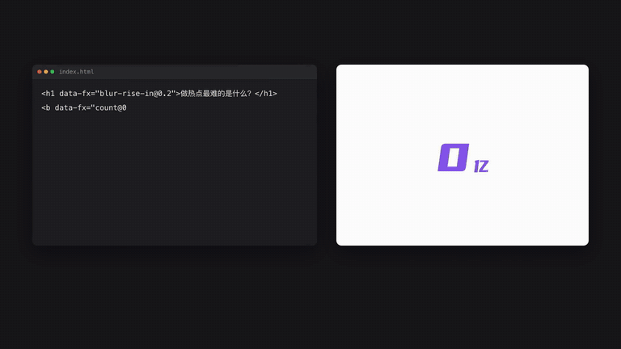
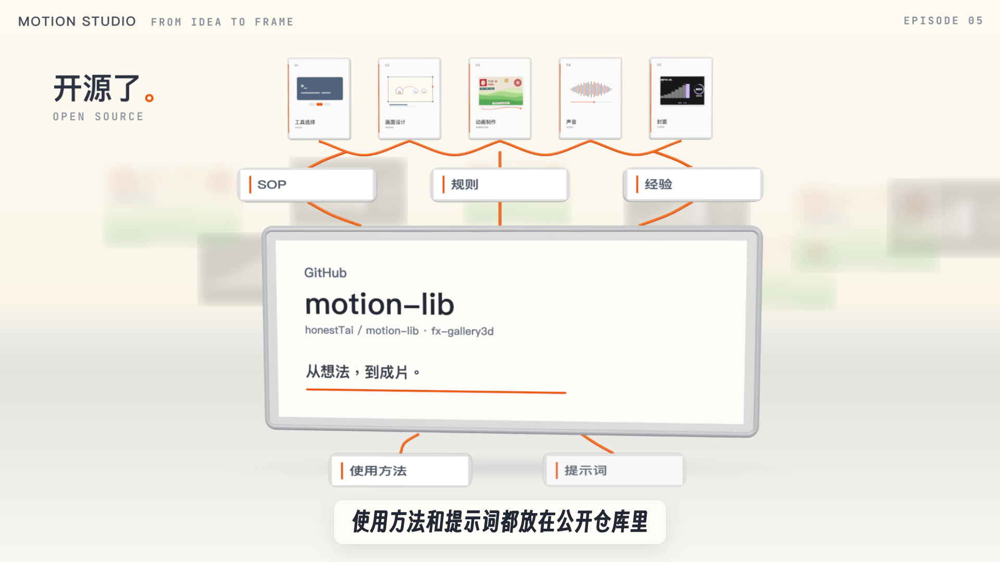
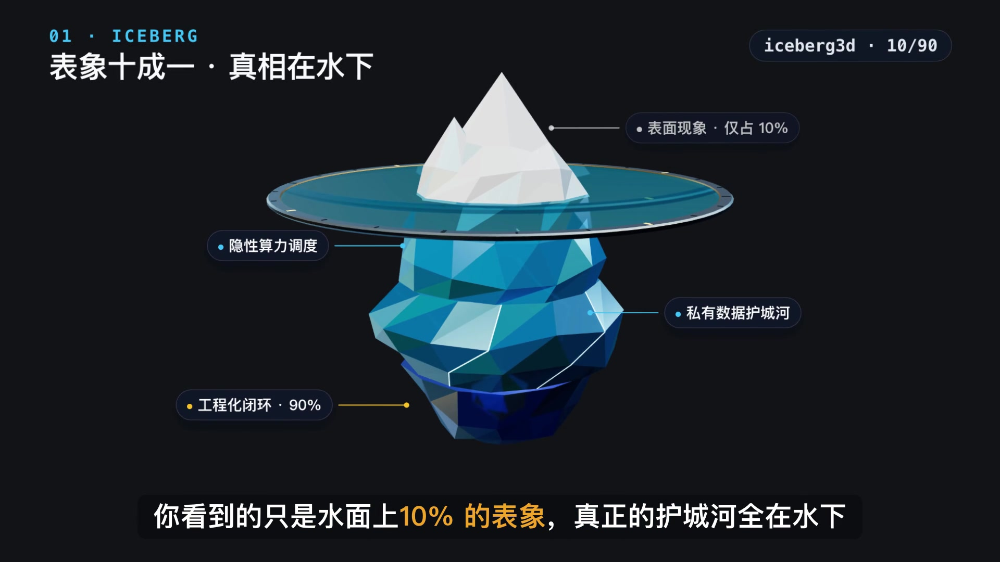
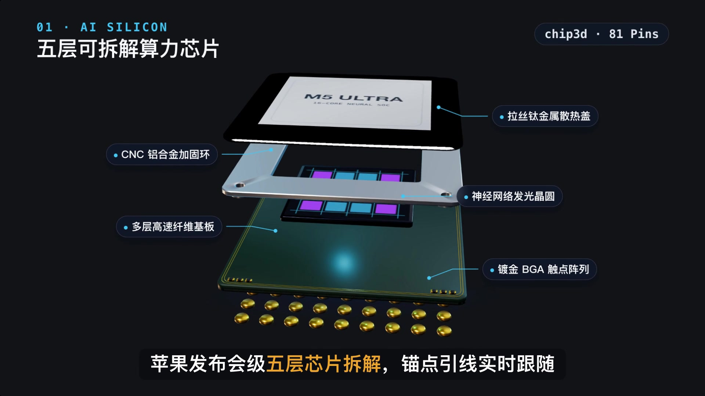
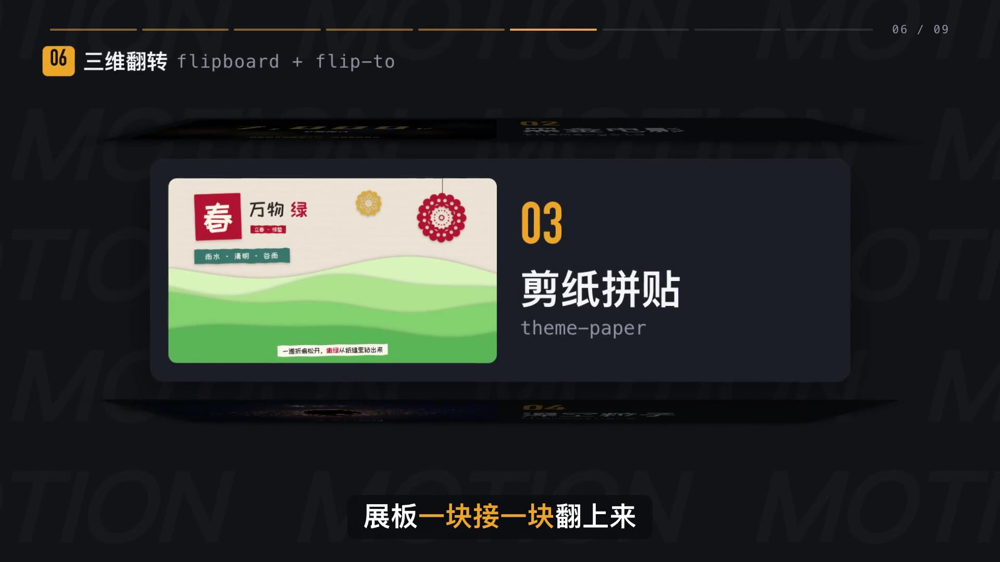
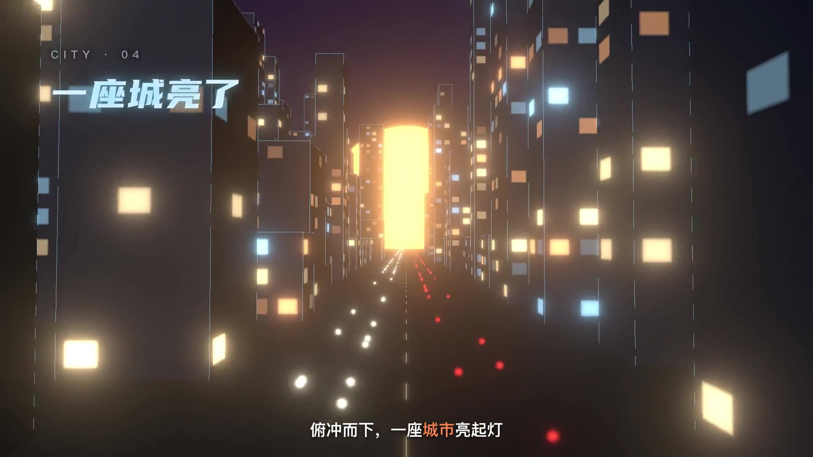
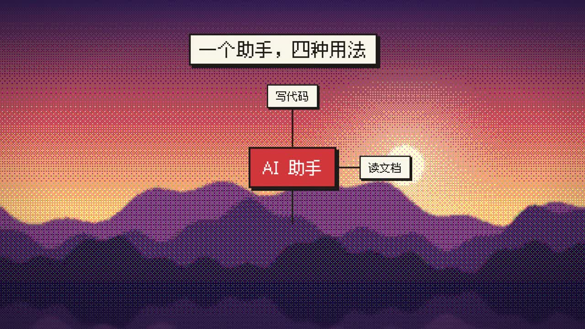
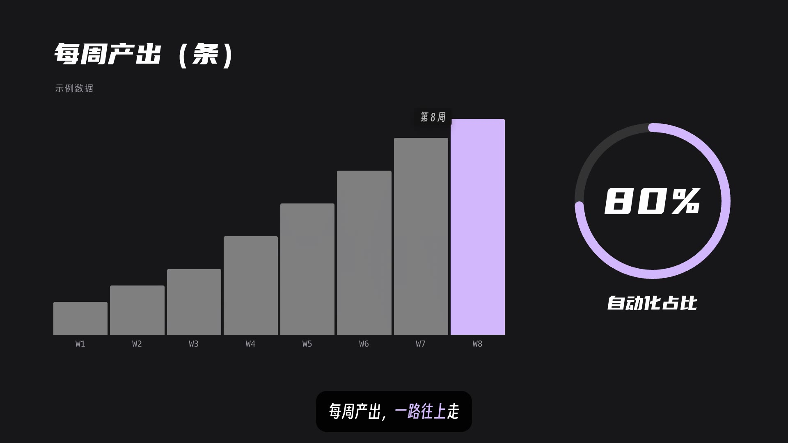

<div align="center">



<br />

**简体中文** · [繁體中文](README.zh-TW.md) · [English](README.en.md) · [日本語](README.ja.md)

[](LICENSE)
[](docs/CATALOG.md)
[](docs/CATALOG.md)
[](examples/gallery3d/index.html)
[](#-快速开始)
[](https://hrouter.net/)

[示例画廊](#-示例画廊) · [目录结构](#-目录结构) · [快速开始](#-快速开始) · [语法与模块](#-核心语法与模块) · [全量动效目录](docs/CATALOG.md)

</div>

---

<div align="center">
  <a href="https://hrouter.net/" target="_blank" rel="noopener">
    
  </a>
</div>

> ⚡ **官方算力合作伙伴 [HRouter](https://hrouter.net/)**：**一把 API Key 直连 Claude / GPT / Gemini / Grok**，原生兼容 [Claude Code](https://hrouter.net/docs/claude-code/)、[Codex](https://hrouter.net/docs/codex/)、[Gemini CLI](https://hrouter.net/docs/gemini-cli/)、[DeepSeek](https://hrouter.net/docs/deepseek/)，按量计费驱动 AI 批量出片。

---

## 🎬 简介与实机预览

**HTML → 视频的声明式动效库。** 在普通 DOM 元素上写一行 `data-fx="动效名@秒数"`，将 DOM 排版、Canvas 粒子、Three.js 真 3D 展厅与 VRM 骨骼角色统一编排进单条确定性 GSAP 主时间线，配合 [HyperFrames](https://hyperframes.heygen.com) 多核并行无接缝渲染 1080p / 60fps MP4。

<div align="center">
  <a href="promo/motion-lib-promo.mp4">
    
  </a>
  <sub>▲ 点击查看高清宣传片 <a href="promo/motion-lib-promo.mp4"><code>promo/motion-lib-promo.mp4</code></a> · 合集 <a href="examples/showreel.mp4"><code>examples/showreel.mp4</code></a></sub>
</div>

<br />

<!-- STATS:START -->
| | 数量 |
|---|---|
| 动效 | **282** 种（入场 26 · 退场 10 · 强调 41 · 文字 9 · 数据 7 · 镜头 14 · 角色 25 · 剪纸 10 · 粒子 8 · 3D 37 · 立体 40 · 空间 21 · 舞台 10 · 手绘 5 · 对话 8 · 图解 3 · 形状 3 · 声音 1 · 组件 4）· [查看全量目录 →](docs/CATALOG.md) |
| 转场 | **24** 种 |
| 组件生成器 | **76** 个 |
| 皮肤 | **7** 套（白紫科技 · 黑金电影 · 像素复古 · 剪纸拼贴 · 深空粒子 · 演播室 · 白底立体/展厅） |
<!-- STATS:END -->

---

## 🎨 示例画廊

<table>
  <tr>
    <td width="33%" align="center">
      <a href="examples/gallery3d/gallery3d.mp4"></a><br />
      <b>暖白 3D 展厅</b> <code>fx-gallery3d.js</code><br />
      <sub><a href="examples/gallery3d/gallery3d.mp4">▶ 成片</a> · <a href="examples/gallery3d/index.html">源码</a></sub>
    </td>
    <td width="33%" align="center">
      <a href="examples/narrative3d/narrative3d.mp4"></a><br />
      <b>口播 3D 叙事连招</b> <code>fx-narrative3d.js</code><br />
      <sub><a href="examples/narrative3d/narrative3d.mp4">▶ 成片</a> · <a href="examples/narrative3d/index.html">源码</a></sub>
    </td>
    <td width="33%" align="center">
      <a href="examples/showcase3d/showcase3d.mp4"></a><br />
      <b>工业 3D 硬件拆解</b> <code>fx-showcase3d.js</code><br />
      <sub><a href="examples/showcase3d/showcase3d.mp4">▶ 成片</a> · <a href="examples/showcase3d/index.html">源码</a></sub>
    </td>
  </tr>
  <tr>
    <td width="33%" align="center">
      <a href="examples/white3d/white3d.mp4"></a><br />
      <b>白底立体牌桌</b> <code>fx-desk3d.js</code><br />
      <sub><a href="examples/white3d/white3d.mp4">▶ 成片</a> · <a href="examples/white3d/index.html">源码</a></sub>
    </td>
    <td width="33%" align="center">
      <a href="examples/world/world.mp4"></a><br />
      <b>世界画布运镜</b> <code>fx-world.js</code><br />
      <sub><a href="examples/world/world.mp4">▶ 成片</a> · <a href="examples/world/index.html">源码</a></sub>
    </td>
    <td width="33%" align="center">
      <a href="examples/stage/stage.mp4"></a><br />
      <b>舞台剧画中画</b> <code>fx-stage.js</code><br />
      <sub><a href="examples/stage/stage.mp4">▶ 成片</a> · <a href="examples/stage/index.html">源码</a></sub>
    </td>
  </tr>
  <tr>
    <td width="33%" align="center">
      <a href="examples/three/three.mp4"></a><br />
      <b>真 3D 场景</b> <code>fx-3d.js</code><br />
      <sub><a href="examples/three/three.mp4">▶ 成片</a> · <a href="examples/three/index.html">源码</a></sub>
    </td>
    <td width="33%" align="center">
      <a href="examples/kit/kit.mp4"></a><br />
      <b>AI 讲解零件包</b> <code>kit/*</code><br />
      <sub><a href="examples/kit/kit.mp4">▶ 成片</a> · <a href="examples/kit/index.html">源码</a></sub>
    </td>
    <td width="33%" align="center">
      <a href="examples/violet/violet.mp4"></a><br />
      <b>白紫科技</b> <code>theme-violet</code><br />
      <sub><a href="examples/violet/violet.mp4">▶ 成片</a> · <a href="examples/violet/index.html">源码</a></sub>
    </td>
  </tr>
</table>

---

## 📂 目录结构

```text
motion-lib/
├── src/
│   ├── core/               # 核心引擎 fx.js + 排版与 7 套主题皮肤 fx.css
│   └── modules/            # 按职责分组的 5 大可选模块域
│       ├── spatial/        # 空间与舞台镜头：fx-world.js · fx-stage.js · fx-oner.js
│       ├── three/          # 3D 与立体展台：fx-3d.js · fx-desk3d.js · fx-gallery3d.js · fx-showcase3d.js · fx-narrative3d.js · fx-particles.js
│       ├── character/      # 角色与骨骼系统：fx-puppet.js · fx-rig.js · fx-vrm.js
│       ├── kit/            # 讲解专用零件包：fx-chat.js · fx-diagram.js · fx-ink.js · fx-shape.js
│       └── audio/          # 代码合成音效层：fx-sound.js
├── scripts/                # 工具链：new-project.sh · sfx.mjs · chrome-tall.sh · gen-readme.mjs
├── assets/ · fonts/ · vendor/  # 离线 3D 模型（VRM / GLB）、商用免费字体与第三方运行时
├── examples/ · demo/ · promo/  # 各风格示例工程与成片
└── docs/                   # 架构图与全量动效速查手册 docs/CATALOG.md
```

---

## 🚀 快速开始

需安装 **Node.js 18+**、**FFmpeg** 与 **Google Chrome**。

```bash
# 1. 新建项目并同步运行库到 my-video/lib/（升级时重跑即可无损更新）
mkdir my-video && ./scripts/new-project.sh my-video

# 2. 编写 my-video/index.html 后，预览、合成音效轨并导出 1080p 60fps MP4
cd my-video
open "index.html?play"                                    # 浏览器预览：空格播放/暂停，←/→ 逐帧
open "index.html?lint"                                    # 页面排版与字号自检
node lib/sfx.mjs .                                        # 按动效触发时间自动合成 audio/sfx.wav
HYPERFRAMES_BROWSER_PATH="$PWD/lib/chrome-tall.sh" \
  npx hyperframes render -o out.mp4 --fps 60 --experimental-fast-capture=false
```

最小 `index.html` 骨架：

```html
<!doctype html>
<html lang="zh">
<head>
  <meta charset="UTF-8">
  <link rel="stylesheet" href="lib/fx.css">
  <script src="lib/vendor/gsap.min.js"></script>
  <script src="lib/fx.js"></script>
  <script src="lib/fx-world.js"></script>
  <script src="lib/fx-sound.js"></script>
</head>
<body>
<div id="root" class="theme-studio" data-composition-id="main" data-width="1920" data-height="1080" data-fps="60" data-world="snake">
  <section class="scene center" data-d="4.0" data-fx="cam-wide@0 cam-home@0.9">
    <h1 class="t-title" data-fx="mask-rise@0.2">声明式 <span class="accent">HTML → 视频</span></h1>
  </section>
</div>
<script>
  FX.subtitles([[0.2, 3.8, '一行属性驱动{确定性}动画']], { style: 'studio' });
  FX.build();
</script>
</body>
</html>
```

---

## 📐 核心语法与模块

- **时间与目标**：`data-fx="[each:|chars:|words:|lines:]动效名@秒数(dur=0.8,ease=spring,stagger=0.08)"`（`@1.2` 场景内秒数，`@+0.3` 顺延，`@-0.4` 结束倒计）。
- **7 套主题皮肤**：在 `#root` 上设 `theme-studio`、`theme-white3d`（可叠加 `desk` 或 `gallery`）、`theme-violet`、`theme-gold`、`theme-paper`、`theme-pixel`、`theme-space`。
- **按需加载可选模块**（经 `new-project.sh` 同步后均位于 `lib/` 下）：

| 模块分类 | 引入脚本（放在 `lib/fx.js` 之后） | 典型用途 |
|---|---|---|
| **空间与长镜头** | `fx-world.js` · `fx-stage.js` · `fx-oner.js` | 世界画布推镜、主持人舞台剧、一镜到底穿墙 |
| **真 3D 与立体棚** | `fx-3d.js` · `fx-desk3d.js` · `fx-gallery3d.js` · `fx-showcase3d.js` · `fx-narrative3d.js` · `fx-particles.js` | 暖白 3D 展厅、口播黄金叙事连招（冰山/骨牌/天平/漏斗/金库/金字塔）、硬件拆解、白格牌桌 |
| **角色与软骨骼** | `fx-puppet.js` · `fx-rig.js` · `fx-vrm.js` | 2D 立绘口型走位、软管双骨 IK、3D VRM 角色（需 `vendor/three-vrm.min.js`） |
| **AI 讲解零件** | `fx-chat.js` · `fx-diagram.js` · `fx-ink.js` · `fx-shape.js` | 聊天窗/终端/代码 diff、包围/辐射图、手绘沸腾批注、SVG 变形 |
| **程序化音效** | `fx-sound.js`（最后引入） | 27 种代码合成音效自动对齐每个动效时间点 |

👉 **全部动效、转场与组件参数表请查阅：[docs/CATALOG.md](docs/CATALOG.md)**

---

## 📜 开源许可

仓库代码采用 **[MIT License](LICENSE)** 开源；第三方运行时、CC0 示例模型与商用免费字体许可详见 [NOTICE](NOTICE)、[assets/README.md](assets/README.md) 与 [fonts/README.md](fonts/README.md)。
