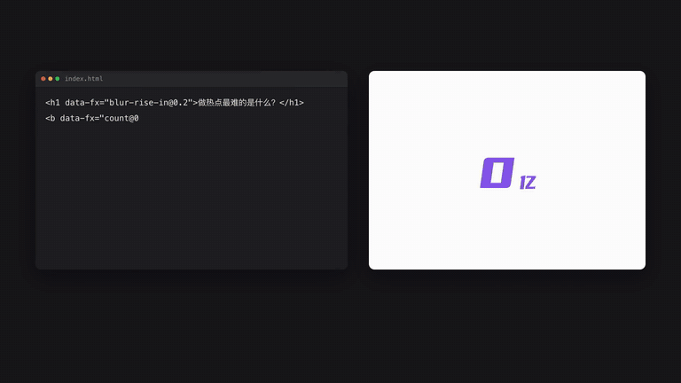
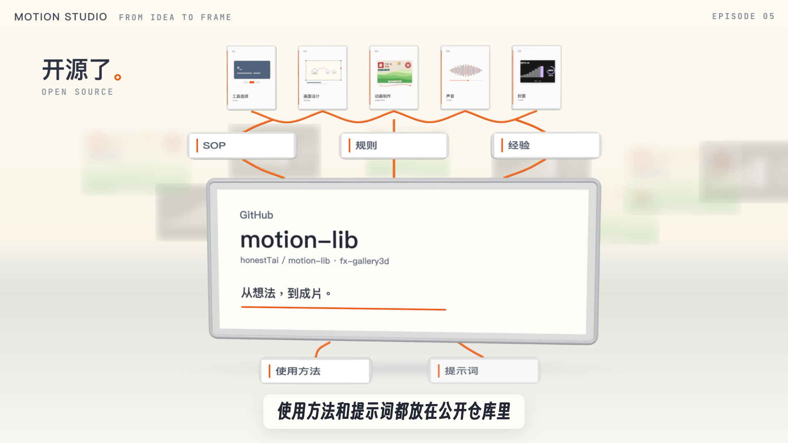
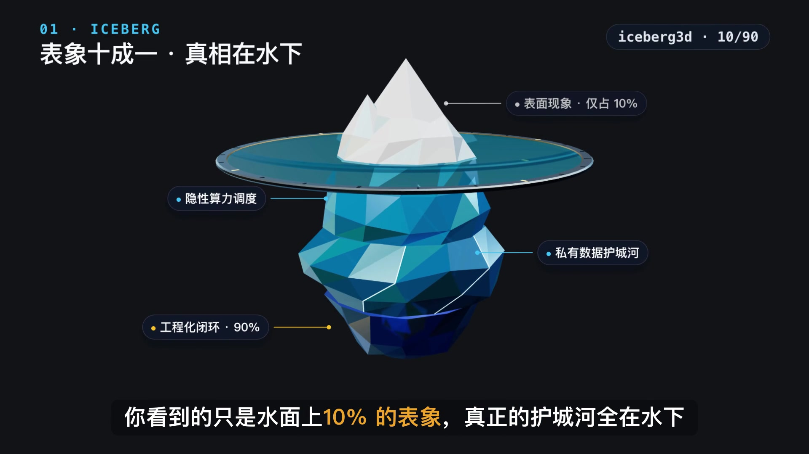
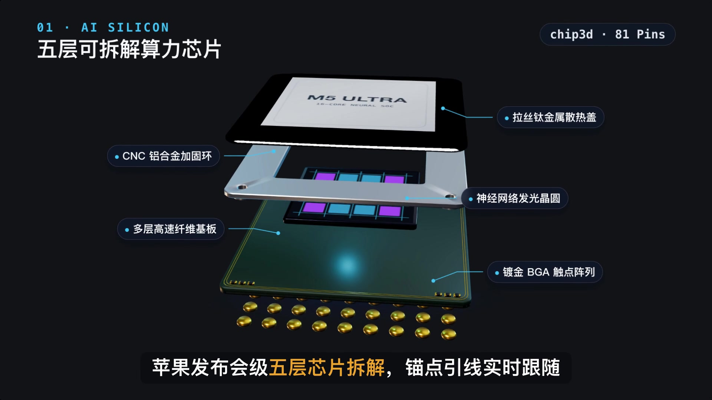
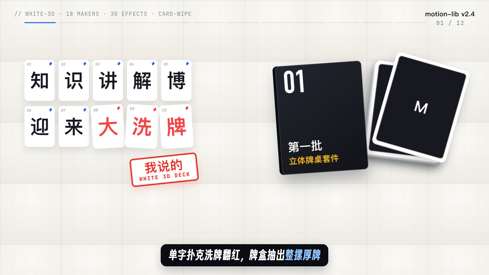
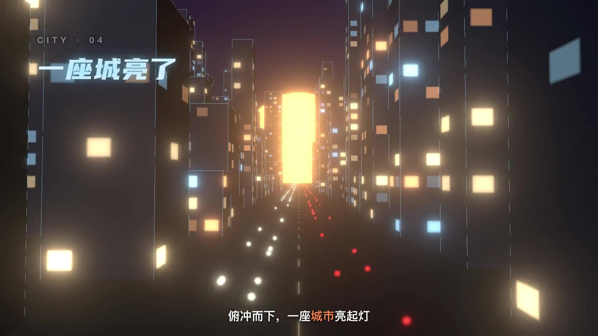
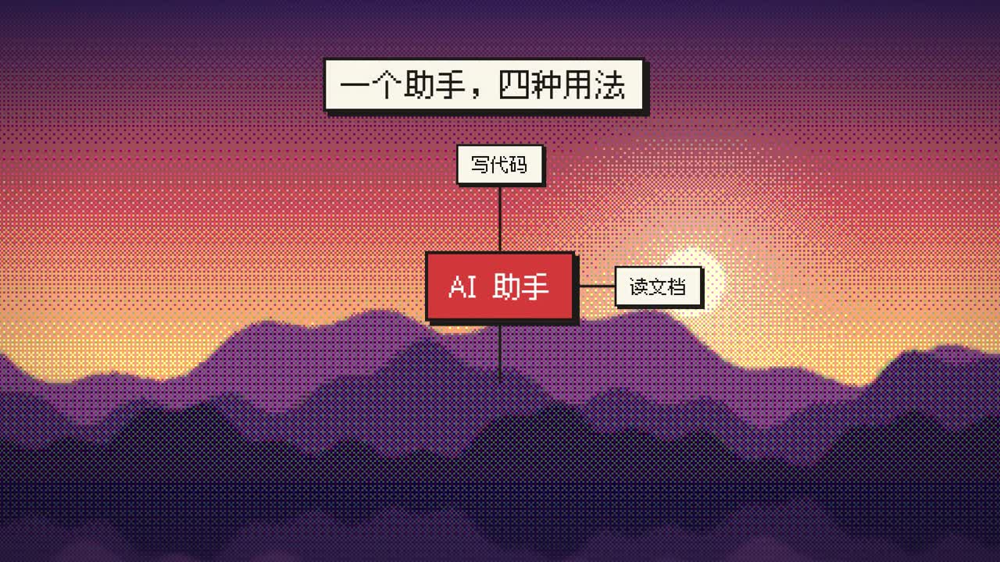

<div align="center">



<br />

[简体中文](README.md) · **繁體中文** · [English](README.en.md) · [日本語](README.ja.md)

[](LICENSE)
[](docs/CATALOG.zh-TW.md)
[](docs/CATALOG.zh-TW.md)
[](examples/gallery3d/index.html)
[](#-快速開始)
[](https://hrouter.net/)

[範例畫廊](#-範例畫廊) · [目錄結構](#-目錄結構) · [快速開始](#-快速開始) · [語法與模組](#-核心語法與模組) · [全量動效目錄](docs/CATALOG.zh-TW.md)

</div>

---

<div align="center">
  <a href="https://hrouter.net/" target="_blank" rel="noopener">
    
  </a>
</div>

> ⚡ **官方算力合作夥伴 [HRouter](https://hrouter.net/)**：**一把 API Key 直連 Claude / GPT / Gemini / Grok**，原生相容 [Claude Code](https://hrouter.net/docs/claude-code/)、[Codex](https://hrouter.net/docs/codex/)、[Gemini CLI](https://hrouter.net/docs/gemini-cli/)、[DeepSeek](https://hrouter.net/docs/deepseek/)，按量計費驅動 AI 批次產片。

---

## 🎬 簡介與實機預覽

**HTML → 影片的宣告式動效庫。** 在一般 DOM 元素上寫一行 `data-fx="動效名@秒數"`，將 DOM 排版、Canvas 粒子、Three.js 真 3D 展廳與 VRM 骨骼角色統一編排進單條決定性 GSAP 主時間軸，搭配 [HyperFrames](https://hyperframes.heygen.com) 多核心平行渲染 1080p / 60fps MP4。

<div align="center">
  <a href="promo/motion-lib-promo.mp4">
    
  </a>
  <sub>▲ 點擊觀看高畫質宣傳片 <a href="promo/motion-lib-promo.mp4"><code>promo/motion-lib-promo.mp4</code></a> · 合集 <a href="examples/showreel.mp4"><code>examples/showreel.mp4</code></a></sub>
</div>

<br />

<!-- STATS:START -->
| | 數量 |
|---|---|
| 動效 | **282** 種（入場 26 · 退場 10 · 強調 41 · 文字 9 · 資料 7 · 鏡頭 14 · 角色 25 · 剪紙 10 · 粒子 8 · 3D 37 · 立體 40 · 空間 21 · 舞台 10 · 手繪 5 · 對話 8 · 圖解 3 · 形狀 3 · 聲音 1 · 元件 4） · [查看全量目錄 →](docs/CATALOG.zh-TW.md) |
| 轉場 | **24** 種 |
| 元件產生器 | **76** |
| 外觀主題 | **7** 套（白紫科技 · 黑金電影 · 像素復古 · 剪紙拼貼 · 深空粒子 · 演播室 · 白底立體） |
<!-- STATS:END -->

---

## 🎨 範例畫廊

<table>
  <tr>
    <td width="33%" align="center">
      <a href="examples/gallery3d/gallery3d.mp4"></a><br />
      <b>暖白 3D 展廳</b> <code>fx-gallery3d.js</code><br />
      <sub><a href="examples/gallery3d/gallery3d.mp4">▶ 成片</a> · <a href="examples/gallery3d/index.html">原始碼</a></sub>
    </td>
    <td width="33%" align="center">
      <a href="examples/narrative3d/narrative3d.mp4"></a><br />
      <b>口播 3D 敘事連招</b> <code>fx-narrative3d.js</code><br />
      <sub><a href="examples/narrative3d/narrative3d.mp4">▶ 成片</a> · <a href="examples/narrative3d/index.html">原始碼</a></sub>
    </td>
    <td width="33%" align="center">
      <a href="examples/showcase3d/showcase3d.mp4"></a><br />
      <b>工業 3D 硬體拆解</b> <code>fx-showcase3d.js</code><br />
      <sub><a href="examples/showcase3d/showcase3d.mp4">▶ 成片</a> · <a href="examples/showcase3d/index.html">原始碼</a></sub>
    </td>
  </tr>
  <tr>
    <td width="33%" align="center">
      <a href="examples/white3d/white3d.mp4"></a><br />
      <b>白底立體牌桌</b> <code>fx-desk3d.js</code><br />
      <sub><a href="examples/white3d/white3d.mp4">▶ 成片</a> · <a href="examples/white3d/index.html">原始碼</a></sub>
    </td>
    <td width="33%" align="center">
      <a href="examples/world/world.mp4"></a><br />
      <b>世界畫布運鏡</b> <code>fx-world.js</code><br />
      <sub><a href="examples/world/world.mp4">▶ 成片</a> · <a href="examples/world/index.html">原始碼</a></sub>
    </td>
    <td width="33%" align="center">
      <a href="examples/stage/stage.mp4"></a><br />
      <b>舞台劇子母畫面</b> <code>fx-stage.js</code><br />
      <sub><a href="examples/stage/stage.mp4">▶ 成片</a> · <a href="examples/stage/index.html">原始碼</a></sub>
    </td>
  </tr>
  <tr>
    <td width="33%" align="center">
      <a href="examples/three/three.mp4"></a><br />
      <b>真 3D 場景</b> <code>fx-3d.js</code><br />
      <sub><a href="examples/three/three.mp4">▶ 成片</a> · <a href="examples/three/index.html">原始碼</a></sub>
    </td>
    <td width="33%" align="center">
      <a href="examples/kit/kit.mp4"></a><br />
      <b>AI 講解零件包</b> <code>kit/*</code><br />
      <sub><a href="examples/kit/kit.mp4">▶ 成片</a> · <a href="examples/kit/index.html">原始碼</a></sub>
    </td>
    <td width="33%" align="center">
      <a href="examples/violet/violet.mp4"></a><br />
      <b>白紫科技</b> <code>theme-violet</code><br />
      <sub><a href="examples/violet/violet.mp4">▶ 成片</a> · <a href="examples/violet/index.html">原始碼</a></sub>
    </td>
  </tr>
</table>

---

## 📂 目錄結構

```text
motion-lib/
├── src/
│   ├── core/               # 核心引擎 fx.js + 排版與 7 套主題皮膚 fx.css
│   └── modules/            # 依職責分組的 5 大可選模組域
│       ├── spatial/        # 空間與舞台鏡頭：fx-world.js · fx-stage.js · fx-oner.js
│       ├── three/          # 3D 與立體展台：fx-3d.js · fx-desk3d.js · fx-gallery3d.js · fx-showcase3d.js · fx-narrative3d.js · fx-particles.js
│       ├── character/      # 角色與骨骼系統：fx-puppet.js · fx-rig.js · fx-vrm.js
│       ├── kit/            # 講解專用零件包：fx-chat.js · fx-diagram.js · fx-ink.js · fx-shape.js
│       └── audio/          # 程式碼合成音效層：fx-sound.js
├── scripts/                # 工具鏈：new-project.sh · sfx.mjs · chrome-tall.sh · gen-readme.mjs
├── assets/ · fonts/ · vendor/  # 離線 3D 模型（VRM / GLB）、商用免費字型與第三方執行庫
├── examples/ · demo/ · promo/  # 各風格範例專案與成片
└── docs/                   # 架構圖與全量動效速查手冊 docs/CATALOG.zh-TW.md
```

---

## 🚀 快速開始

需安裝 **Node.js 18+**、**FFmpeg** 與 **Google Chrome**。

```bash
# 1. 建立專案並同步執行庫至 my-video/lib/
mkdir my-video && ./scripts/new-project.sh my-video

# 2. 預覽、合成音效軌並輸出 1080p 60fps MP4
cd my-video
open "index.html?play"                                    # 空白鍵播放/暫停，←/→ 逐格
node lib/sfx.mjs .                                        # 自動合成與畫面等長的 audio/sfx.wav
HYPERFRAMES_BROWSER_PATH="$PWD/lib/chrome-tall.sh" \
  npx hyperframes render -o out.mp4 --fps 60 --experimental-fast-capture=false
```

---

## 📐 核心語法與模組

- **時間與目標**：`data-fx="[each:|chars:|words:|lines:]動效名@秒數(dur=0.8,ease=spring,stagger=0.08)"`。
- **7 套主題皮膚**：在 `#root` 上設 `theme-studio`、`theme-white3d`（可加 `desk` 或 `gallery`）、`theme-violet`、`theme-gold`、`theme-paper`、`theme-pixel`、`theme-space`。
- **按需載入模組**（同步後均位於 `lib/`）：空間運鏡（`fx-world.js` / `fx-stage.js` / `fx-oner.js`）、3D 與立體展台（`fx-3d.js` / `fx-desk3d.js` / `fx-gallery3d.js` / `fx-showcase3d.js` / `fx-narrative3d.js` / `fx-particles.js`）、角色與 IK（`fx-puppet.js` / `fx-rig.js` / `fx-vrm.js`）、AI 講解零件（`fx-chat.js` / `fx-diagram.js` / `fx-ink.js` / `fx-shape.js`）、合成音效（`fx-sound.js`）。

👉 **全部動效、轉場與元件參數表請查閱：[docs/CATALOG.zh-TW.md](docs/CATALOG.zh-TW.md)**

---

## 📜 開源授權

專案程式碼採用 **[MIT License](LICENSE)** 釋出；第三方執行庫、CC0 範例模型與字型授權詳見 [NOTICE](NOTICE)、[assets/README.md](assets/README.md) 與 [fonts/README.md](fonts/README.md)。
