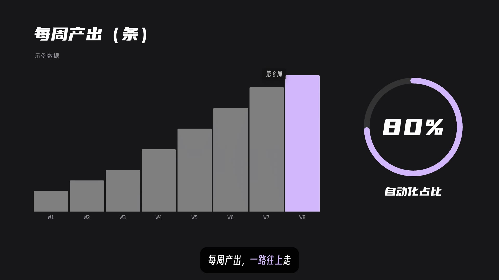

# motion-lib

[简体中文](README.md) · **繁體中文** · [English](README.en.md) · [日本語](README.ja.md)

**HTML → 影片的宣告式動效庫。** 在元素上寫一行 `data-fx="動效名@秒數"`，就能做出知識口播、科技解說這類影片裡常見的動效，再用 [HyperFrames](https://hyperframes.heygen.com) 逐格渲染成 MP4。

[](promo/motion-lib-promo.mp4)

> 上面的宣傳片就是用這個動效庫寫的，原始碼在 [`promo/index.html`](promo/index.html)。

<!-- STATS:START -->
| | 數量 |
|---|---|
| 動效 | **76** 種（入場 24 · 退場 7 · 強調 24 · 資料 6 · 鏡頭 7 · 角色 5 · 元件 3） |
| 轉場 | **10** 種 |
| 元件產生器 | **9** 個（`bars` `wave` `steps` `chapters` `ring` `wall` `dust` `line` `pixels`） |
| 外觀主題 | **3** 套（白紫科技 · 黑金電影 · 像素復古） |
<!-- STATS:END -->

## 為什麼要用它

用 HTML 做影片，難的不是排版，是動效：

- **渲染器是「跳到第 N 格 → 截圖」**。CSS animation、`setTimeout`、`Math.random` 都不受它控制，渲染出來要嘛不動，要嘛每次都不一樣。
- 手寫 GSAP 時間軸，一支一分鐘的影片就要算幾百個時間點。

motion-lib 把所有動效都排進**一條暫停的 GSAP 時間軸**，你只需要宣告「哪個元素、什麼動效、第幾秒」：

```html
<h1 data-fx="blur-rise-in@0.2">做熱點最難的是什麼？</h1>
<b  data-fx="count@0.6 marker@1.6">7,000</b>
<ul data-fx="each:pop-in@1(stagger=0.1)"> <li>晶片</li><li>算力</li><li>大模型</li> </ul>
```

- **逐格可 seek**：任意跳到哪一格，畫面都和依序播放時一致，每次渲染結果相同。
- **隨機也可重現**：需要隨機效果的地方（粒子、亂碼、波形）一律使用帶種子的 `FX.rand(seed)`。
- **不依賴網路**：GSAP 和字型都打包在儲存庫裡。
- **零建置**：一個 `fx.js`、一個 `fx.css`，不需要 npm / 打包工具。

## 目錄結構

```
motion-lib/
├── fx.js            動效庫本體：動效、轉場、元件產生器、字幕、預覽播放器
├── fx.css           基礎樣式、元件樣式、三套外觀主題
├── fonts/           優設標題黑、得意黑、Fusion Pixel 像素字型（授權見 fonts/README.md）
├── vendor/          GSAP 3.15（本機一份）
├── new-project.sh   把動效庫裝進一個影片專案（也用來更新）
├── chrome-tall.sh   渲染用 Chrome 包裝（避免成片底部字幕被截掉）
├── gen-readme.mjs   從 fx.js 自動產生本文的數量表和動效目錄（node gen-readme.mjs）
├── demo/            示範頁：6 個場景，三套外觀主題都用到
├── promo/           宣傳片原始碼 + 成片
└── examples/        三套外觀主題各一支完整範例片 + 合輯
```

## 環境需求

- Node.js 18+（使用 `npx hyperframes`）
- FFmpeg
- Google Chrome（macOS 預設位置；其他位置請設定環境變數 `REAL_CHROME`）
- 第一次執行 `npx hyperframes` 會自動下載 CLI

## 快速開始

**1. 建立專案**

```bash
mkdir my-video
./new-project.sh my-video        # 把 fx.js / fx.css / 字型 / GSAP 複製到 my-video/lib/
```

> HyperFrames 只能讀取專案目錄裡的檔案，所以動效庫是**複製進**專案，而不是用 `../` 引用。動效庫更新後，在同一個專案上再執行一次這個指令即可。
> 儲存庫裡的 `demo/` 和 `promo/` 也一樣，第一次開啟前請先執行 `./new-project.sh demo`、`./new-project.sh promo`。

**2. 撰寫 `my-video/index.html`**

```html
<!doctype html>
<html lang="zh-TW">
<head>
  <meta charset="UTF-8">
  <link rel="stylesheet" href="lib/fx.css">
  <script src="lib/vendor/gsap.min.js"></script>
  <script src="lib/fx.js"></script>
</head>
<body>
<div id="root" class="theme-violet" data-composition-id="main" data-width="1920" data-height="1080">

  <section class="scene dark center" data-d="3.5">
    <h1 class="t-title" data-fx="mask-rise@0.2">全自動剪輯 <span class="accent">Skill</span></h1>
    <p class="t-body" data-fx="rise-in@0.6 marker@1.4">看完這集，你也可以</p>
  </section>

  <section class="scene light" data-d="4" data-in="blur-cross">
    <div class="abs" style="left:200px;top:300px;width:1200px;height:400px"
         data-make="bars" data-values="3,8,21,40,26,12" data-hi="4"
         data-fx="each:grow-y@0.3(stagger=0.05)"></div>
  </section>

</div>
<script>
  FX.subtitles([[0.2, 3.4, '看完這集，你也可以'], [3.5, 7.4, '播放集中在{開播後}幾小時']], { style: 'pill' });
  FX.build();
</script>
</body>
</html>
```

**3. 預覽、截圖、輸出成片**

```bash
cd my-video
open "index.html?play"                       # 瀏覽器預覽：空白鍵播放，←/→ 逐格，↑/↓ 跳場景
npx hyperframes snapshot --at 1,3,5          # 截幾格檢查
HYPERFRAMES_BROWSER_PATH="$PWD/lib/chrome-tall.sh" \
  npx hyperframes render -o out.mp4 --experimental-fast-capture=false
```

> 輸出成片時一定要帶 `chrome-tall.sh`。本機完整版 Chrome 無頭渲染時，可視高度比視窗矮約 90px，成片底部（字幕）會被截掉。這個腳本會把視窗加高。

## 範例片

三套外觀主題各做了一支完整範例（純動效、無配音），原始碼就在對應目錄裡，可以直接拿來改：

| 外觀主題 | 範例 | 原始碼 |
|---|---|---|
| 白紫科技 `theme-violet` | [](examples/violet/violet.mp4) | [`examples/violet/index.html`](examples/violet/index.html) |
| 黑金電影 `theme-gold` | [](examples/gold/gold.mp4) | [`examples/gold/index.html`](examples/gold/index.html) |
| 像素復古 `theme-pixel` | [](examples/pixel/pixel.mp4) | [`examples/pixel/index.html`](examples/pixel/index.html) |

三支合在一起：[`examples/showreel.mp4`](examples/showreel.mp4)。

## 寫法

### 場景 `<section class="scene">`

一個場景就是一個鏡頭。場景之間依序首尾相接。

| 寫法 | 含義 |
|---|---|
| `data-d="4"` | 時長 4 秒 |
| `data-t="12.5"` | 指定開始時間（不寫就緊接上一個場景） |
| `data-in="blur-cross(dur=0.5)"` | 用什麼轉場進入這個場景，見「轉場」 |
| `class="scene dark"` / `"scene light"` | 單一場景切換深色 / 淺色底 |
| `class="scene overlay"` | 疊加層：不佔順序，和其他場景同時顯示（角標、常駐進度條） |

根元素必須帶有 `data-composition-id="main"`、`data-width`、`data-height`，總時長會自動算出來。

### 動效 `data-fx="[目標:]名稱@時間(參數)"`

一個元素可以寫多個動效，用空格隔開：`data-fx="rise-in@0.2 pulse@1.5 fade-out@-0.3"`。

| 部分 | 寫法 | 含義 |
|---|---|---|
| 時間 | `@1.2` | 場景開始後 1.2 秒 |
| | `@+0.3` | 比同一元素上的前一個動效晚 0.3 秒 |
| | `@-0.4` | 場景結束前 0.4 秒（做退場） |
| 目標 | （不寫） | 元素本身 |
| | `each:` | 每個子元素，自動錯峰（卡片組、清單、長條） |
| | `chars:` / `words:` / `lines:` | 拆成單字 / 詞 / 行（依 `<br>`）再做動效 |
| 參數 | `dur=0.8` | 時長（秒） |
| | `ease=spring` | 緩動，見下表 |
| | `stagger=0.1` | 錯峰間隔（搭配 `each:` / `chars:`） |
| | `order=center` | 錯峰順序：`start` `end` `center` `edges` |
| | 其他 | 各動效自己的參數，見「動效目錄」 |

**緩動別名**

| 別名 | 等於 | 手感 |
|---|---|---|
| `out`（預設） | `power3.out` | 急起緩停，最通用 |
| `soft` | `power2.out` | 柔和 |
| `snap` | `expo.out` | 極快衝到定位，再慢慢停穩 |
| `sharp` | `power4.out` | 比 out 更俐落 |
| `inout` | `power3.inOut` | 兩頭慢中間快，鏡頭運動用 |
| `in` | `power2.in` | 越來越快，退場用 |
| `spring` | `back.out(1.7)` | 輕微過衝回彈 |
| `bounce` | `back.out(2.8)` | 明顯過衝 |
| `elastic` | `elastic.out(1,0.55)` | 彈簧 |
| `drop` | `bounce.out` | 落地彈跳 |
| `linear` | `none` | 等速 |
| `pixel` | `steps(5)` | 階梯式（像素風） |

也可以直接寫 GSAP 原名，如 `ease=power4.out`、`ease=steps(8)`、`ease=elastic.out(1,0.5)`。

### 元件產生器 `data-make="名稱"`

重複的 DOM 交給動效庫產生，再搭配對應的動效：

| 名稱 | 屬性 | 搭配的動效 | 用途 |
|---|---|---|---|
| `bars` | `data-values` `data-labels` `data-hi="2,3"` `data-max` | `each:grow-y` | 長條圖 / 直方圖 |
| `line` | `data-values` `data-w` `data-h` `data-smooth` | `draw` | 折線 / 曲線 |
| `ring` | `data-size` `data-stroke` `data-dash` | `ring(to=0.7)` | 圓環進度、倒數計時 |
| `wave` | `data-n` `data-seed` | `each:grow-y`、`wave-live` | 音訊波形 |
| `steps` | `data-labels="選題,寫稿,配音"` | `step(i=2)` | 步驟導覽膠囊 |
| `chapters` | `data-labels` | `chapter(i=3)` | 頂部章節進度條 |
| `pixels` | `data-text="SKILL?"` `data-size` `data-colors` | `each:pixel-in(order=random)` | 5×7 點陣方塊字 |
| `wall` | `data-cols` `data-rows` `data-seed` | `drift` | 背景卡片牆 |
| `dust` | `data-n` `data-seed` | `drift`、`float` | 漂浮粒子 |

### 字幕

```js
FX.subtitles([
  [開始秒, 結束秒, '文字，{大括號}裡的詞會變強調色'],
  …
], { style: 'pill', pop: false });
```

| `style` | 樣子 | 搭配外觀主題 |
|---|---|---|
| `pill` | 黑色圓角膠囊 + 白字 | 白紫科技 |
| `bar` | 半透明黑條 | 像素復古 |
| `plain` | 白字 + 描影，無底 | 黑金電影 |

`pop: true` 時每句字幕會輕輕上浮出現；預設是硬切，口播影片通常就是硬切。

### 手寫補充

動效庫裡沒有的動效，直接寫 GSAP。用 `at('場景id', 場景內秒數)` 換算成絕對時間：

```js
FX.build({
  extra(tl, at) {
    tl.to('#logo', { rotation: 360, duration: 1 }, at('s3', 0.5));
  }
});
```

也可以註冊成新動效，之後就能在 `data-fx` 裡使用：

```js
FX.register('spin-in', '入场', '旋轉入場', c => {
  c.tl.from(c.els, { rotation: -180, opacity: 0, duration: +(c.o.dur || 0.6) }, c.t);
});
```

> 第二個參數是目錄使用的分類鍵（`入场` 入場、`退场` 退場、`强调` 強調、`数据` 資料、`镜头` 鏡頭、`角色` 角色、`组件` 元件、`转场` 轉場）。這些鍵請維持簡體原樣。

**三條硬規則**：不使用 CSS animation / transition；不使用 `setTimeout` / `requestAnimationFrame`；要隨機就用 `FX.rand(種子)`，不要用 `Math.random`。

## 三套外觀主題

在根元素上換一個 class，整支影片就換風格：

| class | 風格 | 底色 | 標題字 | 強調色 | 適合 |
|---|---|---|---|---|---|
| `theme-violet` | 白紫科技 | 白 `#fdfdfd` / 深 `#171719`（場景加 `dark` / `light` 切換） | 優設標題黑 | 紫 `#8453e8` / 淺紫 `#d5befe` | AI 工具、效率、工作流程講解 |
| `theme-gold` | 黑金電影 | 深藍黑 `#080a0f` + 模糊實拍 + 暗角 | 金色漸層斜體 | 金 `#e4b256`，紅 `#ff5b56` 只用於下跌 | 財經、產業分析、排行榜 |
| `theme-pixel` | 像素復古 | 米色網點紙 `#efe9dc` | Fusion Pixel 像素字 | 綠 `#9fe07a` · 紅 · 黃 | 動漫主持人、輕鬆科普 |

所有顏色、字型、圓角、字幕尺寸都是 `fx.css` 最上方的 CSS 變數（`--fx-bg` `--fx-accent` `--fx-font-title` …），改變數就能做出自己的外觀主題。

**常用樣式類別**

| 類型 | 類別名稱 |
|---|---|
| 文字 | `t-hero` `t-title` `t-h2` `t-h3` `t-body` `t-small` `t-en`（英文小副標）`t-num`（大數字）`t-mono` `t-pixel` `accent` `muted` `unit` |
| 版面 | `layer`（整個螢幕的圖層）`abs` `center` `row` `col` |
| 卡片 | `card` `shot`（截圖卡）`glass`（玻璃卡）`qcard`（問號佔位卡）`stat`（大數字報） |
| 標籤 | `pill` `note`（截圖上的黑色標註）`tag` `speed`（×3.5 加速角標）`ptag`（像素標籤） |
| 元件 | `fx-window`（mac 視窗，加 `.pixel` 變像素視窗）`fx-chat`（聊天氣泡）`fx-check`（清單打勾）`fx-cursor`（滑鼠游標）`pbar`（像素能量條）`fx-hbar`（橫向長條） |
| 背景 | `bg-footage`（模糊實拍）`vignette`（暗角） |
| 角色 | `host`（立繪容器，裡面放多張 `[data-pose]` 圖，搭配 `pose` / `lipsync`） |

## 常見問題

**截圖正常，成片底部卻少了一截、字幕不見了？**
渲染時沒有帶 `chrome-tall.sh`，見「快速開始」第 3 步。

**某個動效沒出現？**
先看名稱有沒有拼錯。寫錯的名稱不會中斷渲染，只會在主控台印出 `FX：没有这个动效`（沒有這個動效），用 `npx hyperframes validate` 或瀏覽器主控台就能看到。另外請檢查時間是否超過了場景時長。

**中文變成方塊，或者字型不對？**
內文使用的是系統內建的蘋方（PingFang SC）。非 macOS 的機器請安裝 Noto Sans SC，並在 `--fx-font-body` 裡加上它。

**`npx hyperframes lint` 回報 `missing_timeline_registry` / `font_family_without_font_face`？**
這是靜態檢查的誤報：時間軸由 `fx.js` 在執行階段註冊，字型在 `fx.css` 裡透過 `@import` 宣告。請以 `snapshot` 截出來的畫面為準。

**漸層字拆字後不見了？**
用 `background-clip:text` 做的漸層字（例如黑金外觀的金字），搭配 `chars:`、`type`、`roll` 這類拆字動效時會消失。需要逐字動畫的那段文字請改用純色（例如 `color:#e4b256`）。

**想和配音對齊？**
用配音的時間戳記填入每個場景的 `data-t` / `data-d` 和 `FX.subtitles` 的時間即可。動效時間都是相對場景開頭的，不用修改。

## 授權

- 程式碼：[MIT](LICENSE)；第三方元件說明見 [NOTICE](NOTICE)。
- GSAP：使用 GreenSock 的 [Standard License](https://gsap.com/standard-license)（免費，含商用）。
- 字型：見 [fonts/README.md](fonts/README.md)。

<!-- CATALOG:START -->
## 動效目錄（76 種動效 + 10 種轉場）

> 本節由 `node gen-readme.mjs` 從 `fx.js` 自動產生，請勿手動修改。
> 所有動效都支援通用參數 `dur`（時長）、`ease`（緩動）、`stagger`（錯峰）；下表只列出各自特有的參數。

### 入場 (24)

元素出現的方式。預設會從「入場前」的狀態回到元素原本的樣子，所以元素自己寫的 CSS 位置、旋轉都會保留。

| 名稱 | 作用 / 參數 |
|---|---|
| `fade-in` | 純淡入，最為克制；用於字幕、次要說明 |
| `rise-in` | 從下方上滑 + 淡入，最通用的入場。參數 dist=位移像素 |
| `drop-in` | 從上方落下 + 淡入，用於標籤、角標 |
| `slide-in` | 從一側滑入。參數 dir=left/right/up/down（朝哪個方向運動）、dist |
| `blur-in` | 由模糊到清晰，原地顯現；用於大標題、截圖卡片 |
| `blur-rise-in` | 模糊 + 上滑 + 淡入，電影感標題的標準入場 |
| `scale-in` | 從略小放大到定位，卡片 / 圖片的標準入場。參數 from=起始縮放 |
| `pop-in` | 彈出：從小放大並過衝回彈，用於標註膠囊、圖示、勾叉 |
| `zoom-settle` | 從放大的模糊狀態收回到定位（鏡頭「對上焦」的感覺），用於開場大字 |
| `wipe-in` | 遮罩擦除顯現。參數 dir=right/left/up/down（擦除推進方向） |
| `mask-rise` | 文字從一條看不見的基線下方升上來（遮罩上滑），標題感最強 |
| `flip-in` | 沿水平軸翻轉立起（3D），用於卡片翻牌、問號卡揭曉 |
| `tilt-in` | 帶透視的傾斜飛入（3D 卡片從側面轉正），用於介面截圖 |
| `stamp-in` | 蓋章：從很大砸下來，落定時抖一下；用於結論、印章、勾叉 |
| `drop-bounce` | 從畫面上方掉下來，落地彈兩下；用於物件堆疊、像素方塊 |
| `swing-in` | 像掛牌一樣從上緣甩下來擺正 |
| `focus-in` | 字距從很寬收攏 + 模糊變清晰，英文小標題 / 副標題常用 |
| `grow-x` | 沿橫向從 0 長出來（長條圖、分隔線、進度條）。參數 origin=left/center/right |
| `grow-y` | 沿縱向從 0 長出來（柱狀圖）。參數 origin=bottom/top |
| `fan-in` | 一疊卡片從中心攤開到各自的位置（搭配 each: 使用），卡片最終位置和角度依 CSS 所寫 |
| `type` | 打字機：逐字敲出。參數 cps=每秒字數、caret=1 顯示游標 |
| `draw` | 描線：SVG 線條沿路徑畫出來（連線、箭頭、圈註、折線圖） |
| `pixel-in` | 像素風入場：分 4~5 檔跳著出現（不是平滑的），搭配 each: 可做方塊拼字 |
| `scramble` | 亂碼解碼：每個字先閃隨機字元（灰），從左到右逐個鎖定成正確的字（白）。參數 dur、chars=亂碼字元池 |

### 退場 (7)

元素離開的方式。通常寫成 `@-0.4`（場景結束前 0.4 秒）。

| 名稱 | 作用 / 參數 |
|---|---|
| `fade-out` | 淡出 |
| `rise-out` | 向上滑走 + 淡出 |
| `drop-out` | 向下滑走 + 淡出 |
| `blur-out` | 變模糊 + 淡出（退到背景裡去） |
| `scale-out` | 縮小 + 淡出。參數 to=結束縮放（>1 則是放大著消失） |
| `slide-out` | 向一側滑出。參數 dir |
| `wipe-out` | 遮罩擦除消失 |

### 強調 (24)

元素已經在畫面上，唸到它時做一下強調；也包括移動、變色、內容切換。

| 名稱 | 作用 / 參數 |
|---|---|
| `pulse` | 放大一下再回去（唸到這個詞的時候敲一下）。參數 to=峰值縮放 |
| `shake` | 左右抖動（否定、報錯、警告） |
| `nod` | 上下輕跳一下（角色點頭、圖示彈跳） |
| `blink` | 閃爍幾下（游標、警示）。參數 n=次數 |
| `color` | 文字 / 背景變色。參數 to=顏色、bg=背景色 |
| `marker` | 螢光筆：一道色塊從左到右刷過文字底部。參數 color、h=色塊高度% |
| `underline` | 底線從左長到右。參數 color、w=粗細像素 |
| `strike` | 刪除線劃過（舊方案作廢） |
| `box` | 醒目框：沿元素外緣畫出一圈描邊（在截圖上圈出重點）。參數 color、pad、w、r |
| `glow` | 發光呼吸：光暈亮起再回落。參數 color、n=次數 |
| `sheen` | 掃光：一道高光斜著掃過卡片 / 按鈕 |
| `ping` | 漣漪：從元素中心擴散出一圈（點擊回饋、提示位置） |
| `dim` | 壓暗（退到次要地位）。參數 to=不透明度 |
| `undim` | 恢復亮度 |
| `spot` | 聚光：搭配 each: 使用，第 i 個子元素保持明亮並略微放大，其餘壓暗。參數 i（從 1 數起） |
| `float` | 持續上下漂浮（待機感）。參數 amp=幅度、period=一個來回的秒數、dur=持續多久 |
| `spin` | 旋轉。參數 deg=總角度、dur |
| `move` | 把元素移動到另一個元素的位置（游標移向按鈕、標籤飛入卡片）。參數 to=#目標 或 x、y |
| `click` | 點擊：按下縮一下 + 漣漪（搭配 .fx-cursor 游標元件） |
| `swap` | 原地切換內容：自己淡出，目標元素淡入。參數 to=#目標 |
| `squash` | 卡片擠壓-彈開：橫向先壓窄再彈回（約 3 格壓 + 4 格彈），常和換內容一起用。參數 to=最窄比例 |
| `cycle` | 子元素輪播硬切：一次只顯示一個，每 every 秒換下一個（縮圖裡畫面一直在換）。參數 every、loop=1 循環、stop=停在第幾張 |
| `text` | 文字硬切成新內容（時鐘跳變、標籤換字）。參數 v=新文字 |
| `to` | 萬能補間：直接寫 GSAP 屬性。例 to@2(x=120,scale=1.2,opacity=0.5,dur=0.6,ease=inout) |

### 資料 (6)

數字、進度、圖表類。數字類動效會自動保留小數位數與千分位。

| 名稱 | 作用 / 參數 |
|---|---|
| `count` | 數字滾動。元素裡寫最終數字，或用 to= 指定；from= 起始值。自動保留小數位數與千分位 |
| `roll` | 數字逐位垂直翻滾：每一位是一條 0~9 的垂直帶，帶模糊滾動後從左到右依次停靠（黑金款的 $7,000）。參數 dur、stagger、spins=多轉幾圈 |
| `clock` | 時鐘撥動：from=23:28 撥到 to=01:23（會自動跨日） |
| `fill` | 進度條填充：把元素寬度（或 dir=y 時的高度）從 from% 補到 to% |
| `ring` | 圓環進度：搭配 data-make="ring"。參數 from、to（0~1） |
| `wave-live` | 波形跳動：搭配 data-make="wave"，每根長條依種子隨機起伏。參數 dur、seed |

### 鏡頭 (7)

作用在整個容器上：推近、平移、3D 傾斜、震動。

| 名稱 | 作用 / 參數 |
|---|---|
| `push` | 緩慢推近（Ken Burns）：整個容器在一段時間內等速放大一點點。參數 from、to、dur |
| `pan` | 緩慢平移。參數 x、y（總位移像素）、dur |
| `zoom-to` | 推到局部：把容器放大並平移，讓目標區域佔滿畫面。參數 to=#目標 或 x,y,w,h（容器內像素）、fill=佔畫面比例 |
| `zoom-reset` | 從局部拉回全景 |
| `tilt` | 3D 傾斜擺放並緩慢轉動（懸浮的介面卡片）。參數 rx、ry 起始角度，rx2、ry2 結束角度 |
| `drift` | 背景緩慢漂移（模糊卡片牆、粒子層）。參數 x、y、rot、dur |
| `cam-shake` | 鏡頭震動（重擊、報錯） |

### 角色 (5)

給立繪 / 小人使用：換姿勢、口型、點頭、跳、走。

| 名稱 | 作用 / 參數 |
|---|---|
| `pose` | 立繪換姿勢：.host 裡放多張 [data-pose] 圖，硬切到 name 指定的那張（口播影片的立繪通常就是硬切）；bounce=1 加擠壓回彈 |
| `lipsync` | 口型：在容器裡多張 [data-mouth] 圖之間每 frames 格硬切一次（通常 2~4 格），說完回到第一張。參數 dur、frames、seed |
| `talk` | 說話時的小幅上下點動。參數 dur=說多久、rate=每秒幾下 |
| `hop` | 原地跳一下（驚訝、高興）。參數 h=高度、n=次數 |
| `walk` | 走過去：水平移動 + 一步一顛。參數 x=位移 或 to=#目標、steps=步數；像素角色加 ease=steps(8) |

### 元件 (3)

搭配 `data-make` 產生的元件使用。

| 名稱 | 作用 / 參數 |
|---|---|
| `step` | 步驟導覽切換：搭配 data-make="steps"，把第 i 個膠囊點亮（從 1 數起），其餘熄滅 |
| `chapter` | 章節進度條：搭配 data-make="chapters"，醒目區塊滑到第 i 章（從 1 數起） |
| `check` | 清單打勾：搭配 .fx-check 元件，勾畫出來、文字變實 |

### 轉場 (10)

寫在**後一個**場景上：`<section class="scene" data-in="blur-cross(dur=0.5)">`。

| 名稱 | 作用 / 參數 |
|---|---|
| `cut` | 硬切（預設）。最常用，節奏最快 |
| `fade` | 交叉淡化 |
| `blur-cross` | 模糊交叉：前一鏡變模糊淡出，後一鏡由模糊變清晰 |
| `zoom-through` | 縮放穿越：前一鏡放大衝出畫面，後一鏡從小處放大到定位 |
| `push` | 推移：新場景把舊場景頂出去。參數 dir=left/right/up/down |
| `wipe` | 擦除：新場景沿一個方向蓋上來。參數 dir |
| `iris` | 圓形擴散：新場景從一個點擴成滿版。參數 x、y（百分比） |
| `flash` | 閃白（或任意色）切換：重點句、章節開頭。參數 color |
| `dip` | 黑場過渡：先暗下去再亮起來（換話題）。參數 color |
| `pixelate` | 像素溶解：方塊依隨機順序蓋滿畫面再散開（像素風換場景）。參數 cols、color |
<!-- CATALOG:END -->
